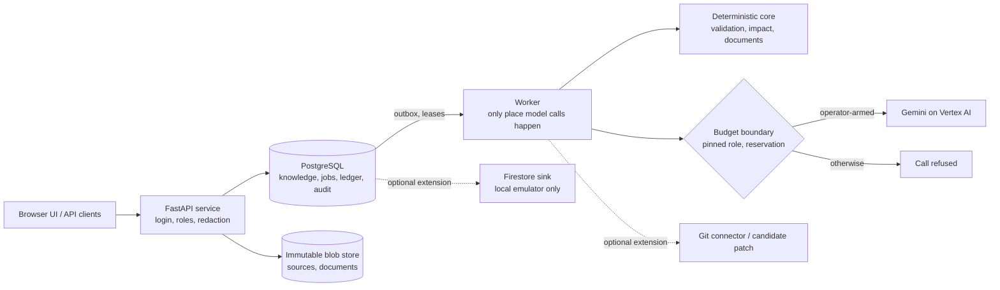

# Ripple: understand the rules, decide with evidence, change with confidence

**Ripple is an AI-powered business rule intelligence and governed change platform.** It reads the places where a company's rules actually live (code, configuration, spreadsheets, documents), turns them into cited, versioned business knowledge, and helps the right people decide what a rule *should* be and what a change would touch. Generative AI (Gemini on Vertex AI) reads, asks, drafts and explains. Deterministic code validates every proposal. People make the decisions.

**AI proposes. Deterministic systems validate. Humans decide.**

> **Development preview, not a finished product.** This snapshot is not deployed, has no formal business or product acceptance of its AI and workflow outcomes (the owner has visually reviewed the desktop interface only), and its real-model quality has not been independently measured ([limits](#12-known-limits-security-provenance-and-licence)). Whether the team advances to a later round is the organiser's decision. Submission for the Google Cloud AI Builder Cup JAPAC 2026. Snapshot: source commit `93a2675` ([provenance](PUBLIC_PREVIEW_PROVENANCE.json)).

## Explore this repository

| I want to... | Go to |
|---|---|
| Understand the idea (2 minutes) | [Problem](#1-the-enterprise-problem), [what is different](#2-why-ripple-is-different), [Harbor example](#3-a-concrete-example-harbor), [journey](#4-end-to-end-product-journey), [interface walkthrough](#4b-explore-the-implemented-interface) |
| Judge the generative AI use | [Gemini implementation](#5-generative-ai-implementation) |
| Check engineering and evidence | [Trust foundation](#6-engineering-foundation-and-trust), [capabilities](#7-current-capabilities-and-evidence), [curated evidence](docs/release/FINAL_PREVIEW_EVIDENCE.md), [claims with limits](docs/release/FINAL_CLAIMS_EVIDENCE_LIMITS.md) |
| Run it | [Run and verify locally](#10-run-and-verify-locally) |
| See what is next | [Roadmap](#11-roadmap-toward-final-readiness) |

**What to evaluate:** evidence-backed knowledge (cited, versioned, observed vs decided); uncertainty handling (open questions, disagreement and abstention are visible results); human decisions (a person's own words, never promoted AI output); exact approval by a different person; and source reconciliation, which compares an edited source with the decision but does not verify behaviour.

---

## 1. The enterprise problem

A rule such as "who must approve a purchase above a threshold" is rarely written in one place. It sits in a configuration file, a spreadsheet, a policy document and code, often with slightly different values. Sources can disagree without anyone noticing until a change is made. Business owners know what a rule should mean but cannot see what systems do; engineers see the implementation but cannot decide its meaning. A technical edit is not an approved business decision, and updating a file does not prove behaviour changed as intended. The result is changes that are hard to review, hard to trace and easy to approve on incomplete information.

## 2. Why Ripple is different

Ripple keeps apart things most tools collapse into one:

| Kept separate | Why it matters |
|---|---|
| **Observed** evidence (what sources say) vs **Target** knowledge (what people decided) | agreement, disagreement and decided intent are visible together |
| Proposed change vs **approved semantic difference** | approval is of an exact difference, by a person other than the requester |
| **Knowledge** decided vs **source** updated vs **behaviour** verified vs **result** accepted | "files edited" is never reported as "behaviour proven" |

Conceptually (responsibilities, not a performance claim): search/RAG finds and summarises text, Ripple adds decided-vs-observed knowledge and abstention; coding assistants edit code, Ripple checks an edit against an approved rule and only recommends for code; impact tools list dependencies, Ripple reports coverage and never turns "unknown" into "no impact"; approval workflows route requests, Ripple binds approval to an exact difference with stale-knowledge guards. These techniques are not new; the contribution is one governed loop built on three ideas:

1. **Governed business knowledge.** Rules are versioned, cited and labelled; open questions and disagreements are first-class records, so the knowledge says what it does not know.
2. **Human authority separate from AI interpretation.** A model may read, ask and draft; only a person's own words answer, accept or approve, and approval needs a different person from the requester. The system can refuse or downgrade model output, never promote it.
3. **Evidence-based, multi-axis completion.** A change is not "done" when a file is edited. Decided knowledge, source alignment, behaviour and business acceptance are separate states; this product can establish only the first two.

## 3. A concrete example: Harbor

**Harbor** is a synthetic, runnable procurement system in [`fixtures/harbor_public`](fixtures/harbor_public). Its public configuration sets the standard manager approval threshold to 1,000,000 JPY ([`approval.yaml`](fixtures/harbor_public/config/approval.yaml)). An illustrative request: *"Raise the standard manager approval threshold from 1,000,000 JPY to 1,500,000 JPY."*

1. **Discover and version.** Sources become immutable revisions; rules are proposed with quotes the server re-checks; rules, relations and open questions form a versioned snapshot.
2. **Ask and accept.** Missing actors, conditions and conflicts become questions; people answer in their own words and accept a version.
3. **Understand the change.** The request becomes validated operations that quote it and name a shown rule; anything uncovered becomes a question.
4. **Impact and simulation.** Affected rules, files and code are listed with coverage. For a supported numeric change, Harbor's own program runs on its public sample to count requisitions whose route changes; otherwise `NOT_SIMULATED` with the reason. The count measures the sample and is not a forecast; this README quotes none.
5. **Exact difference and approval.** A structured draft shows precisely what changes; a different person approves that exact difference, and moved knowledge refuses the decision. Commit makes it Target knowledge.
6. **Follow-through and reconciliation.** For a YAML scalar of a configuration file, an approved edit is written and read back; documents, workbooks and code stay manual (code gets recommendations only). Edits are compared with the decision (correct, partial, divergent); sources still stating the old value stay visible as unresolved.

This does **not** show that runtime behaviour was verified (read-back is source alignment only) or that results generalise beyond Harbor.

## 4. End-to-end product journey


Each change ends in a nine-step view with a state and a next actor per step ([journey logic](core/change_intelligence/v2/business_journey.py)).

## 4b. Explore the implemented interface

The React interface (`/app-next/`; source in [`frontend/`](frontend), built bundle in [`app/ui_next/`](app/ui_next)) is reached through the local rehearsal server ([section 10](#10-run-and-verify-locally)). **A walk through the core loop, by role** (each step is exercised by the named browser test; roles are simulated accounts):

1. *Administrator or knowledge owner* answers business questions on **Questions & Decisions**: preview, then confirm in their own words; an account without authority sees the page without the action ([`test_kno04_browser.py`](tests/final_loop/test_kno04_browser.py)). The same page answers questions from the knowledge, with Business and Technical readings, a stale marker and withheld source text where rights are missing ([`test_qry04_browser.py`](tests/final_loop/test_qry04_browser.py)).
2. *Requester* states a change on **Changes**, confirms the understanding and sees what the rule means, what it touches and what stays pending ([`test_chg04_browser.py`](tests/final_loop/test_chg04_browser.py)). **Impact & Simulation** shows the measured effect for a supported numeric change; the **Harbor try-out** runs one requisition under two configuration versions.
3. *Approver* (a different person) accepts the knowledge change and, separately, the automatic file edits; a clarification makes an earlier approval out of date; a viewer cannot decide ([`test_chg04_browser.py`](tests/final_loop/test_chg04_browser.py), [`test_harbor_journey.py`](tests/ui_next/test_harbor_journey.py): three distinct people).
4. *Knowledge owner* commits and sees four axes (knowledge committed, source and code pending, behaviour not tested; [`test_chg05_browser.py`](tests/final_loop/test_chg05_browser.py)), then chooses whether the product writes the approved edit, shown as "applied, pending read-back" ([`test_syn03_browser.py`](tests/final_loop/test_syn03_browser.py)).
5. Anyone with the right opens **Knowledge Documents**, generated when opened and flagged stale for an older version ([`test_doc04_browser.py`](tests/final_loop/test_doc04_browser.py)), and **History**.

**Code and repository screens** (extension, local, fixture repository): the change review shows code recommendations (never a diff); after the commit a candidate patch can be built, validated on a disposable clone and approved or rejected bound to both hashes; publishing stays refused without a pull-request grant ([`test_fex_code_panel_browser.py`](tests/final_loop/test_fex_code_panel_browser.py)). **Sources** can read a declared repository, and **Support & Access** shows a read-only delivery status. The other pages are Overview, Explorer and a Business/Technical toggle (ten pages in all).

| Interface evidence level | Status |
|---|---|
| Implemented in source | yes: [`frontend/src`](frontend/src) and the built bundle |
| Development-snapshot browser self-checks | [`tests/ui_next`](tests/ui_next) and the browser files above: real Chromium, server and worker, stub models, simulated roles; reported passing at the integration checkpoint in the development record (not in this repository) |
| Owner's visual review | **desktop** layout, this round only; not AI quality, extensions, mobile or production |
| Run on this public tree | **no browser or frontend suite**; only `tests/contract tests/unit` and a server start serving `/app-next/` ([provenance](PUBLIC_PREVIEW_PROVENANCE.json)) |
| Outstanding | small-screen acceptance (screenshot-capture runs only), some partial layout packages, formal business and product acceptance |

**Frontend governance.** Rules: [`UI_DEVELOPMENT_RULES.md`](docs/design-system/UI_DEVELOPMENT_RULES.md) (tokens only from [`index.css`](frontend/src/index.css), shared components, job state, verification, approval and acceptance kept separate). `npm run check:design` ([`check-design-system.mjs`](frontend/tools/check-design-system.mjs)) fails on new violations; known exceptions are in [`design-system-policy.json`](frontend/design-system-policy.json) (six raw-select entries); [`test_a11y.py`](tests/ui_next/test_a11y.py) runs axe-core against a WCAG 2.2 AA *target*. None of this proves full consistency or accessibility compliance. No screenshots are included: none with a verifiable build and state exists here; run the rehearsal to see the interface.

## 5. Generative AI implementation

Gemini is useful because the inputs are messy language: policy prose, comments, spreadsheet labels and free-text requests. Bounded deterministic parsing can read fixed formats such as a YAML key, but it cannot reliably resolve paraphrase, implicit scope or a vague instruction ("keep this limited to the approval file") into a structured proposal. Gemini supplies that semantic reasoning; deterministic code then verifies every proposal and people decide.

**Three core semantic responsibilities**

1. **Ground.** Read prose and configuration into cited rules (the quote must appear verbatim; an amount without its unit stays visibly unknown) and answer questions only from accepted knowledge, citing it or abstaining (numbers must match, disagreements disclosed).
2. **Clarify.** Find questions the structure does not expose (missing exceptions, conflicts in meaning) and read a free-text answer into the structured form; evidence must belong to the shown rules, an uncovered part is never confirmable, and the person's own words are the decision.
3. **Understand change.** Turn a plain-words request into candidate operations, dependencies and draft guidance; each operation quotes the request and names a shown rule, dependencies stay PROPOSED, guidance cannot widen an edit, and a person reviews.

Optional extensions (audience wording, conflict hypotheses, interview questions, multi-agent specialists) follow the same rules and have stub or synthetic tests only.

**Controls.** Each role is pinned to a frozen prompt and schema ([`config/`](config), [`test_final_prompt_pins.py`](tests/contract/test_final_prompt_pins.py)); a call needs a pinned, priced role, a reservation before the call and an accounting entry after it ([`test_final_budget_roles.py`](tests/contract/test_final_budget_roles.py)); without a budget configuration the role is refused, with no silent stub fallback. The provider integration is [`ai_module/vertex_client.py`](ai_module/vertex_client.py).

**Five kinds of evidence, kept apart.** (1) Implemented roles in code and contracts. (2) Deterministic validation tested without any model. (3) Synthetic-stub integration tests, which prove the pipeline, not Gemini's quality. (4) A bounded live pilot (self-check): every role ran end to end under a hard cost cap, which shows the integration works, not how good it is. (5) Independent real-model evaluation: **not yet performed**; a protocol exists, no result does. Results will be added to the [curated evidence](docs/release/FINAL_PREVIEW_EVIDENCE.md) and the [quality plan](docs/evaluation/FINAL_AI_QUALITY_PLAN.md) without restructuring this section. **Capability implemented does not mean quality independently validated.**

**Pilot and diagnostic observations (self-check, unchanged).** 28 calls on Gemini 3.5 Flash-Lite and one paired case on Gemini 3.8 Flash, under a hard cost cap of 2 USD, of which 0.17475295 USD had been recorded at the snapshot. Two sealed sets written by the project's own agent were scored mechanically: questions 10/14, then 8/14 after a server fix; change requests 6/8. They are small and **not independent**. Further diagnostic runs on a held-out set (also non-independent) only classified failures and added server-side guards ([curated evidence](docs/release/FINAL_PREVIEW_EVIDENCE.md)); the model-quality gate remains **OPEN**. Observed: missing required citations with the lighter model, unreliability on three-part requests, varying abstention wording. An earlier snapshot's held-out evaluation (2026-10-02) did not reach its targets ([record](docs/evaluation/HELD_OUT_EVALUATION.md)); it is history and was not repeated on this snapshot.

## 6. Engineering foundation and trust

| Mechanism | Risk it addresses |
|---|---|
| Immutable source revisions; cited, versioned knowledge; Observed/Target separation | silent edits to evidence; a model's reading mistaken for a decision |
| Role and permission boundaries ([`test_ai2_t02_permission.py`](tests/security/test_ai2_t02_permission.py)) | a client choosing its own rights; leaking raw evidence |
| Exact-hash approval by a distinct person; deterministic validators of model output | approving something other than what was reviewed; invented citations, numbers or scope |
| Compare-and-set, idempotent writes, PostgreSQL outbox, leases, fencing ([runbook](docs/runbooks/FINAL_RECOVERY.md)) | lost updates, double effects, duplicate delivery, killed workers |
| Audit events; self-verifying audit package | untraceable decisions |
| Budget reservation, pinned roles, fail-closed AI | runaway or unaccounted spend |

SHA-256 hashes detect a changed byte and are **not** digital signatures. The candidate-code sandbox is advisory by default; its optional container runtime shares the host kernel and is **not** a boundary for hostile code. Reliability is shown by local injection and process-kill tests, not production operation.

## 7. Current capabilities and evidence

**Local** = verified with stub models on a disposable database; **Mock/emulator** = mock transport or local emulator; **Pilot** = also run on a real model (self-check); **API** = no screen in this snapshot. Evidence is test code here; snapshots and runs are in [`FINAL_PREVIEW_EVIDENCE.md`](docs/release/FINAL_PREVIEW_EVIDENCE.md).

| Core capability | Status | Tests (examples) | Important limit |
|---|---|---|---|
| Versioned knowledge, observed/target, relations, gaps | Local, Pilot | [`test_kno01_business_store.py`](tests/final_loop/test_kno01_business_store.py), [`test_kno03_graph_gaps.py`](tests/final_loop/test_kno03_graph_gaps.py) | extraction quality unmeasured; limited formats |
| Answers, free-text reading, acceptance | Local, Pilot | [`test_kno04_answers.py`](tests/final_loop/test_kno04_answers.py), [`test_kno07_answer_interpret.py`](tests/final_loop/test_kno07_answer_interpret.py) | reading quality unmeasured |
| Grounded Q&A with abstention | Local, Pilot | [`test_qry03_qa.py`](tests/final_loop/test_qry03_qa.py), [`test_qry01_context.py`](tests/final_loop/test_qry01_context.py) | lexical retrieval by default, measured as limited (10/12 development, 4/8 validation) |
| Change request, impact, Harbor measurement | Local, Pilot | [`test_chg01_change_request.py`](tests/final_loop/test_chg01_change_request.py), [`test_chg02_simulation.py`](tests/final_loop/test_chg02_simulation.py) | Harbor sample only; five integer keys; never a forecast |
| Draft, review, distinct-person approval, commit | Local | [`test_chg04_review.py`](tests/final_loop/test_chg04_review.py), [`test_chg05_commit.py`](tests/final_loop/test_chg05_commit.py) | approvals are self-checks, not business acceptance |
| Source follow-through, reconciliation, journey | Local | [`test_syn03_source_apply.py`](tests/final_loop/test_syn03_source_apply.py), [`test_syn02_reconcile.py`](tests/final_loop/test_syn02_reconcile.py) | YAML scalars only; behaviour never verified |
| Documents, exact export | Local | [`test_doc02_documents.py`](tests/final_loop/test_doc02_documents.py) | deterministic templates, English |
| Reliability: concurrency, killed worker, upgrades | Local | [`test_rel02_reliability.py`](tests/final_loop/test_rel02_reliability.py), [`test_rel02_process_kill.py`](tests/final_loop/test_rel02_process_kill.py) | local injection, not production |

**Optional extensions** (not required for core-product readiness; Local or Mock/emulator, synthetic data, no real-model quality evidence; full rows in the [claims document](docs/release/FINAL_CLAIMS_EVIDENCE_LIMITS.md)): policy decisions, audit package, CI drift check and ROI replay (Local, API; [`test_mon_policy_audit.py`](tests/final_loop/test_mon_policy_audit.py)); candidate code patch, Git connector and pull-request path (Local, with screens on a fixture repository; pull request on a mock transport; one read-only check on a private test repository; no product-created pull request on a real repository, never a merge; [`test_fex_git_remote.py`](tests/final_loop/test_fex_git_remote.py)); multi-agent workflows, interview, audience variants and conflict mining (Local, API, synthetic specialists; [`test_ma_review_board.py`](tests/final_loop/test_ma_review_board.py)); Firebase hybrid satellite (Mock; Firestore sink on a local emulator; no cloud resource; [`test_fs_emulator.py`](tests/final_loop/test_fs_emulator.py)).

**Test totals.** Totals from earlier snapshots (for example 1,238 passed, 3 skipped, 1 deselected for an earlier export) are historical, not results for this export. A rehearsal of this preview tree (source `93a2675`, before the README adjustment) ran `pytest tests/contract tests/unit -q` in a fresh virtual environment with no database and no provider: 1,268 passed, 3 skipped, 1 deselected, on one machine, and the rehearsal server started and served `/app-next/` ([record](PUBLIC_PREVIEW_PROVENANCE.json)). Database-backed, browser and frontend suites were not part of it; the earlier export `a6fdb72` recorded the same count on a different snapshot (not additive).

## 8. Business value and potential

Intended benefits, **not measured outcomes**: less manual effort finding scattered rules, a clearer line between business decisions and technical edits, more traceable approvals, visibility of what is unresolved or unimplemented, less ambiguity in review, and reusable knowledge across changes. No savings, productivity gain, return on investment or adoption has been measured. Harbor is synthetic; generalisation beyond it is a design claim, not validated.

## 9. Architecture and tech stack



Python 3.11+, FastAPI, PostgreSQL with SQL migrations, a React/TypeScript/Vite interface (built bundle included), pytest and Playwright, Gemini through Vertex AI as the optional provider, Docker for a throwaway database. Dashed paths are optional extensions; the Firestore path is emulator-only and nothing is deployed to a cloud.

| Path | Responsibility |
|---|---|
| [`core/change_intelligence/v2/`](core/change_intelligence/v2) | pure business logic: knowledge, graph, answers, retrieval, validation, change, impact, draft, journey, documents |
| [`infra/`](infra), `infra/worker/` | API routes, roles, store, migrations; worker, jobs, budget accounting |
| [`config/`](config), [`fixtures/harbor_public`](fixtures/harbor_public) | frozen prompts and schemas per role, budget examples (zero-price stand-ins); the Harbor sample |
| [`frontend/`](frontend), [`tests/`](tests), [`tools/`](tools), [`docs/`](docs) | interface source; suites by purpose and the local rehearsal server; [contracts](docs/contracts), [quality plan](docs/evaluation/FINAL_AI_QUALITY_PLAN.md), [map](docs/README.md) |

## 10. Run and verify locally

No cloud account and no AI provider are needed. Prerequisites: Python 3.11+, a **disposable** PostgreSQL 15/16 (Docker is simplest); Node.js only to rebuild the UI; Chromium via Playwright only for browser tests.

```bash
python -m venv .venv
# Windows: .venv\Scripts\Activate.ps1      Linux/macOS: source .venv/bin/activate
python -m pip install -r requirements-dev.txt
docker run -d --name ripple-pg -e POSTGRES_PASSWORD=localtest -p 127.0.0.1:55831:5432 postgres:16
python -m tools.judge_local.run_local
```

After about 30-60 seconds the console prints `http://127.0.0.1:8765/app-next/` and three accounts with random passwords shown once (`rehearsal-admin`, `rehearsal-requester`, `rehearsal-approver`: an administrator, a requester and a different-person approver). Use a different browser profile per person.

**Safety and cleanup.** `run_local` drops and re-creates a database named `rehearsal` on the PostgreSQL it is pointed at (default `127.0.0.1:55831`), refuses non-loopback hosts and database names not ending in `rehearsal`, and keeps blobs in memory. Never point it at a database you care about. Stop with Ctrl+C, then `docker rm -f ripple-pg`.

**What runs, and what is simulated.** Deterministic parts run for real: knowledge versions, questions, acceptance, graph, documents, impact, Harbor measurement, review, approval, commit, source edit, journey. All model output is **simulated by code**. The Final AI roles answer with a declining simulation (abstain, clarify, unsure or unsupported, labelled as simulated), except that a request written as "... from `<old value>` to `<new value>` ..." matching exactly one rule is read by rules into a numeric change so the loop can be walked through. The seeded knowledge has no structured actors or conditions, so answer those first on the Questions page. The demo says nothing about Gemini's real behaviour, and changing an environment variable does not enable a real model: that needs an operator approval file, a budget configuration with real model ids and verified prices (`RIPPLE_BUDGET_CONFIG_PATH`), `RIPPLE_LIVE_LOCAL_ARM=1` and Vertex AI credentials ([`live_local.py`](tools/judge_local/live_local.py)).

**Tests.** Browser tests also need `python -m pip install playwright` and `playwright install chromium`. Run suites one at a time.

| Purpose | Command | Needs |
|---|---|---|
| Contract, unit, architecture guards, prompt pins | `python -m pytest tests/contract tests/unit -q` | nothing |
| Permission sweep | `python -m pytest tests/security/test_ai2_t02_permission.py -q` | PostgreSQL in `AI2_T02_TEST_DSN` |
| Core loop, API level | `python -m pytest tests/final_loop -q -k "not browser"` | PostgreSQL in `PITCH_BRIEF_TEST_DSN` |
| Core loop, browser | `UI_BASE=app-next python -m pytest tests/final_loop -q -k browser` | the same plus Chromium |
| Interface browser journeys | `UI_BASE=app-next python -m pytest tests/ui_next -q` | the same |
| Design check, type check, unit tests | `cd frontend && npm ci && npm run check:design && npm run typecheck && npm test` | Node.js |

```bash
# reuse the container started above (ripple-pg); do not start a second one on port 55831
docker exec ripple-pg psql -U postgres -c "CREATE DATABASE pbrief"
export PITCH_BRIEF_TEST_DSN="host=127.0.0.1 port=55831 dbname=pbrief user=postgres password=localtest"
export AI2_T02_TEST_DSN="$PITCH_BRIEF_TEST_DSN"
```

**Skip semantics.** Without a database DSN the database tests are skipped, without Playwright the browser tests are skipped, and without the Firestore emulator the emulator tests are skipped. **A skip is not a pass**; read the skip count. No test calls a provider. One container serves both the rehearsal server and the tests (separate databases); if port 55831 or the name `ripple-pg` is taken, pick another host port and set `REHEARSAL_ADMIN_DSN` and the DSN variables to match (check `docker ps` first), and remove the container when done.

## 11. Roadmap toward Final readiness

These are plans, not features, and reaching them does not guarantee selection for any later round. **Priorities:** independent model-quality evaluation and formal acceptance are critical gates; real integration (staging, a real pull request) is important; the optional extensions are not required for core-product readiness and come after the critical gates.

| Stage | Status | Contents | Completion evidence |
|---|---|---|---|
| **Foundation** | Implemented | the knowledge and governed-change mechanisms of sections 3-4 and 6 | local suites in section 7 |
| **Interface** | Merged; acceptance partial | the redesigned interface is merged into this snapshot; the owner accepted the desktop layout. **Remaining:** small-screen acceptance, partial layout packages, browser suites rerun on the tree being claimed | recorded browser run on the claimed tree |
| **Intelligence** | Implemented, quality pending | Gemini roles, grounding controls, budget boundary, a bounded pilot | section 5: kinds 1-4 exist, kind 5 does not |
| **Validation** | Next gate | independent real-model evaluation on a reviewer-built set with fixed model, prompt and schema versions; formal business and product acceptance; scenario-based verification | a published result whatever it shows and an acceptance record; establishes measured quality on those sets, not in general |
| **Integration** | Next gate | cloud staging; one product-created pull request on a real repository under explicit authorisation; real Firebase activation | staging checks recorded; the pull request opened and read back, never merged by the product |
| **Final readiness** | Target | an integrated, demonstrable system with published evidence and its remaining limits disclosed | all of the above recorded; no dates promised |

## 12. Known limits, security, provenance and licence

**Real-model quality.** Not independently measured (section 5, kind 5); sealed sets were agent-written and small; two diagnostic labels on one held-out set remain disputed and unchanged; an earlier snapshot's held-out evaluation did not reach its targets.
**Acceptance.** No formal business or product acceptance of the AI and workflow outcomes; approvals in tests are self-checks. Interface acceptance is the owner's desktop review only (section 4b).
**Supported use and formats.** Import of `.md`, `.yml/.yaml`, `.py`, `.xlsx` (no macros), `.csv`, `.jsonl`, English only; automatic source edits are YAML scalars of configuration files; changes effective on a date are unsupported; Harbor is the only exercised system.
**Integration and deployment.** Not deployed; the pull-request path is mock-tested and the product never merges or deploys; Firebase pieces are mock or emulator only; no cloud resource exists. Policy decisions, multi-agent workflows, interview, audience variants and conflict mining have no screens.
**Behaviour and outcomes.** The product reads sources back and compares them with the decision; it never verifies behaviour or business outcomes.
**Security.** Roles are assigned by the server; raw quotes and code recommendations need `evidence.read`, AI use needs `ai.use` and a workspace policy; external identity exchange gives one generic refusal and every right still comes from SQL membership; projected hints are minimal and opaque. No independent security validation has been performed. No credential, token or private dataset is in this repository; a pattern scan of the export reported 0 findings, a check and not a guarantee.

Details: [claims and limits](docs/release/FINAL_CLAIMS_EVIDENCE_LIMITS.md), [release checklist](docs/release/FINAL_RELEASE_CHECKLIST.md), [contracts](docs/contracts).

**Provenance.** This tree is an export of committed content from a private development repository with a fresh Git history. [`SUBMISSION_MANIFEST.json`](SUBMISSION_MANIFEST.json) is the export manifest generated with the tree (source commit, file hashes, export decisions); it is created at export time, so the development repository's link check cannot resolve it. This README was adjusted for the preview after export, so the tree does not match the original manifest byte for byte; [`PUBLIC_PREVIEW_PROVENANCE.json`](PUBLIC_PREVIEW_PROVENANCE.json) records the source commit, the manifest hashes (raw and line-ending-normalised) and the hashes of the exported and published README.

**Licence.** Proprietary, **Competition Evaluation Only** ([`LICENSE`](LICENSE)): authorised judges and evaluators may read, clone, build, run, test and modify a local copy solely to evaluate this submission. No commercial, production, reuse or redistribution rights are granted, and a public repository is not an open-source licence. Third-party components keep their own licences ([`THIRD_PARTY_NOTICES.md`](THIRD_PARTY_NOTICES.md), [`frontend/THIRD_PARTY_NOTICES.md`](frontend/THIRD_PARTY_NOTICES.md)).
**Ownership and thanks.** Copyright holder: Eiki Tomobe; team details are not provided in this repository. Thanks to Google Cloud (Vertex AI), the competition organiser, and the open-source libraries listed in the notices.
