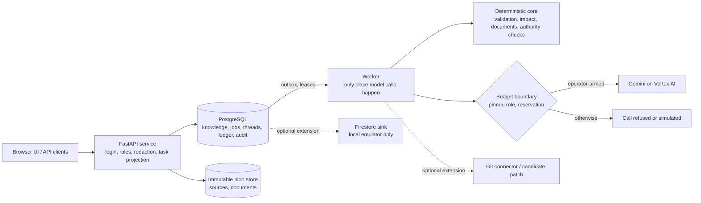

# Ripple: understand the rules, decide with evidence, change with confidence

**Ripple is an AI-powered business rule intelligence and governed change platform.** It reads the places where a company's rules actually live (code, configuration, spreadsheets, documents), turns them into cited, versioned business knowledge, and helps the right people decide what a rule *should* be and what a change would touch. Generative AI (Gemini on Vertex AI) reads, asks, drafts and explains. Deterministic code validates every proposal. People make the decisions.

**AI proposes. Deterministic systems validate. Humans decide.**

**Product direction — enterprise future of work:** LLMs are essential for work that requires semantic understanding, adaptive dialogue and generative reasoning. Algorithms provide grounded context, exact calculations and enforceable controls. Choose model strength per task using measured quality, risk, latency and cost; see the [AI system principles and task-design policy](docs/product/AI_SYSTEM_PRINCIPLES.md). This is the design objective, not a claim that every target capability is delivered or quality-validated in this preview.

> **Development preview, not a finished product.** This snapshot shows progress toward the Final round. It is not deployed and is not production-ready; it has no formal business or product acceptance of its AI and workflow outcomes; its newest interface (request task screens, request assistant, review rail, guided preparation and the other screens of [section 4c](#4c-new-in-this-snapshot-request-tasks-assistant-and-interface-slices)) has **no human acceptance**; and its real-model quality has not been independently measured. The request assistant's own live diagnostic on this snapshot did **not** meet its business-cause targets ([section 5](#5-generative-ai-implementation)). Whether the team advances to a later round is the organiser's decision. Submission for the Google Cloud AI Builder Cup JAPAC 2026. Snapshot: source commit `cadf555` of 2026-10-20 ([provenance](PUBLIC_PREVIEW_PROVENANCE.json)).

## Explore this repository

| I want to... | Go to |
|---|---|
| Understand the idea (2 minutes) | [Problem](#1-the-enterprise-problem), [what is different](#2-why-ripple-is-different), [Harbor example](#3-a-concrete-example-harbor), [journey](#4-end-to-end-product-journey), [interface walkthrough](#4b-explore-the-implemented-interface) |
| See what is new in this snapshot | [Request tasks, assistant and interface slices](#4c-new-in-this-snapshot-request-tasks-assistant-and-interface-slices) |
| Judge the generative AI use | [Gemini implementation](#5-generative-ai-implementation) |
| Check engineering and evidence | [Trust foundation](#6-engineering-foundation-and-trust), [capabilities](#7-current-capabilities-and-evidence), [curated evidence](docs/release/FINAL_PREVIEW_EVIDENCE.md), [claims with limits](docs/release/FINAL_CLAIMS_EVIDENCE_LIMITS.md) |
| Run it | [Run and verify locally](#10-run-and-verify-locally) |
| See what is next | [Roadmap](#11-roadmap-toward-final-readiness) |

**What to evaluate:** evidence-backed knowledge (cited, versioned, observed vs decided); uncertainty handling (open questions, disagreement and abstention are visible results); human decisions (a person's own words, never promoted AI output); exact approval by a different person; source reconciliation, which compares an edited source with the decision but does not verify behaviour; and, new here, a request assistant whose statements about who acts are written by the server, not by the model.

**How to read the status words.** *Implemented* = in the source of this tree. *Local (stub)* = verified on a disposable database with a synthetic stub model, which proves the wiring and the checks, not the model's quality. *Live diagnostic* = a real model was called on a small self-authored set (self-check, not independent; it describes only the prompts and checks it ran on). *PARTIAL* = some parts of a package built and verified, others open. *OPEN* = quality or human acceptance not established. *Roadmap* = not built.

---

## 1. The enterprise problem

A rule such as "who must approve a purchase above a threshold" is rarely written in one place. It sits in a configuration file, a spreadsheet, a policy document and code, often with slightly different values. Sources can disagree without anyone noticing until a change is made. Business owners know what a rule should mean but cannot see what systems do; engineers see the implementation but cannot decide its meaning. A technical edit is not an approved business decision, and updating a file does not prove behaviour changed as intended. The result is changes that are hard to review, hard to trace and easy to approve on incomplete information.

## 2. Why Ripple is different

Ripple keeps apart things most tools collapse into one:

| Kept separate | Why it matters |
|---|---|
| **Observed** evidence (what sources say) vs **Target** knowledge (what people decided) | agreement, disagreement and decided intent are visible together |
| Proposed change vs **approved semantic difference** | approval is of an exact difference, by a person other than the requester |
| **Knowledge** decided vs **source** updated vs **behaviour** verified vs **result** accepted | "files edited" is never reported as "behaviour proven" |
| **Permission** vs **assignment** vs **waiting** | being allowed to do a step is not being asked to do it; who a request waits on is stated, never guessed |

Conceptually (responsibilities, not a performance claim): search/RAG finds and summarises text, Ripple adds decided-vs-observed knowledge and abstention; coding assistants edit code, Ripple checks an edit against an approved rule and only recommends for code; impact tools list dependencies, Ripple reports coverage and never turns "unknown" into "no impact"; approval workflows route requests, Ripple binds approval to an exact difference with stale-knowledge guards. These techniques are not new; the contribution is one governed loop built on three ideas:

1. **Governed business knowledge.** Rules are versioned, cited and labelled; open questions and disagreements are first-class records, so the knowledge says what it does not know.
2. **Human authority separate from AI interpretation.** A model may read, ask, explain and draft; only a person's own words answer, accept or approve, and approval needs a different person from the requester. The system can refuse or downgrade model output, never promote it.
3. **Evidence-based, multi-axis completion.** A change is not "done" when a file is edited. Decided knowledge, source alignment, behaviour and business acceptance are separate states; this product can establish only the first two.

## 3. A concrete example: Harbor

**Harbor** is a synthetic, runnable procurement system in [`fixtures/harbor_public`](fixtures/harbor_public). Its public configuration sets the standard manager approval threshold to 1,000,000 JPY ([`approval.yaml`](fixtures/harbor_public/config/approval.yaml)). An illustrative request: *"Raise the standard manager approval threshold from 1,000,000 JPY to 1,500,000 JPY."*

1. **Discover and version.** Sources become immutable revisions; rules are proposed with quotes the server re-checks; rules, relations and open questions form a versioned snapshot.
2. **Ask and accept.** Missing actors, conditions and conflicts become questions; people answer in their own words and accept a version.
3. **Understand the change.** The request becomes validated operations that quote it and name a shown rule; anything uncovered becomes a question.
4. **Impact and simulation.** Affected rules, files and code are listed with coverage. For a supported numeric change, Harbor's own program runs on its public sample to count requisitions whose route changes; otherwise `NOT_SIMULATED` with the reason. The count measures the sample and is not a forecast; this README quotes none.
5. **Exact difference and approval.** A structured draft shows precisely what changes; a different person approves that exact difference, and moved knowledge refuses the decision. Commit makes it Target knowledge.
6. **Follow-through and reconciliation.** For a YAML scalar of a configuration file, an approved edit is written and read back; documents, workbooks and code stay manual (code gets recommendations only). Edits are compared with the decision (correct, partial, divergent); sources still stating the old value stay visible as unresolved.

At every step, each person sees their own task for the request (what to read, what to do, what to hand over) and can ask a private assistant about it ([section 4c](#4c-new-in-this-snapshot-request-tasks-assistant-and-interface-slices)).

This does **not** show that runtime behaviour was verified (read-back is source alignment only) or that results generalise beyond Harbor.

## 4. End-to-end product journey


Each change ends in a nine-step view with a state and a next actor per step ([journey logic](core/change_intelligence/v2/business_journey.py)). One server-side task projection per request and reader feeds the task frame, the whole-request view, My work and the request assistant, so they cannot disagree about the stage, who holds a step or what blocks it ([contract](docs/contracts/REQUEST_TASKS_AND_ASSISTANT.md)).

## 4b. Explore the implemented interface

The React interface (`/app-next/`; source in [`frontend/`](frontend), built bundle in [`app/ui_next/`](app/ui_next)) is reached through the local rehearsal server ([section 10](#10-run-and-verify-locally)). **A walk through the core loop, by role** (each step is exercised by the named browser test; roles are simulated accounts):

1. *Administrator or knowledge owner* answers business questions on **Questions & Decisions**: preview, then confirm in their own words; an account without authority sees the page without the action ([`test_kno04_browser.py`](tests/final_loop/test_kno04_browser.py)). The same page answers questions from the knowledge, with Business and Technical readings, a stale marker and withheld source text where rights are missing ([`test_qry04_browser.py`](tests/final_loop/test_qry04_browser.py)).
2. *Requester* states a change on **Changes**, confirms the understanding and sees what the rule means, what it touches and what stays pending ([`test_chg04_browser.py`](tests/final_loop/test_chg04_browser.py)). **Impact & Simulation** shows the measured effect for a supported numeric change; the **Sample process trial** runs one requisition through Harbor's code under two configuration versions (a trial on a sample, not production and not a forecast).
3. *Approver* (a different person) accepts the knowledge change and, separately, the automatic file edits; a clarification makes an earlier approval out of date; a viewer cannot decide ([`test_chg04_browser.py`](tests/final_loop/test_chg04_browser.py), [`test_harbor_journey.py`](tests/ui_next/test_harbor_journey.py): three distinct people). On wide screens the decisions sit in a rail beside the evidence.
4. *Knowledge owner* commits and sees four axes (knowledge committed, source and code pending, behaviour not tested; [`test_chg05_browser.py`](tests/final_loop/test_chg05_browser.py)), then chooses whether the product writes the approved edit, shown as "applied, pending read-back" ([`test_syn03_browser.py`](tests/final_loop/test_syn03_browser.py)).
5. Anyone with the right opens **Knowledge Documents**, generated when opened and flagged stale for an older version ([`test_doc04_browser.py`](tests/final_loop/test_doc04_browser.py)), and **History**.

**Request task screens** (new, [section 4c](#4c-new-in-this-snapshot-request-tasks-assistant-and-interface-slices)): a task frame at the top of each request, a whole-request view with every step's state, **My work** on Overview and Changes, and the request assistant beside the task.

**Code and repository screens** (extension, local, fixture repository): the change review shows code recommendations (never a diff); after the commit a candidate patch can be built, validated on a disposable clone and approved or rejected bound to both hashes; publishing stays refused without a pull-request grant ([`test_fex_code_panel_browser.py`](tests/final_loop/test_fex_code_panel_browser.py)). **Sources** can read a declared repository, and **Support & Access** shows a read-only delivery status. **Extension AI screens** (audience versions, conflict scan, interview, multi-agent assessment with memo panels, refresh correspondence) were built and browser-tested with synthetic models only ([`test_lha_ui_browser.py`](tests/final_loop/test_lha_ui_browser.py)). The other pages are Overview, Explorer and a Business/Technical toggle (ten pages in all).

| Interface evidence level | Status |
|---|---|
| Implemented in source | yes: [`frontend/src`](frontend/src) and the built bundle `app/ui_next/assets/index-DbCkWK9g.js` |
| Development-snapshot browser self-checks | real Chromium, server and worker, stub models, simulated roles; reported passing in the development record (not in this repository), each for the files it ran, several on earlier bundles of the same day |
| Owner's visual review | the **desktop** layout of an earlier round (2026-10-18), plus the owner's review of this preview for publication as a progress introduction; neither is human acceptance of the screens of section 4c, AI quality, mobile or production |
| Run on this public tree | `tests/contract tests/unit` and a rehearsal-server smoke that served `/app-next/` and every bundle asset; **no browser or frontend suite** ([section 7](#7-current-capabilities-and-evidence)) |
| Outstanding | human acceptance of the new screens; small-screen acceptance; the PARTIAL packages of section 4c; formal business and product acceptance |

**Frontend governance.** Rules: [`UI_DEVELOPMENT_RULES.md`](docs/design-system/UI_DEVELOPMENT_RULES.md) (tokens only from [`index.css`](frontend/src/index.css), shared components, job state, verification, approval and acceptance kept separate). `npm run check:design` ([`check-design-system.mjs`](frontend/tools/check-design-system.mjs)) fails on new violations; known exceptions are in [`design-system-policy.json`](frontend/design-system-policy.json); [`test_a11y.py`](tests/ui_next/test_a11y.py) runs axe-core against a WCAG 2.2 AA *target*. None of this proves full consistency or accessibility compliance. **No screenshots are included:** the review captures of this round come from browser tests with synthetic models, and most of them were taken on earlier bundles of the same day, so none is published here as a picture of this exact build; run the rehearsal to see the interface.

## 4c. New in this snapshot: request tasks, assistant and interface slices

Unless stated otherwise, everything below is **implemented** and **verified locally with a synthetic stub model** through the real routes, worker and browser, in the development record (not in this repository; not rerun on this tree, see section 7). Human acceptance of all of it is **OPEN**. User guide: [request tasks and the request assistant](docs/product/request_tasks_and_assistant.md); rules: [contract](docs/contracts/REQUEST_TASKS_AND_ASSISTANT.md); operators: [runbook](docs/runbooks/REQUEST_ASSISTANT_OPERATIONS.md).

**The base it builds on.** A **task frame** at the top of each request shows the stage, *Input* (what to read), *What to do* (only the steps this person is asked to do now) and *Result to hand over*, with blockers above the action. Permission is not assignment: an administrator who may do a step but is not asked sees "you may do this, but you are not asked to". Waiting is named ("waiting on the requester / an approver / the system") without inventing a person, deadline or service level. A **whole-request view** lists every step with a text state, and **My work** groups requests into waiting for you, optional, blocked, waiting for someone, waiting for the system and recently finished ([`test_request_task_view.py`](tests/final_loop/test_request_task_view.py), [`test_request_surfaces_agree.py`](tests/final_loop/test_request_surfaces_agree.py)).

**A. Authority-grounded request assistant.** A private conversation about one request for people with the read-only capability `request.assistant.ask` who may read that request. The model chooses which permitted facts matter and explains reasons, blockers, decisions and trade-offs from the context it is allowed to read. Sentences about **who holds a step, who must or may act and who the request waits on** are not the model's wording: the model proposes a typed statement, the server checks it against the task facts and writes the sentence itself; free-text authority from the model ("You can approve") is refused, and an answer with refused parts says so. The assistant never acts: "I agree" approves nothing ([`test_request_assistant_authority.py`](tests/unit/test_request_assistant_authority.py), [`test_request_assistant_integrity_jobs.py`](tests/final_loop/test_request_assistant_integrity_jobs.py), [`test_request_assistant_access.py`](tests/final_loop/test_request_assistant_access.py)).
*Limits:* this narrows one class of error (wrong statements about authority); it does not make the model's explanations correct. In the live diagnostic of this format (section 5) the model still wrote authority in prose, those parts were refused, and the explanation in the same sentence was lost with them. Answers are **English only**. Answers stored under older checks are shown with a note and their free-text authority withheld.

**B. Priority-aware context.** The facts sent to the model are chosen in tiers: the request's mandatory task facts first, then supporting information, then history, all within fixed limits on count and size. If the mandatory facts do not fit, the question is **refused before any model call** (no partial answer, no cost) rather than answered from part of them. Selection and its hash are stable: two independent reads (at ask time and in the worker, with lists reordered and another read time) must give the same facts, ids, coverage and citation mapping, which an equality test checks; a blocker added before the answer refuses it as `context_changed` with no provider call. Omitted supporting or history facts are counted per tier. A defect found after the first local verification (several affected rules sharing a link kind collapsed into one fact) was fixed in this snapshot with a regression test. *Limits:* this bounds and stabilises what the model sees; it does **not** mean every relevant piece of knowledge always reaches the model, and the live diagnostic shows a second blocker can still go unexplained.

**C. Interface provenance and progressive disclosure** (PARTIAL). Content carries its origin: **AI** (model-written), **Source**, **Engine** (deterministic computation) and **Task record** (the server's authority sentence), shown by label, icon and border style so it does not rely on colour ([`Origin.tsx`](frontend/src/components/decision/Origin.tsx)). An origin label never means correct or approved. Routine explanations are folded under "How this works" in three places (the source update walkthrough, the knowledge summary and the simulation panel); warnings and decision consequences stay visible next to their actions. On the business change review, from 1280 px the decisions (list, form, completion axes, outcome note) sit in a rail beside the evidence and work; it stacks below that width and is not sticky. *Open:* folding has not been applied beyond those three places; contrast was computed from token values, not audited.

**D. Guided request assistant.** The panel opens directly on suggested questions (derived from the task view: your step, steps you may do but are not asked to, blockers, waiting, purpose, decisions) and the question box. **Ask AI** sends one question and states next to the button that each question is one paid model call; **Edit question** only fills the draft. Opening the panel, editing or switching views starts no model call, thread or job. The first question creates the private conversation in the same call and is idempotent: repeating it after a lost response does not ask twice. **Go to** buttons only move the focus to the step's own control on the page after rechecking the task view; they never approve, submit or execute anything ([`test_request_assistant_browser.py`](tests/final_loop/test_request_assistant_browser.py), [`test_request_tasks_intent_browser.py`](tests/final_loop/test_request_tasks_intent_browser.py), [`test_request_assistant_first_ask.py`](tests/final_loop/test_request_assistant_first_ask.py)).

**E. Citations.** "Show on this page" marks and focuses the section a cited fact comes from (impact row, rule meaning, decisions, blockers, task frame); a fact without a target gives a note. For holders of `evidence.read`, a citation of an **impact** or **draft rule-change** fact can also show its source: path, locator, binding revision and whether that place is current, changed since or absent now, resolved by the server from the pack the answer was built on and rechecked at read time (no client-supplied path, no model call). A **source excerpt** (the stored value) is shown only for a **YAML key**; other files give the location without an excerpt, and other facts give no source locator ([`test_request_assistant_citation_source.py`](tests/final_loop/test_request_assistant_citation_source.py)).

**F. Further interface slices (each PARTIAL).** The rule difference is shown as typed aspects (who acts, operator, value, unit, exception, scope; [`test_business_semantic_aspects.py`](tests/unit/test_business_semantic_aspects.py)); the whole-request view has a compact stepper and Explorer shows typed metrics with state pills ([`test_explorer_summary.py`](tests/ui_next/test_explorer_summary.py)); the interview offers sentence starters and words used by other accepted rules, labelled "not established for this rule", plus a structured preview that is never a confirmation ([`test_interview_vocabulary.py`](tests/final_loop/test_interview_vocabulary.py)); a clarification opens under its item and conflicting sources appear as A/B cards where choosing a card only prepares an answer and the number of sources is not a vote; AI statements in the simulation and risk memo highlight exactly the engine or impact rows they cite. Open parts include a bounded multi-file byte diff, badge counts taken from server outcomes and evaluations of usefulness.

**G. Guided preparation (EUI-08), off by default.** With `RIPPLE_GUIDED_PREPARATION=on`, a person can start one run that requests impact, simulation and a proposal for a change they may prepare, after choosing what to include (nothing is preselected; 0 paid calls). The run approves, reviews, commits and applies nothing; its jobs are requested as the person who started it, workspace policy (sandbox writing session, distinct approvers, revoked rights) still applies, and moved inputs pause it ([contract](docs/contracts/GUIDED_PREPARATION.md), [`test_guided_preparation.py`](tests/pitch_brief/test_guided_preparation.py), [`test_guided_preparation_browser.py`](tests/ui_next/test_guided_preparation_browser.py)). It is **not enabled** in the rehearsal or by default, and is not an autonomous agent.

| Item | Implemented | Local (stub) | Live | OPEN |
|---|---|---|---|---|
| A. Typed authority | yes | yes | diagnostic on this format: authority met, business cause **not met** | answer quality (cause coverage, distinguishing similar requests); human acceptance |
| B. Priority context | yes | yes, incl. the equality test | same diagnostic | whether every relevant cause is used |
| C. Provenance, folding, review rail | partial | yes, for what was built | not applicable | wider folding, audit of contrast, human acceptance |
| D. Guided assistant | yes | yes | not applicable (UI) | some Go to targets, human acceptance |
| E. Citations | yes | yes | not applicable | excerpts beyond YAML keys and sources for other fact kinds |
| F. Interface slices | partial | yes, per slice | not applicable | open parts listed above; the final consumer pass; human acceptance |
| G. Guided preparation | yes, off by default | yes | not applicable (0 paid calls) | product decision to enable; human acceptance |

**Known gaps of this round.** **Go to** for steps of the change-understanding flow may show "not available on this page". The Sources selected-file detail pane remains deferred. In the local rehearsal the assistant is simulated ([section 10](#10-run-and-verify-locally)).

## 5. Generative AI implementation

Gemini is useful because the inputs are messy language: policy prose, comments, spreadsheet labels, free-text requests and questions about a request. Bounded deterministic parsing can read fixed formats such as a YAML key, but it cannot reliably resolve paraphrase, implicit scope or a vague instruction ("keep this limited to the approval file") into a structured proposal. Gemini supplies that semantic reasoning; deterministic code then verifies every proposal and people decide.

**Four core semantic responsibilities**

1. **Ground.** Read prose and configuration into cited rules (the quote must appear verbatim; an amount without its unit stays visibly unknown) and answer questions only from accepted knowledge, citing it or abstaining (numbers must match, disagreements disclosed).
2. **Clarify.** Find questions the structure does not expose (missing exceptions, conflicts in meaning) and read a free-text answer into the structured form; evidence must belong to the shown rules, an uncovered part is never confirmable, and the person's own words are the decision.
3. **Understand change.** Turn a plain-words request into candidate operations, dependencies and draft guidance; each operation quotes the request and names a shown rule, dependencies stay PROPOSED, guidance cannot widen an edit, and a person reviews.
4. **Explain a request** (new). Answer a person's question about one request from the facts they may read; authority statements are typed and rendered by the server, the mandatory facts are sent whole or the question is refused ([section 4c](#4c-new-in-this-snapshot-request-tasks-assistant-and-interface-slices)).

Optional extensions (audience wording, conflict hypotheses, interview questions, multi-agent specialists, advisory memos, semantic drift, refresh correspondence, a proposal-only coder and an analyst on synthetic data) follow the same rules and have stub or synthetic tests; a few had one-off live smokes at earlier snapshots.

**Controls.** Each role is pinned to a frozen prompt and schema ([`config/`](config), [`test_final_prompt_pins.py`](tests/contract/test_final_prompt_pins.py)); a call needs a pinned, priced role, a reservation before the call and an accounting entry after it ([`test_final_budget_roles.py`](tests/contract/test_final_budget_roles.py)); without a budget configuration the role is refused, with no silent stub fallback. The provider integration is [`ai_module/vertex_client.py`](ai_module/vertex_client.py).

**Five kinds of evidence, kept apart.** (1) Implemented roles in code and contracts. (2) Deterministic validation tested without any model. (3) Synthetic-stub integration tests, which prove the pipeline, not Gemini's quality. (4) Bounded live pilots and diagnostics (self-check) under a hard cost cap, which show the integration works and where it fails, not how good it is in general. (5) Independent real-model evaluation: **not yet performed**; a protocol exists, no result does. **Capability implemented does not mean quality independently validated.**

**Request assistant live diagnostic on this snapshot's format (AIG-03; self-authored, non-independent; Gemini 3.5 Flash-Lite; recorded in the development record, not in this repository).** Two separately approved runs used the prompt, checks and context of this snapshot. *R1*, a regression on an already seen set (6 questions): no wrong statement about authority (the earlier failure class did not recur); only 1 of 6 answers counted as useful, which that set was not designed to test. *Q1*, a new 12-item set written by the project and frozen before collection: authority correct 12/12 and as expected 11/11; useful answers 9/11; an honest refusal where the facts did not answer; but **correct business cause 7/11 (target 9)** and **similar requests told apart by cause 1/3 (target 3/3)**: **not met**. Failure classes: a second blocker left unexplained, and causes lost when the model put authority in prose (refused by design). **AIG-03 quality therefore remains OPEN**; a revised prompt needs a new version, a fresh unseen set and a new approval, and must not be tuned on these items. The two runs cost about 0.021 USD inside a 2 USD cap.

**Other live observations at earlier snapshots (self-check, not repeated here).** 28 calls on Gemini 3.5 Flash-Lite and one paired case on Gemini 3.8 Flash; two sealed sets written by the project's own agent were scored mechanically (questions 10/14, then 8/14 after a server fix; change requests 6/8); held-out diagnostics (also non-independent) only classified failures and added server-side guards ([curated evidence](docs/release/FINAL_PREVIEW_EVIDENCE.md)). Self-authored live scoring of extension roles missed several of their own targets (interview 7/10, audience variants 4/6, planted conflict recall 0/6). An earlier assistant format once told a person who was not asked that the step was theirs; that is what item A addresses. None of these runs used this snapshot's prompts where they changed, and the model-quality gate remains **OPEN**. An earlier snapshot's held-out evaluation (2026-10-02) did not reach its targets ([record](docs/evaluation/HELD_OUT_EVALUATION.md)).

## 6. Engineering foundation and trust

| Mechanism | Risk it addresses |
|---|---|
| Immutable source revisions; cited, versioned knowledge; Observed/Target separation | silent edits to evidence; a model's reading mistaken for a decision |
| Role and permission boundaries ([`test_ai2_t02_permission.py`](tests/security/test_ai2_t02_permission.py)); one task projection per request and reader | a client choosing its own rights; leaking raw evidence; screens disagreeing about who acts |
| Exact-hash approval by a distinct person; deterministic validators of model output; server-rendered authority sentences | approving something other than what was reviewed; invented citations, numbers, scope or authority |
| Compare-and-set, idempotent writes, PostgreSQL outbox, leases, fencing ([runbook](docs/runbooks/FINAL_RECOVERY.md)) | lost updates, double effects, duplicate delivery, killed workers |
| Audit events; self-verifying audit package | untraceable decisions |
| Budget reservation, pinned roles, fail-closed AI, context refused before the call when it does not fit | runaway or unaccounted spend; answers built from partial facts |

SHA-256 hashes detect a changed byte and are **not** digital signatures. The candidate-code sandbox is advisory by default; its optional container runtime shares the host kernel and is **not** a boundary for hostile code. Reliability is shown by local injection and process-kill tests, not production operation.

## 7. Current capabilities and evidence

**Local** = verified with stub models on a disposable database; **Mock/emulator** = mock transport or local emulator; **Pilot** = also run on a real model (self-check; for most rows at an earlier snapshot); **API** = no screen in this snapshot. Evidence is test code here; earlier snapshots and runs are in [`FINAL_PREVIEW_EVIDENCE.md`](docs/release/FINAL_PREVIEW_EVIDENCE.md).

| Core capability | Status | Tests (examples) | Important limit |
|---|---|---|---|
| Versioned knowledge, observed/target, relations, gaps | Local, Pilot | [`test_kno01_business_store.py`](tests/final_loop/test_kno01_business_store.py), [`test_kno03_graph_gaps.py`](tests/final_loop/test_kno03_graph_gaps.py) | extraction quality unmeasured; limited formats |
| Answers, free-text reading, acceptance | Local, Pilot | [`test_kno04_answers.py`](tests/final_loop/test_kno04_answers.py), [`test_kno07_answer_interpret.py`](tests/final_loop/test_kno07_answer_interpret.py) | reading quality unmeasured on the current prompt pin |
| Grounded Q&A with abstention | Local, Pilot | [`test_qry03_qa.py`](tests/final_loop/test_qry03_qa.py), [`test_qry01_context.py`](tests/final_loop/test_qry01_context.py) | lexical retrieval by default, measured as limited (10/12 development, 4/8 validation) |
| Change request, impact, Harbor measurement | Local, Pilot | [`test_chg01_change_request.py`](tests/final_loop/test_chg01_change_request.py), [`test_chg02_simulation.py`](tests/final_loop/test_chg02_simulation.py) | Harbor sample only; five integer keys; never a forecast |
| Draft, review, distinct-person approval, commit | Local | [`test_chg04_review.py`](tests/final_loop/test_chg04_review.py), [`test_chg05_commit.py`](tests/final_loop/test_chg05_commit.py) | approvals are self-checks, not business acceptance |
| Source follow-through, reconciliation, journey | Local | [`test_syn03_source_apply.py`](tests/final_loop/test_syn03_source_apply.py), [`test_syn02_reconcile.py`](tests/final_loop/test_syn02_reconcile.py) | YAML scalars only; behaviour never verified |
| Request task frame, whole-request view, My work | Local | [`test_request_task_view.py`](tests/final_loop/test_request_task_view.py), [`test_request_surfaces_agree.py`](tests/final_loop/test_request_surfaces_agree.py) | human acceptance OPEN |
| Request assistant (typed authority, priority context, citations) | Local; live diagnostic on this format | [`test_request_assistant_authority.py`](tests/unit/test_request_assistant_authority.py), [`test_request_assistant_jobs.py`](tests/final_loop/test_request_assistant_jobs.py) | business-cause quality not met (AIG-03 OPEN); English only; source excerpts for YAML keys only |
| Guided preparation | Local, off by default | [`test_guided_preparation.py`](tests/pitch_brief/test_guided_preparation.py) | not enabled; approves nothing |
| Documents, exact export | Local | [`test_doc02_documents.py`](tests/final_loop/test_doc02_documents.py) | deterministic templates, English |
| Reliability: concurrency, killed worker, upgrades | Local | [`test_rel02_reliability.py`](tests/final_loop/test_rel02_reliability.py), [`test_rel02_process_kill.py`](tests/final_loop/test_rel02_process_kill.py) | local injection, not production |

**Optional extensions** (not required for core-product readiness; Local or Mock/emulator, synthetic data, no real-model quality evidence; rows and limits as in the [claims document](docs/release/FINAL_CLAIMS_EVIDENCE_LIMITS.md)): policy decisions, audit package, CI drift check and ROI replay (Local, API; [`test_mon_policy_audit.py`](tests/final_loop/test_mon_policy_audit.py)); candidate code patch, Git connector and pull-request path (Local, with screens on a fixture repository; pull request on a mock transport; one read-only check on a private test repository; no product-created pull request on a real repository, never a merge; [`test_fex_git_remote.py`](tests/final_loop/test_fex_git_remote.py)); multi-agent workflows, interview, audience variants and conflict mining (Local, synthetic specialists; [`test_ma_review_board.py`](tests/final_loop/test_ma_review_board.py)); Firebase hybrid satellite (Mock; Firestore sink on a local emulator; no cloud resource; [`test_fs_emulator.py`](tests/final_loop/test_fs_emulator.py)). This snapshot also contains further optional AI roles that the claims document does not list: advisory risk and review-synthesis memos, a semantic drift advisory, proposed refresh correspondence, a proposal-only coder that never applies or runs a diff, and an analyst over synthetic replay data ([`test_sur06_08_memos.py`](tests/final_loop/test_sur06_08_memos.py), [`test_sur03_code_proposal.py`](tests/final_loop/test_sur03_code_proposal.py)). They are Local (stub) only: **no claim** is made for them; real data and execution of model diffs are not permitted.

**Checks run on this public tree** (2026-10-20, one machine, no provider; details in the [provenance record](PUBLIC_PREVIEW_PROVENANCE.json)):
- `python -m pytest tests/contract tests/unit -q` (no database, no provider): **1,367 passed, 3 skipped, 1 deselected** (the deselected test would call a real provider). The prompt-pin guard that failed on the previous candidate passes.
- Rehearsal smoke: `python -m tools.judge_local.run_local` on a throwaway PostgreSQL started for this check and removed afterwards; `/app-next/` and all four bundle files returned HTTP 200 with bytes equal to the manifest, and every chunk and font they reference returned 200.
- Not run on this tree: database-backed suites, browser suites and frontend checks. Browser and database results quoted in this README come from the development record and are not results for this tree; totals from earlier snapshots are history.

## 8. Business value and potential

Intended benefits, **not measured outcomes**: less manual effort finding scattered rules, a clearer line between business decisions and technical edits, more traceable approvals, visibility of what is unresolved or unimplemented, less ambiguity in review, less time working out whose turn a request is, and reusable knowledge across changes. No savings, productivity gain, return on investment or adoption has been measured. Harbor is synthetic; generalisation beyond it is a design claim, not validated.

## 9. Architecture and tech stack



Python 3.11+, FastAPI, PostgreSQL with SQL migrations, a React/TypeScript/Vite interface (built bundle included), pytest and Playwright, Gemini through Vertex AI as the optional provider, Docker for a throwaway database. Dashed paths are optional extensions; the Firestore path is emulator-only and nothing is deployed to a cloud.

| Path | Responsibility |
|---|---|
| [`core/change_intelligence/v2/`](core/change_intelligence/v2) | pure business logic: knowledge, graph, answers, retrieval, validation, change, impact, draft, journey, documents, request assistant checks |
| [`infra/`](infra), `infra/worker/` | API routes, roles, store, migrations; worker, jobs, budget accounting |
| [`config/`](config), [`fixtures/harbor_public`](fixtures/harbor_public) | frozen prompts and schemas per role, budget examples (zero-price stand-ins); the Harbor sample |
| [`frontend/`](frontend), [`tests/`](tests), [`tools/`](tools), [`docs/`](docs) | interface source; suites by purpose and the local rehearsal server; [contracts](docs/contracts), [quality plan](docs/evaluation/FINAL_AI_QUALITY_PLAN.md), [map](docs/README.md) |

## 10. Run and verify locally

No cloud account and no AI provider are needed. Prerequisites: Python 3.11+, a **disposable** PostgreSQL 15/16 (Docker is simplest); Node.js only to rebuild the UI; Chromium via Playwright only for browser tests.

```bash
python -m venv .venv
# Windows: .venv\Scripts\Activate.ps1      Linux/macOS: source .venv/bin/activate
python -m pip install -r requirements-dev.txt
docker run -d --name ripple-pg -e POSTGRES_PASSWORD=localtest -p 127.0.0.1:55831:5432 postgres:16
python -m tools.judge_local.run_local
```

After about 30-60 seconds the console prints `http://127.0.0.1:8765/app-next/` and three accounts with random passwords shown once (`rehearsal-admin`, `rehearsal-requester`, `rehearsal-approver`: an administrator, a requester and a different-person approver). Use a different browser profile per person.

**Safety and cleanup.** `run_local` drops and re-creates a database named `rehearsal` on the PostgreSQL it is pointed at (default `127.0.0.1:55831`; `REHEARSAL_ADMIN_DSN` and `REHEARSAL_PORT` change the database server and the web port), refuses non-loopback hosts and database names not ending in `rehearsal`, and keeps blobs in memory. Never point it at a database you care about. Stop with Ctrl+C, then `docker rm -f ripple-pg`.

**What runs, and what is simulated.** This clone has no credential and no AI budget; the rehearsal declares the provider mode `SIMULATED`, and all model output is **simulated by code**. Deterministic parts run for real: knowledge versions, questions, acceptance, graph, documents, impact, Harbor measurement, review, approval, commit, source edit, journey, task frame and My work. The Final AI roles answer with a declining simulation (abstain, clarify, unsure or unsupported, labelled as simulated), except that a request written as "... from `<old value>` to `<new value>` ..." matching exactly one rule is read by rules into a numeric change so the loop can be walked through. The **request assistant** answers every question with a labelled decline ("the facts do not answer this", with the simulated note); the panel still shows the paid-call note because that is what a live deployment would mean, but nothing is sent or spent. The server-written "Who acts" sentence and model-written answer blocks of section 4c therefore appear only in the stub browser tests, not in the rehearsal. Guided preparation is off. The extension AI screens show their labelled fallback states. The seeded knowledge has no structured actors or conditions, so answer those first on the Questions page. The demo says nothing about Gemini's real behaviour, and changing an environment variable does not enable a real model: that needs an operator approval file, a budget configuration with real model ids and verified prices (`RIPPLE_BUDGET_CONFIG_PATH`), `RIPPLE_LIVE_LOCAL_ARM=1` and Vertex AI credentials ([`live_local.py`](tools/judge_local/live_local.py), [assistant runbook](docs/runbooks/REQUEST_ASSISTANT_OPERATIONS.md)).

**Tests.** Browser tests also need `python -m pip install playwright` and `playwright install chromium`. Run suites one at a time.

| Purpose | Command | Needs |
|---|---|---|
| Contract, unit, architecture guards, prompt pins | `python -m pytest tests/contract tests/unit -q` | nothing |
| Permission sweep | `python -m pytest tests/security/test_ai2_t02_permission.py -q` | PostgreSQL in `AI2_T02_TEST_DSN` |
| Core loop, API level | `python -m pytest tests/final_loop -q -k "not browser"` | PostgreSQL in `PITCH_BRIEF_TEST_DSN` |
| Core loop and request screens, browser | `UI_BASE=app-next python -m pytest tests/final_loop -q -k browser` | the same plus Chromium |
| Interface browser journeys | `UI_BASE=app-next python -m pytest tests/ui_next -q` | the same |
| Design check, type check, unit tests | `cd frontend && npm ci && npm run check:design && npm run typecheck && npm test` | Node.js |

```bash
# reuse the container started above (ripple-pg); do not start a second one on port 55831
docker exec ripple-pg psql -U postgres -c "CREATE DATABASE pbrief"
export PITCH_BRIEF_TEST_DSN="host=127.0.0.1 port=55831 dbname=pbrief user=postgres password=localtest"
export AI2_T02_TEST_DSN="$PITCH_BRIEF_TEST_DSN"
```

**Skip semantics.** Without a database DSN the database tests are skipped, without Playwright the browser tests are skipped, and without the Firestore emulator the emulator tests are skipped. **A skip is not a pass**; read the skip count. No test calls a provider. One container serves both the rehearsal server and the tests (separate databases); if port 55831 or the name `ripple-pg` is taken, pick another host port and set `REHEARSAL_ADMIN_DSN` and the DSN variables to match (check `docker ps` first), and remove the container when done.

## 11. Roadmap toward Final readiness

These are plans, not features, and reaching them does not guarantee selection for any later round. **Priorities:** independent model-quality evaluation and formal acceptance are critical gates; real integration (staging, a real pull request) is important; the optional extensions are not required for core-product readiness and come after the critical gates.

| Stage | Status | Contents | Completion evidence |
|---|---|---|---|
| **Foundation** | Implemented | the knowledge and governed-change mechanisms of sections 3-4 and 6 | local suites in section 7 |
| **Interface** | Implemented in part; acceptance open | desktop layout reviewed by the owner in an earlier round; request task screens, assistant, review rail and the PARTIAL slices of section 4c added; guided preparation built but off. **Remaining:** human acceptance of the new screens; open parts of the PARTIAL packages and a final pass over every changed screen; the deferred Sources detail pane; small-screen acceptance; browser suites rerun on the tree being claimed | recorded browser run on the claimed tree and an acceptance record |
| **Intelligence** | Implemented, quality pending | Gemini roles, grounding controls, budget boundary, bounded pilots; typed authority and priority context for the assistant. **Next:** a revised assistant prompt that explains every blocker and separates causes from authority, evaluated on a fresh unseen set under a new approval | section 5: kinds 1-4 exist, kind 5 does not; AIG-03 not met |
| **Validation** | Next gate | independent real-model evaluation on a reviewer-built set with fixed model, prompt and schema versions; formal business and product acceptance; scenario-based verification | a published result whatever it shows and an acceptance record; establishes measured quality on those sets, not in general |
| **Integration** | Next gate | cloud staging; one product-created pull request on a real repository under explicit authorisation; real Firebase activation | staging checks recorded; the pull request opened and read back, never merged by the product |
| **Final readiness** | Target | an integrated, demonstrable system with published evidence and its remaining limits disclosed | all of the above recorded; no dates promised |

## 12. Known limits, security, provenance and licence

**Status of this preview.** Reviewed by the owner for publication as an introduction to progress; this is **not** acceptance of AI quality or of production readiness.
**Real-model quality.** Not independently measured (section 5, kind 5); the request assistant's live diagnostic did not meet its business-cause targets (AIG-03 OPEN); sealed sets were agent-written and small; several self-authored extension targets were missed; an earlier snapshot's held-out evaluation did not reach its targets.
**Acceptance.** No formal business or product acceptance of the AI and workflow outcomes; approvals in tests are self-checks. Interface acceptance is the owner's desktop review of an earlier round only; the screens of section 4c and the extension AI screens are not accepted.
**Supported use and formats.** Import of `.md`, `.yml/.yaml`, `.py`, `.xlsx` (no macros), `.csv`, `.jsonl`, English only (including assistant answers); automatic source edits are YAML scalars of configuration files; assistant source excerpts are YAML keys only; changes effective on a date are unsupported; Harbor is the only exercised system.
**Integration and deployment.** Not deployed; the pull-request path is mock-tested and the product never merges or deploys; Firebase pieces are mock or emulator only; no cloud resource exists. Guided preparation is off by default. Policy decisions and several other extensions have no screens; the extension AI screens that exist run on synthetic models only.
**Behaviour and outcomes.** The product reads sources back and compares them with the decision; it never verifies behaviour or business outcomes.
**Security.** Roles are assigned by the server; raw quotes, code recommendations and assistant citation sources need `evidence.read`, AI use needs `ai.use` and a workspace policy, the request assistant needs `request.assistant.ask` and read access to the request, and its threads are private to their creator; external identity exchange gives one generic refusal and every right still comes from SQL membership; projected hints are minimal and opaque. No independent security validation has been performed. No credential, token or private dataset is in this repository. The repository's pattern scanner (unchanged allow-list) covers the final tree including `SUBMISSION_MANIFEST.json`; for the manifest only, the entropy heuristic is not applied to a `"path"` line naming a listed file that exists in the tree, while every other rule still applies. A scan is a check, not a guarantee.

Details: [claims and limits](docs/release/FINAL_CLAIMS_EVIDENCE_LIMITS.md), [release checklist](docs/release/FINAL_RELEASE_CHECKLIST.md), [contracts](docs/contracts).

**Provenance.** This tree is an export of committed content from a private development repository with a fresh Git history. [`SUBMISSION_MANIFEST.json`](SUBMISSION_MANIFEST.json) is the export manifest (source commit `cadf555`, overall hash, raw-byte file hashes, export decisions) and is kept unchanged; it is created at export time, so the development repository's link check cannot resolve it. Line endings follow the shipped [`.gitattributes`](.gitattributes) (`text=auto eol=lf`, with exact-byte and CRLF sample rules), so a checkout of this repository reproduces the manifest's raw bytes for every listed file except this README, which was rewritten for the preview after export. [`PUBLIC_PREVIEW_PROVENANCE.json`](PUBLIC_PREVIEW_PROVENANCE.json) records the source commit and overall hash, the previous public commit, the files changed or removed by this update, the README hashes, and the checks actually run on this tree.

**Licence.** Proprietary, **Competition Evaluation Only** ([`LICENSE`](LICENSE)): authorised judges and evaluators may read, clone, build, run, test and modify a local copy solely to evaluate this submission. No commercial, production, reuse or redistribution rights are granted, and a public repository is not an open-source licence. Third-party components keep their own licences ([`THIRD_PARTY_NOTICES.md`](THIRD_PARTY_NOTICES.md), [`frontend/THIRD_PARTY_NOTICES.md`](frontend/THIRD_PARTY_NOTICES.md)).
**Ownership and thanks.** Copyright holder: Eiki Tomobe; team details are not provided in this repository. Thanks to Google Cloud (Vertex AI), the competition organiser, and the open-source libraries listed in the notices.
