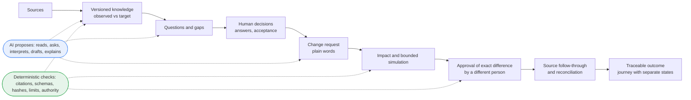
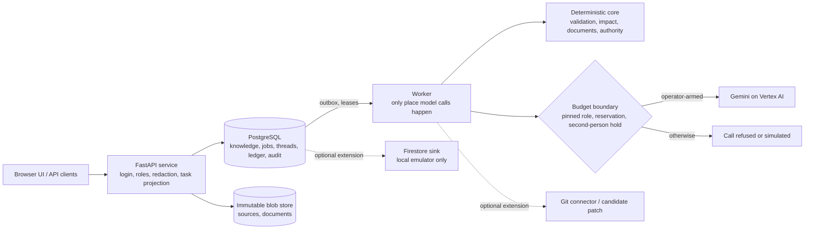

# Ripple: understand the rules, decide with evidence, change with confidence

**Ripple is an AI-powered business rule intelligence and governed change platform.** It reads the places where a company's rules actually live (code, configuration, spreadsheets, documents), turns them into cited, versioned business knowledge, and helps the right people decide what a rule *should* be and what a change would touch. Generative AI (Gemini on Vertex AI) reads, asks, drafts and explains. Deterministic code validates every proposal. People make the decisions.

**AI proposes. Deterministic systems validate. Humans decide.**

**Product direction — enterprise future of work:** LLMs are essential for work that requires semantic understanding, adaptive dialogue and generative reasoning. Algorithms provide grounded context, exact calculations and enforceable controls. Choose model strength per task using measured quality, risk, latency and cost; see the [AI system principles and task-design policy](docs/product/AI_SYSTEM_PRINCIPLES.md). This is the design objective, not a claim that every target capability is delivered or quality-validated in this preview.

> **Development preview, not a finished product.** This snapshot shows progress toward the Final round. It is **not production-ready**: there is no production go-ahead, no production deployment, no production smoke and no production resource. It has **no human rating or usability study** (the owner accepted specific outputs and screens as presented), and its real-model quality has **not been independently measured**. New here: the **request assistant met its acceptance on a sealed agent-built set (v8)** under the owner's hackathon profile (agent evaluation, **not independent**, synthetic seeded requests): model useful 33 of 35, shown useful 44 of 44, 50 of 50 answered, measured p95 27.26 s and 0.0081 USD per question; a per-role budget (each AI role has its own output caps and call limits, verified locally and in a local image); and later agent-evaluation rounds on the current versions of the other core AI roles, with the rounds that did not meet kept ([section 4i](#4i-request-assistant-acceptance-and-per-role-budget-new-in-this-snapshot)). The hackathon profile itself, where synthetic data and agent evaluation stand in for outside reviewers, human raters and real enterprise data with quality thresholds unchanged, is in [section 4h](#4h-hackathon-profile-results); the clearer work screens in [section 4g](#4g-clearer-work-screens). Earlier evidence (the fresh V9 journey on an earlier version, a staging rehearsal on an earlier candidate) is stated with the version it ran on ([section 4d](#4d-journey-from-sources-to-refresh-and-its-evidence-levels)). Whether the team advances to a later round is the organiser's decision. Submission for the Google Cloud AI Builder Cup JAPAC 2026. Snapshot: source commit `35f56af` of 2026-10-30 ([provenance](PUBLIC_PREVIEW_PROVENANCE.json)).

## Explore this repository

| I want to... | Go to |
|---|---|
| Understand the idea (2 minutes) | [Problem](#1-the-enterprise-problem), [what is different](#2-why-ripple-is-different), [Harbor example](#3-a-concrete-example-harbor), [journey](#4-end-to-end-product-journey), [interface walkthrough](#4b-explore-the-implemented-interface) |
| See what is new in this snapshot | [request assistant acceptance and per-role budget](#4i-request-assistant-acceptance-and-per-role-budget-new-in-this-snapshot), [hackathon profile results](#4h-hackathon-profile-results), [clearer work screens](#4g-clearer-work-screens), [Q&A on large knowledge bases and clearer guidance](#4f-qa-on-large-knowledge-bases-and-clearer-guidance), [change understanding, guidance holds and operations](#4e-change-understanding-guidance-holds-and-operations), [journey from sources to refresh](#4d-journey-from-sources-to-refresh-and-its-evidence-levels), [request tasks, assistant and interface](#4c-request-tasks-assistant-and-interface-in-this-snapshot) |
| Judge the generative AI use | [Gemini implementation](#5-generative-ai-implementation) |
| Check engineering and evidence | [Trust foundation](#6-engineering-foundation-and-trust), [capabilities](#7-current-capabilities-and-evidence), [curated evidence](docs/release/FINAL_PREVIEW_EVIDENCE.md), [claims with limits](docs/release/FINAL_CLAIMS_EVIDENCE_LIMITS.md) |
| Run it | [Run and verify locally](#10-run-and-verify-locally) |
| See what is next | [Roadmap](#11-roadmap-toward-final-readiness) |

**What to evaluate:** evidence-backed knowledge (cited, versioned, observed vs decided); uncertainty handling (open questions, disagreement and abstention are visible results); human decisions (a person's own words, never promoted AI output); exact approval by a different person, including for AI runs that wait for a second person; source reconciliation, which compares an edited source with the decision but does not verify behaviour; and a request assistant in which **the server, not the model, states who acts**.

**How to read the status words.** *Implemented* = in the source of this tree. *Local (stub)* = verified on a disposable database with a synthetic stub model, which proves the wiring and the checks, not the model's quality. *Live diagnostic* = a real model was called on a small self-authored set (self-check, not independent; it describes only the build it ran on). *Accepted (scope)* = the owner accepted exactly the stated scope; *accepted automated evidence* means the owner accepted recorded test results, not that the owner operated the screens. *PARTIAL* = some parts built and verified, others open. *OPEN* = not established. *Roadmap* = not built.

---

## 1. The enterprise problem

A rule such as "who must approve a purchase above a threshold" is rarely written in one place. It sits in a configuration file, a spreadsheet, a policy document and code, often with slightly different values. Sources can disagree without anyone noticing until a change is made. Business owners know what a rule should mean but cannot see what systems do; engineers see the implementation but cannot decide its meaning. A technical edit is not an approved business decision, and updating a file does not prove behaviour changed as intended. The result is changes that are hard to review, hard to trace and easy to approve on incomplete information.

## 2. Why Ripple is different

Ripple keeps apart things most tools collapse into one:

| Kept separate | Why it matters |
|---|---|
| **Observed** evidence (what sources say) vs **Target** knowledge (what people decided) | agreement, disagreement and decided intent are visible together |
| Proposed change vs **approved semantic difference** | approval is of an exact difference, by a person other than the requester |
| **Knowledge** decided vs **source** updated vs **behaviour** verified vs **result** accepted | "files edited" is never reported as "behaviour proven" |
| **Permission** vs **assignment** vs **waiting** | being allowed to do a step is not being asked to do it; who a request waits on is stated, never guessed |
| What the **model** said vs what the **server** stated or refused | a sentence written or refused by a server guard is never counted as the model answering correctly |

Conceptually (responsibilities, not a performance claim): search/RAG finds and summarises text, Ripple adds decided-vs-observed knowledge and abstention; coding assistants edit code, Ripple checks an edit against an approved rule and only recommends for code; impact tools list dependencies, Ripple reports coverage and never turns "unknown" into "no impact"; approval workflows route requests, Ripple binds approval to an exact difference with stale-knowledge guards. These techniques are not new; the contribution is one governed loop built on three ideas:

1. **Governed business knowledge.** Rules are versioned, cited and labelled; open questions and disagreements are first-class records, so the knowledge says what it does not know.
2. **Human authority separate from AI interpretation.** A model may read, ask, explain and draft; only a person's own words answer, accept or approve, and approval needs a different person from the requester. The system can refuse or downgrade model output, never promote it.
3. **Evidence-based, multi-axis completion.** A change is not "done" when a file is edited. Decided knowledge, source alignment, behaviour and business acceptance are separate states; this product can establish only the first two.

## 3. A concrete example: Harbor

**Harbor** is a synthetic, runnable procurement system in [`fixtures/harbor_public`](fixtures/harbor_public). Its public configuration sets the standard manager approval threshold to 1,000,000 JPY ([`approval.yaml`](fixtures/harbor_public/config/approval.yaml)). An illustrative request: *"Raise the standard manager approval threshold from 1,000,000 JPY to 1,500,000 JPY."*

1. **Discover and version.** Sources become immutable revisions, each with a kind the person sets at import (policy, code or configuration, records, tests, not sure). A person with the right asks for the business rules to be read; rules are proposed with quotes the server re-checks, and code is linked to configuration with recorded provenance (for example a code threshold resolved to the one configuration key of that name). Rules, relations and open questions form a versioned snapshot.
2. **Ask and accept.** Missing actors, conditions and conflicts become questions, including disagreements the model suggests between differently worded sources; a person previews the options, decides in their own words and accepts a version.
3. **Understand the change.** The request becomes validated operations that quote it and name a shown rule; anything uncovered becomes a question.
4. **Impact and simulation.** Affected rules, files and code are listed with coverage. For a supported numeric change, Harbor's own program runs on its public sample to count requisitions whose route changes; otherwise `NOT_SIMULATED` with the reason. The count measures the sample and is not a forecast; this README quotes none.
5. **Exact difference and approval.** A structured draft shows precisely what changes, including a bounded candidate byte diff of the automatic file edits (candidate, not applied); a different person approves that exact difference, and moved knowledge refuses the decision. Commit makes it Target knowledge.
6. **Follow-through and reconciliation.** For a YAML scalar of a configuration file, an approved edit is written and read back; documents, workbooks and code stay manual (code gets recommendations only). Edits are compared with the decision (correct, partial, divergent); sources still stating the old value stay visible as unresolved.

Where a workspace requires it, an AI run waits for a second, eligible person to allow it; the page says why it waits, who may allow it and whether the reader may. At every step, each person sees their own task for the request and can ask a private assistant about it ([section 4c](#4c-request-tasks-assistant-and-interface-in-this-snapshot)).

This does **not** show that runtime behaviour was verified (read-back is source alignment only) or that results generalise beyond Harbor.

## 4. End-to-end product journey



Each change ends in a nine-step view with a state and a next actor per step ([journey logic](core/change_intelligence/v2/business_journey.py)). One server-side task projection per request and reader feeds the task frame, the whole-request view, My work and the request assistant, so they cannot disagree about the stage, who holds a step or what blocks it ([contract](docs/contracts/REQUEST_TASKS_AND_ASSISTANT.md)).

## 4b. Explore the implemented interface

The React interface (`/app-next/`; source in [`frontend/`](frontend), built bundle in [`app/ui_next/`](app/ui_next)) is reached through the local rehearsal server ([section 10](#10-run-and-verify-locally)). **A walk through the core loop, by role** (each step is exercised by the named browser test; roles are simulated accounts):

1. *Administrator or knowledge owner* reads the business rules from the sources on **Questions & Decisions** (the page states never read / sources changed / read, and offers "Accept this knowledge" as the next step; [`test_source_to_knowledge_browser.py`](tests/final_loop/test_source_to_knowledge_browser.py)), then answers business questions: preview, then confirm in their own words; an account without authority sees the page without the action ([`test_kno04_browser.py`](tests/final_loop/test_kno04_browser.py)). The same page answers questions from the knowledge, with Business and Technical readings, a stale marker and withheld source text where rights are missing ([`test_qry04_browser.py`](tests/final_loop/test_qry04_browser.py)), and lists AI runs waiting for a second person.
2. *Requester* states a change on **Changes**, confirms the understanding and sees what the rule means, what it touches and what stays pending ([`test_chg04_browser.py`](tests/final_loop/test_chg04_browser.py)). **Impact & Simulation** shows the measured effect for a supported numeric change, with an impact worklist that keeps full counts per category; the **Sample process trial** runs one requisition through Harbor's code under two configuration versions (a trial on a sample, not production and not a forecast).
3. *Approver* (a different person) accepts the knowledge change and, separately, the automatic file edits, and can open the candidate file diff first; a clarification makes an earlier approval out of date; a viewer cannot decide ([`test_chg04_browser.py`](tests/final_loop/test_chg04_browser.py), [`test_harbor_journey.py`](tests/ui_next/test_harbor_journey.py): three distinct people). On wide screens the decisions sit in a rail beside the evidence.
4. *Knowledge owner* commits and sees four axes (knowledge committed, source and code pending, behaviour not tested; [`test_chg05_browser.py`](tests/final_loop/test_chg05_browser.py)), then chooses whether the product writes the approved edit, shown as "applied, pending read-back" ([`test_syn03_browser.py`](tests/final_loop/test_syn03_browser.py)).
5. Anyone with the right opens **Knowledge Documents**, generated when opened and flagged stale for an older version ([`test_doc04_browser.py`](tests/final_loop/test_doc04_browser.py)); wide tables scroll inside their own labelled, keyboard-focusable region. **History** shows a failed read or comparison as unavailable, never as an empty result.

**Request task screens** ([section 4c](#4c-request-tasks-assistant-and-interface-in-this-snapshot)): a task frame at the top of each request with a step badge showing the recorded phase, a whole-request view with every step's state, **My work** on Overview and Changes, and the request assistant beside the task. **Sources** shows Cards (default) or a Table with the same rows, stage words and actions, and both share one selected-file pane that keeps reading, AI and confirmation apart ([`test_sources_selected.py`](tests/ui_next/test_sources_selected.py), [`test_scn_sources_table_browser.py`](tests/ui_next/test_scn_sources_table_browser.py); section 4g).

**Code and repository screens** (extension, local, fixture repository): the change review shows code recommendations (never a diff); after the commit a candidate patch can be built, validated on a disposable clone and approved or rejected bound to both hashes; publishing stays refused without a pull-request grant ([`test_fex_code_panel_browser.py`](tests/final_loop/test_fex_code_panel_browser.py)). **Support & Access** shows a read-only delivery status and operator switches that each state what switching them off does. **Extension AI screens** (audience versions, conflict scan, interview, multi-agent assessment with memo panels, refresh correspondence) were built and browser-tested with synthetic models only ([`test_lha_ui_browser.py`](tests/final_loop/test_lha_ui_browser.py), [`test_extension_panels_a11y_browser.py`](tests/final_loop/test_extension_panels_a11y_browser.py)). The other pages are Overview, Explorer and a Business/Technical toggle (ten pages in all).

| Owner acceptance (exact scope) | What it covers | What it does not cover |
|---|---|---|
| Human acceptance session 1 (local rehearsal, simulated models, an earlier build of the same day) | A1, A2, A3 and the administrator part of A20 **performed by hand: pass**; every other row: the owner **accepted the automated evidence** (not performed by hand), with the uncovered parts listed per row; wording and usability only for the screens seen in that session; desktop only | real-model answers (A4, A5, A19 have none), narrow widths, AI quality |
| Changes C1–C5 made after that session (the items of section 4c, part G) | the owner **accepted the automated evidence** within the reported test scope; the owner did not operate these screens | anything beyond the reported tests |
| Review galleries | the desktop screens and states captured in two review galleries (browser tests with synthetic models; review material outside this repository) | uncaptured screens and states |
| Request assistant | the assistant screens and the usefulness review of a fixed set of example questions; the step-badge change | general answer quality, every role and request |
| Layered journey evidence (2026-10-22) | the owner accepted the evidence as recorded in layers: the change chain passed in the live and synthetic scope; concrete-case answers did not pass live and passed on a targeted replay after fixes; model omissions stay limits | quality of the model, the gates of section 4d |
| AI quality shown in journey V9 (2026-10-23) | the owner accepted the quality of the V9 answers, disagreement suggestion and guidance as shown in a pre-production package, for that version with its listed weaknesses (recorded as PARTIAL in the release checklist) | any other role, data set or version; human acceptance of AI quality in general |
| Change guidance v3 and v5 (2026-10-25) | the owner accepted the guidance package v3 as presented (no numeric score) and the whole rating sheet of guidance v5 | that guidance prose only; not a human usefulness rating, which stays OPEN; not other roles |
| Journey close-out | the owner accepted the local J2 integration close-out and acknowledged the fresh V9 run as meeting the end-to-end row at its recorded level (live, synthetic, self-authored) | independence, AI quality, real use |
| Interface plan, phase 2 checklist P1–P7 (from screenshots) | the owner answered "yes" from screenshots | P1 ("is any text hard to read") not confirmed; no check on the running app recorded |
| Interface plan, phase 3 checklist Q1–Q4 (2026-10-26) | the owner accepted the interface and improvements **as presented** | the ten-second recognition test (S1–S5) and the action journey **with people** (not recorded; an agent / automated substitute is in section 4h); usability in general; screens changed later |
| None of the above | — | **production readiness**, AI quality in general, real integrations |

| Interface evidence level | Status |
|---|---|
| Implemented in source | yes: [`frontend/src`](frontend/src) and the built bundle `app/ui_next/assets/index-CSFEzSjG.js` (built and checked by the development process; not rebuilt for this repository) |
| Journey decisions | in the live journey runs an operator stood in for the person through the real routes; those decisions and acceptances are **not** owner acceptance |
| Development-snapshot self-checks | real Chromium, server and worker, stub models, simulated roles; recorded in the development record (not in this repository), each for the files it ran |
| Run on this public tree | **none**; this repository receives packaging and content checks only ([section 7](#7-current-capabilities-and-evidence)) |

**Frontend governance.** Rules: [`UI_DEVELOPMENT_RULES.md`](docs/design-system/UI_DEVELOPMENT_RULES.md) (tokens only from [`index.css`](frontend/src/index.css), shared components, job state, verification, approval and acceptance kept separate). `npm run check:design` ([`check-design-system.mjs`](frontend/tools/check-design-system.mjs)) fails on new violations; known exceptions are in [`design-system-policy.json`](frontend/design-system-policy.json); [`test_a11y.py`](tests/ui_next/test_a11y.py) and targeted keyboard and axe checks inside journeys ([`test_request_task_frame_a11y_browser.py`](tests/final_loop/test_request_task_frame_a11y_browser.py)) work against a WCAG 2.2 AA *target*. None of this proves full consistency or accessibility compliance. **No screenshots are included in this repository;** run the rehearsal to see the interface.

## 4c. Request tasks, assistant and interface in this snapshot

Unless stated otherwise, everything below is **implemented** and **verified locally with a synthetic stub model** through the real routes, worker and browser, in the development record (not in this repository). User guide: [request tasks and the request assistant](docs/product/request_tasks_and_assistant.md); rules: [contract](docs/contracts/REQUEST_TASKS_AND_ASSISTANT.md); operators: [runbook](docs/runbooks/REQUEST_ASSISTANT_OPERATIONS.md).

**The base.** A **task frame** at the top of each request shows the stage, *Input* (what to read), *What to do* (only the steps this person is asked to do now) and *Result to hand over*, with blockers above the action; its step badge shows the phase recorded for the step, and a spinner only when something is running. Permission is not assignment: a person who may do a step but is not asked sees "you may do this, but you are not asked to". Waiting is named without inventing a person, deadline or service level. A **whole-request view** lists every step with a text state, and **My work** groups requests into waiting for you, optional, blocked, waiting for someone, waiting for the system and recently finished ([`test_request_task_view.py`](tests/final_loop/test_request_task_view.py), [`test_request_surfaces_agree.py`](tests/final_loop/test_request_surfaces_agree.py)).

**A. Request assistant: the server states who acts.** A private conversation about one request for people with the read-only capability `request.assistant.ask` who may read that request. **Who holds each step, what this person may do and who the request waits on is written by the server from the person's task record, never by the model.** The model explains the business causes from cited facts. Its blocks are checked: cited facts, numbers, a cause only from a fact that records a reason, no authority wording in its blocks or limitations, status claims against the record, and no claim that "who acts is unknown". Blockers it does not explain, a reason it could not ground and facts it could not see are disclosed. Asked to perform an action, it is instructed to say that it does not do that; it has no way to act ("I agree" approves nothing). Earlier designs, in which the model proposed typed authority statements and the server refused or corrected them, are history; their stored answers are shown as stored ([`test_request_assistant_integrity.py`](tests/unit/test_request_assistant_integrity.py), [`test_request_assistant_authority.py`](tests/unit/test_request_assistant_authority.py), [`test_request_assistant_integrity_jobs.py`](tests/final_loop/test_request_assistant_integrity_jobs.py), [`test_request_assistant_jobs.py`](tests/final_loop/test_request_assistant_jobs.py); claims row 29 of the [claims document](docs/release/FINAL_CLAIMS_EVIDENCE_LIMITS.md)).
*Limits:* the reliable authority is the server's section; the model's prose is checked by lexical defence in depth, not by a parser. Answers are **English only**. The request assistant of this snapshot met its acceptance on a sealed agent-built set (v8, section 4i); an earlier self-authored release cohort (V12) belongs to an earlier configuration; neither is an independent evaluation (section 5).

**B. Priority-aware context.** The facts sent to the model are chosen in tiers: the request's mandatory task facts first (now including each step's phase and any recorded stage reason or its absence), then supporting information, then history, within fixed limits. If the mandatory facts do not fit, the question is **refused before any model call** rather than answered from part of them. Selection and its hash are stable, which an equality test checks; a blocker added before the answer refuses it as `context_changed` with no provider call. *Limits:* this bounds what the model sees; it does **not** mean every relevant piece of knowledge always reaches the model.

**C. Interface provenance and progressive disclosure** (PARTIAL). Content carries its origin: **AI**, **Source**, **Engine** and **Task record**, shown by label, icon and border style ([`Origin.tsx`](frontend/src/components/decision/Origin.tsx)). An origin label never means correct or approved. Routine explanations are folded under "How this works"; warnings and decision consequences stay visible next to their actions. On the business change review, from 1280 px the decisions sit in a rail beside the evidence. *Open:* contrast was computed from token values, not audited.

**D. Guided request assistant.** The panel opens directly on suggested questions and the question box. **Ask AI** sends one question and states next to the button that each question is one paid model call; **Edit question** only fills the draft. Opening the panel, editing or switching views starts no model call. The first question creates the private conversation in the same call and is idempotent. **Go to** buttons only move the focus to the step's own control after rechecking the task view; they never approve, submit or execute anything ([`test_request_assistant_browser.py`](tests/final_loop/test_request_assistant_browser.py), [`test_request_assistant_first_ask.py`](tests/final_loop/test_request_assistant_first_ask.py)).

**E. Citations.** "Show on this page" marks and focuses the section a cited fact comes from. For holders of `evidence.read`, a citation of an **impact** or **draft rule-change** fact can also show its source (path, locator, binding revision, current / changed since / absent now), resolved by the server and rechecked at read time. A **source excerpt** is shown only for a **YAML key**, read from the pinned bytes; other files give the location without an excerpt ([`test_request_assistant_citation_source.py`](tests/final_loop/test_request_assistant_citation_source.py)).

**F. Further interface slices** (PARTIAL where open parts remain): typed aspects of a rule difference and a bounded candidate file diff of the automatic edits (10 files, 120 lines each, `evidence.read`, nothing written; [`test_eui03_file_diff.py`](tests/final_loop/test_eui03_file_diff.py)); an impact worklist with full counts; questions grouped by kind with exact counts; a shared preview for a model reading before confirmation; interview sentence starters and a structured preview that is never a confirmation; conflicting sources as A/B cards; AI statements in the simulation and memos that highlight exactly the rows they cite, with a check badge counted from what the server kept and refused; Explorer typed metrics with state pills; the Sources selected-file pane; operator switches that state their consequences. Open parts include usefulness evaluations and a final pass over every changed screen.

**G. Changes after the first acceptance session (C1–C5; the owner accepted their automated evidence, see section 4b).**
- **Business rules read from the sources in the interface:** on Questions & Decisions a person with `knowledge.confirm` (and, in a sandbox, the writing session) can ask for the current sources to be read; the page states whether they were never read, changed since, or read, shows the result and offers "Accept this knowledge" as the next step. Nothing is accepted for the person ([`test_source_to_knowledge_browser.py`](tests/final_loop/test_source_to_knowledge_browser.py)).
- **AI runs waiting for a second person:** a run that a workspace holds shows `waiting for approval`, `waiting for a slot` or `running`, why it waits, which roles may allow it, that a distinct person is required, whether the reader may allow it and why not; a list of runs awaiting approval is available. Allowing uses the existing approval route, which re-checks permission, the distinct person and the writing session. Nothing is allowed automatically and the second-person rule is unchanged ([`test_ai_run_hold.py`](tests/final_loop/test_ai_run_hold.py)).
- **Status words** for questions and change readings that keep polling while waiting for a slot.
- **Wide tables** in generated documents scroll inside a labelled, keyboard-focusable region instead of the whole page.
- **Local rehearsal** changes (section 10): curated knowledge and an in-process worker by default, no Google credentials in the process, and a simulated change-understanding stub that handles one number on one rule.

**H. Guided preparation** stays **off by default** (`RIPPLE_GUIDED_PREPARATION=on` enables it; it approves, commits and applies nothing; [contract](docs/contracts/GUIDED_PREPARATION.md), [`test_guided_preparation.py`](tests/pitch_brief/test_guided_preparation.py)).

**Known gaps.** **Go to** for steps of the change-understanding flow may show "not available on this page". A simulation that seemed to hang during a gallery capture was investigated earlier: it was correctly refused with `knowledge_moved`; the fault was in the capture script, not the product. In the local rehearsal the assistant is simulated ([section 10](#10-run-and-verify-locally)).

## 4d. Journey: from sources to refresh, and its evidence levels

New in this snapshot, all **implemented** and verified locally with stub models (tests named below; development record, not rerun here):
- **Sources to knowledge with traced links.** A candidate becomes a rule only when it says who acts or what happens; a structured value without either stays a supporting fact, and an incomplete statement is listed with what is missing. A code `if` line quoted as evidence is parsed (never executed); a comparison against a configuration attribute is resolved only when exactly one numeric key of that name exists in the same revision, otherwise a person is asked; an enum member is compared by its name; a code outcome takes its actor only from the one rule that names who acts on that value. Each resolution is recorded as provenance; nothing is confirmed by the server ([`test_business_sources.py`](tests/unit/test_business_sources.py), [`test_business_sources_code.py`](tests/unit/test_business_sources_code.py), [`test_kno02_source_links.py`](tests/final_loop/test_kno02_source_links.py), [`test_sources_import_roles.py`](tests/ui_next/test_sources_import_roles.py), [`test_source_reading_summary_browser.py`](tests/final_loop/test_source_reading_summary_browser.py)).
- **Disagreements: suggestion, preview, decision, acceptance.** The engine lists candidate rule pairs; the model may suggest a disagreement between them; the server keeps a suggestion only when its references are the offered ones (recognised by content and stored in the server's own form), keeps an over-long question as its head plus the asking sentence and discloses the cut, and keeps the model's raw output, the shown question and the references apart. A person previews both options, chooses a rule in their own words and accepts the knowledge; the decided pair then counts as a disagreement in answers and documents ([`test_gap_proposal_pairs.py`](tests/unit/test_gap_proposal_pairs.py), [`test_kno06_gap_proposals.py`](tests/final_loop/test_kno06_gap_proposals.py), [`test_counterevidence_from_questions.py`](tests/unit/test_counterevidence_from_questions.py)).
- **Answers with applicability and decisions.** A stated amount stands in for an amount field the rule compares in JPY (never for another currency, a gross or difference field, or an unstated category); a disagreement recorded as a question counts as counter-evidence; a claim on a passage is read through the one rule bound to that passage; an approval gate is read from the rule's own outcome words, and an uncited amount-keyed gate that a fact would decide becomes a server question, never a claim ([`test_business_qa_amount_alias.py`](tests/unit/test_business_qa_amount_alias.py), [`test_business_qa_passage_binding_and_gates.py`](tests/unit/test_business_qa_passage_binding_and_gates.py), [`test_qry03_qa.py`](tests/final_loop/test_qry03_qa.py)).
- **Change to commit, document and refresh.** A guidance question holds the decision only when it names an open numbered item of the draft and the change cannot be defined without the answer; other questions are advice with their reason. Documents list the people's decisions and name the decided rule of a settled disagreement ([`test_chg03_draft.py`](tests/final_loop/test_chg03_draft.py), [`test_document_decided_suggested_disagreement.py`](tests/unit/test_document_decided_suggested_disagreement.py), [`test_syn04_journey.py`](tests/final_loop/test_syn04_journey.py)).
- **Fixes included in the version that ran V9:** a claim citing several passages, each the source of exactly one rule, is read through each of those rules; a configuration `key: value` whose outcome or actor only restates the value is a supporting fact, not a rule ([`test_business_qa_passage_binding_and_gates.py`](tests/unit/test_business_qa_passage_binding_and_gates.py), [`test_business_sources.py`](tests/unit/test_business_sources.py)).
- **Fixes made after V9, included in this snapshot (not re-run by V9; they are not on its steps):** the ROI replay over extracted knowledge no longer reads the unresolved-scope marker as a field and no longer counts routes that still need an approver as approvals ([`test_roi_replay_extracted_knowledge.py`](tests/unit/test_roi_replay_extracted_knowledge.py)); the semantic drift advisory no longer refuses comparison operators as markup ([`test_semantic_drift_plain_text.py`](tests/unit/test_semantic_drift_plain_text.py)).

**Evidence levels** (from the development record; summarised in [`FINAL_RELEASE_CHECKLIST.md`](docs/release/FINAL_RELEASE_CHECKLIST.md), "Release status by criterion"). The journey runs are **self-authored, non-independent self-checks** on Harbor workspaces with synthetic data, seen questions and Gemini 3.5 Flash-Lite (V9: a new workspace from the seven original files, 16 calls, retries 0); an operator stood in for the person through the real routes. *Built* = implemented and verified locally; *journey* = exercised live; *replay* = a defect found live, fixed afterwards and shown on the run's own stored output through the real callers, with **no new model call**; *model* = the model's own output met the frozen check.

| Criterion | Built | Journey (live, staged) | Replay after fixes | Model | Status |
|---|---|---|---|---|---|
| Sources to knowledge with traced code and configuration links | yes | passed on the third run (4 of 4 required rules, the capital-purchase route traced from code to configuration) | — | partial: code outcomes and actors came from the server's code facts, not the model | PARTIAL |
| Suggested disagreement, preview, decision, acceptance | yes | passed the frozen gate in the fourth run and again in the continuation run (V6C); the two fresh attempts on later builds (V7, then one more call, V7P) **did not pass**: the server refused the right suggestion, first as not a plain question (probably over the length limit; the model's wording was not kept, so the cause is not proven), then because its references were copied in another form | both causes fixed afterwards; the local integration (J2) was closed by tests and by replaying the **verbatim** recorded V7P output through the real callers; **the fresh V9 then passed this stage live** | the suggestion named the right pair; precision not measured | PARTIAL (passed live in V9; self-check, operator-simulated decision) |
| Concrete-case answers | yes | 1 of 5, then 0 of 2 on re-ask; 5 of 5 shown in V6C; 4 of 5 shown in V8; **5 of 5 shown in the fresh V9** (no safety breach in any run) | the stored outputs of the earlier runs pass after the fixes (A19 in both views, A5, A4a, A4b) | **model-only 3 of 5 in V6C and 2 of 5 in V9**: the shown answers include the server's passage binding, gates and clarifying questions; the two layers are separate measurements and are **never added or substituted** | PARTIAL (model quality below the shown answers; not independent) |
| Change, guidance, decision, commit, document, refresh | yes | passed to the refresh in the fifth run and in V6C (decision and commit by the operator for the person; the refresh read back; honest "pending" where a source is prose) | — | guidance: advice only, no blocker | PARTIAL (not human acceptance, not runtime-verified) |
| One fresh, continuous end-to-end live run | yes | **V9 (2026-10-22, new workspace, one version `0b410d23`): every gate passed**: J1 sources to knowledge (4 of 4 traced), J2 the suggested disagreement kept, decided and accepted, J3 answers (5 of 5 shown), J4 change understood, guidance, decision, commit, document and refresh (`verified`, source-aligned). Earlier attempts V6, V7 and V8 stopped on product defects, all fixed (history kept); V6C was a continuation across two code versions | — | V9 model-only answers 2 of 5 | **met at the live, synthetic, self-check level** on `0b410d23`; decisions operator-simulated; behaviour not tested; **this snapshot adds two later fixes that V9 did not run** |
| Independent evaluation; human acceptance of AI quality | — | — | — | — | **OPEN** |

Known model limits recorded in these runs: omitted code outcomes and actors, a passage cited instead of the rule, a missing fact noticed but not asked about, references rewritten, questions over the length limit, a category marker left out of a condition. Where the server can read the binding or the gate it now does; that does not make the model's output correct. All live work ran under a hard cost cap.

## 4e. Change understanding, guidance holds and operations

Added in snapshot `aadecba` and unchanged since except where [section 4f](#4f-qa-on-large-knowledge-bases-and-clearer-guidance) says so. All **implemented**; evidence as recorded in the development record for the version named in the table below (not rerun here).

**A. Change understanding by numbered parts.** The server numbers the parts of a request; the model classifies every part (change, current state, reason, heading, aside, unclear); the server checks the result by grounding (numbers against rule values and set values, roles against rule actors) instead of word lists. Ambiguous sibling rules and vague actors are **asked, never picked**; a limit on the other side of a rule becomes a condition edit; decimals, signed numbers, unit aliases, list membership, headings and remarks are handled by class (contract versions 5 to 8; [`business_change.py`](core/change_intelligence/v2/business_change.py), [`change_understand.json`](config/change_understand.json)).

**B. Dependencies before guidance; server holds with a basis.** Guidance waits until the model's dependency step is completed (or shown not to apply, with grounds). The server **holds** the knowledge decision until a person clarifies when it can prove a basis: tiers of the same decision inverted, a dependent rule losing its trigger through a confirmed relation or its own condition, or a recorded disagreement; the held rule's automatic edits are downgraded. A dependency the model proposes is checked and shown as a lead, never as a hold. Dependency proposals name one of the accepted relations and see each rule's condition, and the impact report flags an incomplete walk only for connected rules it never reached ([contract](docs/contracts/FINAL_KNOWLEDGE_LOOP.md) sections 19-20, [`business_draft.py`](core/change_intelligence/v2/business_draft.py)).

**C. Operating a deployment.** Each server runs only the AI kinds listed in its budget configuration (`enabled_roles`, fail-closed, checked when a person asks and again before execution; the page shows which AI features the server offers; [`ai_kinds.py`](infra/ai_kinds.py)). A provisioning tool creates a deployment's first workspace ([`provision_workspace.py`](tools/provision_workspace.py)), and queued jobs are handled between operating windows ([`ops_jobs.py`](tools/ops_jobs.py), [operating-window runbook](docs/runbooks/FINAL_PRODUCTION_WINDOWS.md)). Database-backed write routes run off the event loop with bounded admission; readiness checks the database; overload returns a bounded 503; one owned provider client per call without SDK retries; typed, bounded diagnostics; durable request-to-job correlation; citation sources and review notes are read as bounded pages. Two **additive** migrations: a partial index on review notes and an append-only job-correlation table (no existing table changed). Procedures: [deploy and rollback](docs/runbooks/FINAL_DEPLOY_ROLLBACK.md).

**D. Quality closure of other roles and the changes page.** Updated contracts for Q&A, the request assistant, mining, the ROI analyst, the risk memo, refresh correspondence and the coder; on the changes page, the stages (analysis, draft, apply, review notes, decision basis), explanation and simulation cards, AI kinds and reason vocabularies and error handling were reworked (bundle `index-Dm9Hue2s.js` of that snapshot, since replaced).

| Evidence | Version it ran on | Result as recorded | Limits |
|---|---|---|---|
| Change understanding on an unseen set (v14, n = 22) | the previous snapshot's understanding role (prompt, configuration and code unchanged in this one) | status correct 0.909, exact 0.889, dropped 0, invented 0: thresholds met | written by a separate agent session, **not independent, not a person**; the owner accepted the set as a gate set at that level; no general quality inferred; the previous set (v13) did not meet its thresholds |
| Code proposals through the whole caller (v14) | the previous snapshot's coder role (unchanged in this one), proposal only, local sandbox | 8 items reached the coder, 7 of 8 passed; static and planted checks 0.875; edits outside the allowlist 0; nothing applied or run: thresholds met | same authoring limit; nothing applied or executed |
| Guidance holds (offline rerun on a recorded run) | the hold logic of this snapshot on recorded operations and proposals; the guidance **wording** comes from an earlier run | expected holds 5 of 5; clean cases held 0 of 12 against corrected labels (2 of 12 against the original labels) | logic checked locally and by replay; wording **not regenerated**; superseded by the live guidance v5 result in section 4f |
| Route and unit tests of the changed paths | the previous snapshot, test database, stub models | passed | self-authored tests; no provider |
| Staging rehearsal (a separate, torn-down cloud project) | candidate `479b5e31`, an **ancestor** of this snapshot that already contains both additive migrations | migration, rollback and restore, startup, access and budget enforcement rehearsed; live calls through the deployed worker | **not re-run on this snapshot**; inherited only for what it covered, because the files changed since are code, configuration, tests and documentation, with no migration, runtime or budget-configuration file; at that time the changed roles, including the Q&A path, had no deployed evidence; a later cloud rehearsal of the code of snapshot `a762e01` is in section 4h |

The release checklist shipped in this snapshot ([`FINAL_RELEASE_CHECKLIST.md`](docs/release/FINAL_RELEASE_CHECKLIST.md)) was last updated before the v14 runs above, so its rows for change understanding and the coder show the earlier state; it also records an earlier staging rehearsal (2026-10-23) and a local rollback rehearsal.

## 4f. Q&A on large knowledge bases and clearer guidance

Added in the previous snapshot (`6447f03`); the AI core, configuration and worker are unchanged in this one. All **implemented**; evidence as recorded in the development record (not rerun here). The AI results were measured on development version `cf47df43`; snapshot `6447f03` had the same code, configuration and tests and differed only in two documentation files that record those results ([quality plan](docs/evaluation/FINAL_AI_QUALITY_PLAN.md), [release checklist](docs/release/FINAL_RELEASE_CHECKLIST.md)).

**A. Questions over large knowledge bases.** When a knowledge pack is larger than the model may read at once, the semantic layers (expand the search, rank, judge whether the evidence suffices) now receive the pack's own candidates and their counter-evidence first, instead of a cut by item order. Ranking and judging share one budget that fits the model's output limit, and what the expansion found is kept. A malformed search term no longer throws away the grounded candidates. The judge's "not enough evidence" verdict blocks an answer only when the judge saw everything the answer can use; otherwise the answer states what was not checked. A live run found the problem: a two-step question was refused because the judge never saw the second rule ([`semantic_retrieval.py`](infra/adapters/semantic_retrieval.py), [`knowledge_qa.py`](infra/worker/knowledge_qa.py), [contract](docs/contracts/FINAL_KNOWLEDGE_LOOP.md)).

**B. Guidance that separates related rules.** Each file item now says in business words which rule it concerns. A related rule is classed by what links it to the change: it follows from the change, it is the subject of a hold, it is a separate obligation or another tier, or it only shares the topic. The model acts on the first two and says "no change needed" for the others, without suggesting to align thresholds; it also says when a change only adds cases. Hold logic is otherwise unchanged (guidance version 5; [`business_draft.py`](core/change_intelligence/v2/business_draft.py), [`change_draft_guidance.json`](config/change_draft_guidance.json)).

| Evidence | Version it ran on | Result as recorded | Limits |
|---|---|---|---|
| Q&A on a new sealed set of 12 questions (three packs above the semantic size limit) | `cf47df43` | **12 of 12**: answered with citations, wrong rule cited 0, abstention rows met; every kept claim written by the model (server added 0); every semantic layer applied on 12 of 12 | written by a separate agent session and reviewed by a second one, **not independent, not a person**; no general guarantee |
| Guidance holds, live (version 5) | `cf47df43` | **0 false holds in 10 changes; 5 of 5 expected holds** | the set had been read in an earlier round (a regression set); agent-authored, not independent |
| Guidance usefulness, 27 instructions | guidance version 5 | **115 of 135, mean 4.26** (4.259259) on a 1-5 scale | **scored by an agent at the owner's explicit request**, not by people; the requirement for a human rating stays **OPEN**; the owner's acceptance of the v5 rating sheet is recorded separately (section 4b); a later rating of the same sheet by a separate evaluator session gave 4.04 of 5 (section 4h) |
| Gap suggestions (planted missing rules and exceptions) | the current suggestion role | recall 0.714, precision 0.714: measured criteria met; exceptions supplied by another rule 3 of 3 | exceptions that no source states: **0 of 2**; agent-authored, not independent; not complete |
| Container image built from the export of `6447f03` | the previous snapshot, **local machine only**; not rebuilt for this one | entry-point smoke (migrate, provision, readiness, worker health, access refusals) and 147 tests inside the image passed | **local only**, image not pushed; **not a cloud smoke of a deployed image** |

The quality plan and release checklist shipped in this snapshot were written before the guidance usefulness score and the owner's acceptance of the v5 rating sheet were recorded, so they still say usefulness waits for the owner's rating.

## 4g. Clearer work screens

Added in snapshot `87115f7`; later interface changes are listed in section 4i. All **implemented** in the interface (bundle `index-Dnp3qfV0.js` of that snapshot) with two backend read-rule fixes; verified locally by the developer's own browser runs on the committed bundles with synthetic data (**self-checks**, not independent, not a usability result). The AI core, configuration and worker did not change, so this snapshot adds **no new AI quality result**.

- **Requests as tasks, and My work.** Each request opens with a task header: the step now, who holds it and your part, taken from the server's task projection, never guessed from a role name. Your own action comes first; a business change opens on its task; an opened request has a compact section navigator, and "Go to the decision / commit / apply control" appears only for the step you are asked to do now ([`TaskFrame.tsx`](frontend/src/features/request-assistant/TaskFrame.tsx), [`decisionJump.ts`](frontend/src/features/questions/decisionJump.ts)).
- **Inbox coverage.** **My work** and Overview show three counts of the loaded list (waiting for you, waiting for someone else, blocked) that filter it; a cut or partly unreadable list is said so, never shown as 0; Current state is a quiet figure strip ([`overviewModel.ts`](frontend/src/pages/overviewModel.ts), [`test_inbox_coverage.py`](tests/final_loop/test_inbox_coverage.py)).
- **Shell and controls.** A navy command bar, a tinted side navigation that follows the window width until the person chooses, an account menu, and workspace and view controls in the bar colours ([`Shell.tsx`](frontend/src/shell/Shell.tsx)).
- **Tables, inspector, graph and empty states.** One shared table (My work, History versions, Sources Table view), split panel header and body, and a request id is no longer shown as a title; one pane, drawer or sheet inspects a Sources file or a History version; the Explorer graph lists items that have no link in the loaded graph; every changed surface says why it is empty (none, filter, failed, partial, denied) and offers an allowed next step ([`data-table.tsx`](frontend/src/components/ui/data-table.tsx), [`inspector.tsx`](frontend/src/components/ui/inspector.tsx), [`graphSplit.ts`](frontend/src/features/explorer/graphSplit.ts)).
- **Before / After of a rule change.** Clause lists with changed, added and removed clauses marked; the server's words are shown unchanged ([`ClauseCompare.tsx`](frontend/src/features/questions/ClauseCompare.tsx)).
- **Sources: Cards or Table.** Same rows, stage words and actions in both views, sharing one selected-file pane.
- **Read-rule fixes.** The audit route of a workspace now follows the business-change and request-assistant read rules, and job records withhold raw model output from callers without evidence rights ([`test_audit_route_scope.py`](tests/final_loop/test_audit_route_scope.py)). When access is revoked while Sources is open (rights removed, membership removed, a late answer, a view switch, signing in again), the next read in either view refuses and nothing revoked comes back: this journey passed through the real routes and identity store on this bundle and on a copy of this export ([`test_scn_sources_revocation_browser.py`](tests/ui_next/test_scn_sources_revocation_browser.py)). **No realtime cut-off** of an already displayed page is claimed.

| Evidence | Version it ran on | Result as recorded | Limits |
|---|---|---|---|
| Browser runs per slice and for the integration | the committed bundles of each phase; phase 3 on bundle `index-Dnp3qfV0.js` (since rebuilt) | passed | self-checks by the developer, synthetic fixtures; not independent; not a usability result |
| Revoked access while Sources is open | the same bundle, and a copy of the export of `87115f7` | passed through the real routes and identity store | enforced at the next read; no realtime revocation |
| Development version `96a8d356` vs snapshot `87115f7` | — | they differ only in a new test file; the product bundle is the same | — |
| Owner acceptance | phase 3 checklist Q1–Q4 | accepted **within the interface and improvements as presented** | phase 2 keeps its scope (P1 not confirmed); the ten-second recognition test (S1–S5) and the action journey (§4.1) **with people** are not recorded; under the hackathon profile an agent / automated substitute was run (section 4h), which is not human usability |
| Browser tests that failed when `87115f7` was published | the test files, fixed after that snapshot (in this one) | causes found in the tests, not the product: a journey helper counted "busy" answers as rounds, a Q&A fixture had become the duplicate-rule case (the product correctly asks), a polling check counted every request since sign-in, a conflict-scan check measured before the scan finished; criteria kept, no product change; passed locally afterwards | self-checks; the earlier failures stay in the development record |
| Deferred by the plan | — | a request-scoped timeline read model; server pagination and totals | not built; lists state when they are cut |

## 4h. Hackathon profile results

First recorded in snapshot `a762e01` (2026-10-27). The role results in the first table ran on the role versions of that time; later rounds on the versions shipped here are in [section 4i](#4i-request-assistant-acceptance-and-per-role-budget-new-in-this-snapshot). The history below is kept, including the results that did not meet.

**Profile.** The owner works alone and approved a hackathon solo profile (2026-10-27): **synthetic data and agent evaluation replace outside reviewers, human raters and real enterprise data; quality thresholds are unchanged.** Nothing below is human-rated, independently validated, real-data ROI or enterprise production readiness. The original criteria that need a person, an independent reviewer or real data stay open as originally defined. Details: [release checklist](docs/release/FINAL_RELEASE_CHECKLIST.md) (hackathon profile table) and [quality plan section 7](docs/evaluation/FINAL_AI_QUALITY_PLAN.md).

**Agent acceptance evaluation.** New acceptance sets were each built by a separate agent session from the protocol, contracts and scorer only, with a new fictional organisation, hashes committed before the run and mechanical scoring. Small sets; the same model family builds, runs and rates.

| Role | Result | Limits |
|---|---|---|
| Extraction | original scorer: rule recall **0.478, not met**; after a scorer correction (the actor written as a role id): **1.0** | the correction was made **after viewing the results**; both scores are reported |
| Q&A | the original check counted **2 wrong-rule citations (not met)**; the established "does not apply" scorer counts **0** | the scorer reading was settled **after viewing the results**; both are reported |
| Change understanding | on a second, unseen set: exact 0.889, status 0.941 (thresholds met) | the first set did not meet; three defects were fixed, then it was re-measured on the new set; misses U-07 (a second operation in another form) and U-16 remain; the U-16 fix has **only a regression test after the run**, not a fresh live pass |
| Dependencies | on the second set: required links 0.875, forbidden 0 (met) | miss D-04 (one link not proposed) |
| Guidance | agent rubric: **4.04 / 5** on the v5 sheet (n 27) and **4.36 / 5** on new outputs (n 14) | an agent rating, **not a human rating**; approver gaps are not stated in agd-02, agd-09, agd-10 and AEV-G-05 |
| Extension roles (interview, mining, variants, board, memos, ROI analyst, correspondence, drift, coder) | keep their earlier agent- or self-authored results where their dependencies are unchanged | **not re-run** |

**Fixes found by the evaluation (product code of snapshot `a762e01`).** Change understanding asks instead of proposing a rule reversal or a role for a person who is described but not named, and accepts a source-label year in the edited rule's title ([`business_change.py`](core/change_intelligence/v2/business_change.py)). A question whose rules and amount are in the same non-JPY currency gets a PARTIAL answer saying the amount was not checked, and no JPY question ([`business_qa.py`](core/change_intelligence/v2/business_qa.py)). The workspace audit lists each membership grant or revocation once, with its id and time ([`v2_policy_routes.py`](infra/v2_policy_routes.py)). ROI replay and process simulation list a rule replaced by a decided target as superseded, not as evaluated; decisions are unchanged ([`roi_replay.py`](core/change_intelligence/v2/roi_replay.py)).

| Other substitute | Result | Limits |
|---|---|---|
| Work screens: comprehension and action journey | fresh agent sessions read each screen: every screen 4 of 4, no wrong responsibility answer; a scripted journey takes 6 actions, the same as before the redesign; smallest text 12 px ([`test_action_journey_browser.py`](tests/ui_next/test_action_journey_browser.py)) | agent / automated, **not human usability**; the human test is not recorded |
| ROI | the replay engine equals a separately written oracle on frozen synthetic sets (3 scenarios, 2 splits) and through the route ([`roi_synthetic`](tests/fixtures/roi_synthetic/README.md), [`test_roi_synthetic_acceptance.py`](tests/final_loop/test_roi_synthetic_acceptance.py)) | a **simulation on synthetic data**, not an observed enterprise benefit |
| Required business check (MON-CI) | on a public synthetic sandbox repository: a drift report blocked the pull request, an aligned report unblocked it, a missing or forged status stayed blocked | **the status was posted by an operator tool**; no automated CI pipeline is shown; no production repository is protected |
| Extension publication | Git → knowledge and the reviewed pull-request workflow published with limits (owner, 2026-10-27; [claims row 16](docs/release/FINAL_CLAIMS_EVIDENCE_LIMITS.md)) | no deploy or runtime verification claimed; the sandbox pull request is not merged |
| Cloud rehearsal | the code of snapshot `a762e01` (development candidate `45b89d4b`) in a separate cloud project, then removed: readiness, access, the changed routes, AI jobs through the real routes, the changed Q&A path and budget fail-closed passed | a rehearsal, not production; no traffic; **production is not deployed, has no smoke and no go-ahead** |
| Local image of that code | entry-point smoke and observed in-image caller tests (16 paths: 1,756 passed, 3 skipped, 6 expected failures, 0 errors) | local, self-check; not a deployed-image result |

Snapshot `a762e01` differed from the rehearsed code only in documentation. **This snapshot's code has not been rehearsed in the cloud**: the request assistant, the per-role budget and several AI roles changed since; it has a local image only (section 4i).

## 4i. Request assistant acceptance and per-role budget (new in this snapshot)

All **implemented**; evidence as recorded in the development record for the version named (not rerun here). Everything below is **agent evaluation or local verification**: nothing is human-rated, independently validated, measured in production or a claim of perfection. The quality plan and release checklist shipped in this snapshot predate the request assistant's v8 acceptance and still show its earlier configuration; the acceptance below is recorded in the development record.

**A. Request assistant.** One request, the asking person's own rights, read-only. Since the previous snapshot: the question is answered part by part, and names that the record does not hold are declared and stated by the server (answer schema 6); recorded steps are given for a step the question names; reasons are scoped to the reader; contrastive and "whether" questions have guards; a claim by any actor on this request is refused; a kept limitation shows the record fact it rests on; a 45 s request deadline with plain waiting, Stop and no-answer states. Route: Gemini 3.8 Flash with a bounded recovery call (configuration 32, context 14, checks 30; [`request_assistant.json`](config/request_assistant.json), [`request_assistant.py`](core/change_intelligence/v2/request_assistant.py)).

| Request assistant result | Version | Outcome | Limits |
|---|---|---|---|
| **Acceptance on the sealed v8 set** (hackathon profile, 2026-10-30) | configuration 32, context 14, checks 30 | **met on every gate**: 50 of 50 answered; model useful **33 of 35**; shown useful **44 of 44**; declines **6 of 6**; zero-tolerance errors **0**; supported **0.972 / 0.986**; measured p95 **27.26 s**; measured mean cost **0.0081 USD per question** | **agent evaluation** (two blind rater sessions and an adjudicator), **not independent**, not a human rating; synthetic seeded requests; 2 of 35 model answers not rated useful |
| Cost under production prices | the production configuration example | at most **0.01616 USD** per question on average | a **computed bound**, not a production measurement |
| Earlier acceptance attempts (2026-10-27) | configuration 10 (checks 14 and 15); configuration 12 | **not met** (A104, A106; A111: shown useful 7 of 12, 2 wrongly declined), configuration 12 rolled back | kept as history |
| Acceptance on configuration 11 (2026-10-27) | configuration 11, checks 15, 14 unseen questions | met: shown useful 12 of 12, wrong to the reader 0, supported 0.97, declines 2 of 2, p95 13.8 s; model usefulness below the hardening target | agent-built set, not independent; superseded |
| Development rounds after it (2026-10-28 to 2026-10-30) | configurations after 11, on seen sets | several **not met or not selected** (usefulness below target, wrong answers to the reader, a provider timeout, p95 above the limit of that time); later rounds met in development before v8 | seen sets, development only; not acceptance |
| Open findings | — | H8-33 and H8-38: a fact quoted verbatim was restated as a limitation without showing where it came from | **open**, recorded as an observation, not a gate |

**B. Per-role budget.** Each AI role has its own output caps: the request assistant sends 2,048 output tokens and reserves 4,096, the other roles keep the global caps. Admission reserves the worst call of any role at that role's own ceiling, and a missing side of a provider's usage is booked at the call's role ceiling. The production configuration example carries the accepted assistant route within the unchanged per-job cap (0.52 USD; reservation 0.51264) and total cap (10.00 USD). An abandoned provider call now shuts its sockets down before closing, so its thread also ends on Linux; this does not mean the provider stopped or did not charge (the call is booked at its ceiling) ([`budget_config.py`](infra/worker/budget_config.py), [budget contract](docs/contracts/AI_CLOSED_LOOP_BUDGETS.md), [`final_budgets.production.example.yaml`](config/ai_closed_loop/final_budgets.production.example.yaml)). **Verified locally and in a local image** (unit and database-backed caller tests of the role caps, recovery, assistant jobs and budget boundary); not run in a deployment.

**C. Later rounds on the other core AI roles** (hackathon profile, agent-built unseen sets, **not independent**; [quality plan section 7](docs/evaluation/FINAL_AI_QUALITY_PLAN.md)):

| Role (version shipped here) | Rounds as recorded |
|---|---|
| Change understanding (version 9) | two rounds **not met as collected** (reversals marked ready: product defects, fixed; the frozen outputs pass only on a server replay); the latest round met, status 1.0 and exact 1.0 (n 16), with reversals and pronoun actors asked mostly by the server's guards (the model asked by itself on 1 of 7 reversals) |
| Reading a free-text answer (version 2) | version 1 **not met** (status 0.75, exact 0.667: an untyped schema let condition answers come back empty, a product defect); version 2 met (status 1.0, exact 1.0, n 12) |
| Dependencies (version 3) | required links 1.0, forbidden 0 (n 10) |
| Guidance (version 10) | hold false positives 0 (n 17); usefulness 4.545 of 5 rated by a separate agent session (n 33), not a human rating; one invented sentence now removed by the server; the model may omit an uncovered range (the server shows it); earlier versions' results are kept in the quality plan |
| Gap suggestions (version 5) | on Gemini 3.8 Flash: recall 1.0, precision 1.0, controls 0 of 5 (n 12); Flash-Lite still reported 2 of 5 controls on seen items |
| Extraction | scorer frozen before the run: rule recall 0.918, precision 0.889 (n 20) |
| Q&A | scorer frozen before the run: status 1.0, required citations 1.0, wrong rule 0 (n 14); the original check counts 2 "does not apply" claims |

Small sets; the same model family builds, runs and rates; the extension roles were not re-run.

**D. Interface.** A change review asks for the AI dependency check and guidance as named steps, refused older AI controls name the equivalent step, and the draft step is asked of nobody when the server does not enable it; a requester asked for the AI draft gets "Go to the draft control"; the phone header shows the whole role; an id-only request title says it has no title yet; the request assistant's waiting, Stop and no-answer states (new bundle `index-CSFEzSjG.js`; [`DraftAiSteps.tsx`](frontend/src/features/questions/DraftAiSteps.tsx), [`EquivalentStep.tsx`](frontend/src/components/EquivalentStep.tsx)). The judges' guides were updated ([`START_HERE.md`](docs/judges/START_HERE.md)).

| Deployment evidence | Result | Limits |
|---|---|---|
| Local image built from this snapshot's export (digest `sha256:76e04961cb2dd31dc9041a4e7be3468570201aa15ae9cf9427fc81de9aaa1c0a`) | entry-point smoke, every row; unit tests in the image 708 of 708 and database-backed caller tests 48 of 48; 0 deadlocks, 0 server errors | **local only**, not pushed, self-check |
| Cloud | not rehearsed on this snapshot's code (the last cloud rehearsal ran on `a762e01`'s code, section 4h) | **production is not deployed; no production pre-traffic smoke; no production go-ahead** |

## 5. Generative AI implementation

Gemini is useful because the inputs are messy language: policy prose, comments, spreadsheet labels, free-text requests and questions about a request. Bounded deterministic parsing can read fixed formats such as a YAML key, but it cannot reliably resolve paraphrase, implicit scope or a vague instruction ("keep this limited to the approval file") into a structured proposal. Gemini supplies that semantic reasoning; deterministic code then verifies every proposal and people decide.

**Four core semantic responsibilities**

1. **Ground.** Read prose and configuration into cited rules (the quote must appear verbatim; an amount without its unit stays visibly unknown) and answer questions only from accepted knowledge, citing it or abstaining (numbers must match, disagreements disclosed).
2. **Clarify.** Find questions the structure does not expose (missing exceptions, conflicts in meaning) and read a free-text answer into the structured form; evidence must belong to the shown rules, an uncovered part is never confirmable, and the person's own words are the decision.
3. **Understand change.** Turn a plain-words request into candidate operations, dependencies and draft guidance; each operation quotes the request and names a shown rule, dependencies stay PROPOSED, guidance cannot widen an edit, and a person reviews.
4. **Explain a request.** Explain the business causes of a request from the facts a person may read, while the server states who acts ([section 4c](#4c-request-tasks-assistant-and-interface-in-this-snapshot)).

Optional extensions (audience wording, conflict hypotheses, interview questions, multi-agent specialists, advisory memos, semantic drift, refresh correspondence, a proposal-only coder and an analyst on synthetic data) follow the same rules and have stub or synthetic tests; some had live diagnostics (section 7).

**Controls.** Each role is pinned to a frozen prompt and schema ([`config/`](config), [`test_final_prompt_pins.py`](tests/contract/test_final_prompt_pins.py)); a call needs a pinned, priced role, a reservation before the call and an accounting entry after it ([`test_final_budget_roles.py`](tests/contract/test_final_budget_roles.py)); without a budget configuration the role is refused, with no silent stub fallback. The provider integration is [`ai_module/vertex_client.py`](ai_module/vertex_client.py).

**Five kinds of evidence, kept apart.** (1) Implemented roles in code and contracts. (2) Deterministic validation tested without any model. (3) Synthetic-stub integration tests, which prove the pipeline, not Gemini's quality. (4) Bounded live diagnostics and staged journey runs (self-check) under a hard cost cap, which show where the integration works and fails, not how good it is in general ([section 4d](#4d-journey-from-sources-to-refresh-and-its-evidence-levels)). (5) Independent real-model evaluation: **not yet performed**; no independent result exists. Under the owner's hackathon profile an agent acceptance evaluation (sets built by separate agent sessions, thresholds unchanged; **not independent**) was run ([section 4h](#4h-hackathon-profile-results)). **Capability implemented does not mean quality independently validated**, and the AI quality gate (REL-03) is **open**.

**Request assistant: which result was measured on which build** (all self-authored, non-independent, Gemini 3.5 Flash-Lite unless stated; recorded in the development record, not in this repository):

| Result | Build measured | Outcome |
|---|---|---|
| Live cohort of 33 questions plus 12 regression questions | configuration 6 | 7 of 7 frozen criteria met after a scoring correction (6 of 7 under the earlier scorer, kept beside it) |
| Decline check (8 questions) | configuration 7 | all 4 action requests declined; supported claims 16 of 17 (below target on one row) |
| Check of 12 questions | configuration 8 | **not met**: usefulness 7 of 10 and one wrong shown sentence |
| Comparison with Gemini 3.8 Flash | configuration 8 | stopped after 2 calls (provider timeout); no conclusion |
| **Live regression on the same 12 (seen) questions** | configuration 9, context 3, checks 12 | **not met** on one mandatory row: one critical wrong shown sentence (case P3); every other row met (supported claims 25 of 25, server errors 0, shown useful 9 of 10, p95 latency 18.36 s) |
| Checks 13 (an earlier build) | configuration 9, context 3, checks 13 | met on unit, tool, prompt-pin and database tests and on a **replay of the stored answers of the regression above**, in which only P3's sentence is now refused. A refusal by a guard is not the model answering correctly |
| **Release cohort V12 (live)** | configuration 10, checks 14 (an earlier build) | 12 questions, every row met: supported claims 22 of 22, nothing wrong shown to the reader, useful 10 of 10, declines 2 of 2, p95 12.5 s; **self-authored set**, not independent |

Later results, including the v8 acceptance of this snapshot's request assistant (agent evaluation on Gemini 3.8 Flash, not independent), are in [section 4i](#4i-request-assistant-acceptance-and-per-role-budget-new-in-this-snapshot). The original RQA-05 / AIG-03 criteria that need an independent evaluation or human acceptance of AI quality are **not met as originally defined**; the hackathon profile replaces them with agent evaluation. Earlier designs' live diagnostics (published in previous previews) describe those designs, not this one.

**Not seen with a real model in the acceptance session.** In the owner's acceptance session, rows A4, A5 and A19 (answers, readings and explanations by a real model) could not be observed: the rehearsal model is simulated and declines. The journey runs of section 4d asked related questions of a real model, but not in an acceptance session.

**Other live observations at earlier snapshots (self-check, not repeated here).** 28 calls on Gemini 3.5 Flash-Lite and one paired case on Gemini 3.8 Flash; two sealed sets written by the project's own agent were scored mechanically (questions 10/14, then 8/14 after a server fix; change requests 6/8); held-out diagnostics only classified failures and added server-side guards ([curated evidence](docs/release/FINAL_PREVIEW_EVIDENCE.md)). Self-authored live scoring of extension roles missed several of their own targets (interview 7/10, audience variants 4/6, planted conflict recall 0/6). An earlier snapshot's held-out evaluation (2026-10-02) did not reach its targets ([record](docs/evaluation/HELD_OUT_EVALUATION.md)).

## 6. Engineering foundation and trust

| Mechanism | Risk it addresses |
|---|---|
| Immutable source revisions; cited, versioned knowledge; Observed/Target separation | silent edits to evidence; a model's reading mistaken for a decision |
| Role and permission boundaries ([`test_ai2_t02_permission.py`](tests/security/test_ai2_t02_permission.py)); one task projection per request and reader | a client choosing its own rights; leaking raw evidence; screens disagreeing about who acts |
| Exact-hash approval by a distinct person; AI runs held for a second, eligible person; deterministic validators of model output; server-written authority | approving something other than what was reviewed; an AI run started by one person alone; invented citations, numbers, scope or authority |
| Compare-and-set, idempotent writes, PostgreSQL outbox, leases, fencing ([runbook](docs/runbooks/FINAL_RECOVERY.md)) | lost updates, double effects, duplicate delivery, killed workers |
| Audit events; self-verifying audit package; AI job results record their execution mode | untraceable decisions; simulated output mistaken for a model's |
| Budget reservation, pinned roles, fail-closed AI, context refused before the call when it does not fit | runaway or unaccounted spend; answers built from partial facts |

SHA-256 hashes detect a changed byte and are **not** digital signatures. The candidate-code sandbox is advisory by default; its optional container runtime shares the host kernel and is **not** a boundary for hostile code. Reliability is shown by local injection and process-kill tests, not production operation.

## 7. Current capabilities and evidence

**Local** = verified with stub models on a disposable database; **Mock/emulator** = mock transport or local emulator; **Pilot** = also run on a real model (self-check; for most rows at an earlier snapshot); **API** = no screen in this snapshot. Evidence is test code here; earlier snapshots and runs are in [`FINAL_PREVIEW_EVIDENCE.md`](docs/release/FINAL_PREVIEW_EVIDENCE.md).

| Core capability | Status | Tests (examples) | Important limit |
|---|---|---|---|
| Versioned knowledge, observed/target, relations, gaps; reading the rules from the sources; traced code and configuration links | Local, journey (staged) | [`test_kno01_business_store.py`](tests/final_loop/test_kno01_business_store.py), [`test_kno02_source_links.py`](tests/final_loop/test_kno02_source_links.py), [`test_source_to_knowledge_browser.py`](tests/final_loop/test_source_to_knowledge_browser.py) | extraction quality unmeasured; the model omitted code outcomes and actors that the server supplied |
| Suggested disagreements, preview, decision, acceptance | Local, journey (passed in V9) | [`test_kno06_gap_proposals.py`](tests/final_loop/test_kno06_gap_proposals.py), [`test_gap_proposal_pairs.py`](tests/unit/test_gap_proposal_pairs.py) | decisions operator-simulated in the runs; self-check |
| Live journey: sources to refresh | journey: fresh V9 passed every gate on `0b410d23` (self-check) | run records summarised in [`FINAL_RELEASE_CHECKLIST.md`](docs/release/FINAL_RELEASE_CHECKLIST.md) and [`FINAL_PREVIEW_EVIDENCE.md`](docs/release/FINAL_PREVIEW_EVIDENCE.md) | synthetic data, seen questions, operator decisions; model-only answers 2 of 5; not independent |
| Answers, free-text reading, acceptance | Local, Pilot | [`test_kno04_answers.py`](tests/final_loop/test_kno04_answers.py), [`test_kno07_answer_interpret.py`](tests/final_loop/test_kno07_answer_interpret.py) | reading quality unmeasured on the current prompt pin |
| Grounded Q&A with abstention and applicability | Local, journey (staged) | [`test_qry03_qa.py`](tests/final_loop/test_qry03_qa.py), [`test_qry01_context.py`](tests/final_loop/test_qry01_context.py) | lexical retrieval by default, measured as limited (10/12 development, 4/8 validation); with the semantic layers, 12 of 12 on a new sealed agent-authored set (section 4f), not independent |
| AI runs held for a second person | Local | [`test_ai_run_hold.py`](tests/final_loop/test_ai_run_hold.py) | nothing allowed automatically |
| Change request, impact, Harbor measurement | Local, Pilot | [`test_chg01_change_request.py`](tests/final_loop/test_chg01_change_request.py), [`test_chg02_simulation.py`](tests/final_loop/test_chg02_simulation.py) | Harbor sample only; five integer keys; never a forecast |
| Draft, review, candidate file diff, distinct-person approval, commit | Local | [`test_chg04_review.py`](tests/final_loop/test_chg04_review.py), [`test_eui03_file_diff.py`](tests/final_loop/test_eui03_file_diff.py), [`test_chg05_commit.py`](tests/final_loop/test_chg05_commit.py) | approvals are self-checks, not business acceptance; byte diff for automatic YAML edits only |
| Source follow-through, reconciliation, journey | Local | [`test_syn03_source_apply.py`](tests/final_loop/test_syn03_source_apply.py), [`test_syn02_reconcile.py`](tests/final_loop/test_syn02_reconcile.py) | YAML scalars only; behaviour never verified |
| Request task frame, whole-request view, My work, inbox counts, shared tables and inspector, Before / After | Local (self-check browser runs); accepted within the scopes of section 4b, phase 3 as presented | [`test_request_task_view.py`](tests/final_loop/test_request_task_view.py), [`test_request_surfaces_agree.py`](tests/final_loop/test_request_surfaces_agree.py) | acceptance limited to its scope |
| Request assistant | Local; acceptance on the sealed v8 set met (agent evaluation, section 4i) | [`test_request_assistant_integrity.py`](tests/unit/test_request_assistant_integrity.py), [`test_request_assistant_jobs.py`](tests/final_loop/test_request_assistant_jobs.py) | not independent; original RQA-05 / AIG-03 not met as defined; open findings H8-33 / H8-38; English only |
| Change understanding by numbered parts; guidance with dependency step and server holds | Local; unseen agent-authored set v14 met (understanding) | [`test_chg01_change_request.py`](tests/final_loop/test_chg01_change_request.py), [`test_chg03_draft.py`](tests/final_loop/test_chg03_draft.py), [`test_chg04_review.py`](tests/final_loop/test_chg04_review.py) | not independent; guidance v5 accepted by the owner (that prose only); human usefulness rating OPEN |
| Guided preparation | Local, off by default | [`test_guided_preparation.py`](tests/pitch_brief/test_guided_preparation.py) | not enabled; approves nothing |
| Documents, exact export | Local | [`test_doc02_documents.py`](tests/final_loop/test_doc02_documents.py) | deterministic templates, English |
| Reliability: concurrency, killed worker, upgrades | Local | [`test_rel02_reliability.py`](tests/final_loop/test_rel02_reliability.py), [`test_rel02_process_kill.py`](tests/final_loop/test_rel02_process_kill.py) | local injection, not production |

**Optional extensions** (not required for core-product readiness; Local or Mock/emulator, synthetic data, real-model evidence only as the self-authored diagnostics stated below; rows and limits as in the [claims document](docs/release/FINAL_CLAIMS_EVIDENCE_LIMITS.md)): policy decisions, audit package, CI drift check and ROI replay (Local, API; ROI replay checked against a separately written oracle on frozen synthetic sets, so its figures are simulations, not observed benefits; [`test_mon_policy_audit.py`](tests/final_loop/test_mon_policy_audit.py), [`test_roi_synthetic_acceptance.py`](tests/final_loop/test_roi_synthetic_acceptance.py)); candidate code patch, Git connector and pull-request path (Local, with screens on a fixture repository; pull request tested on a mock transport, and opened once by the product on a private sandbox repository under the owner's authorisation (PR #2). Project records document an agent self-check; they do not record a GitHub review. The owner accepted that pull request within the sandbox scope on 2026-10-21; it is **not merged**, and on 2026-10-27 the owner approved publishing this scope (Git → knowledge and the reviewed pull-request workflow, no deploy or runtime claim); [`test_fex_git_remote.py`](tests/final_loop/test_fex_git_remote.py)); the **deploy segments of the code extension are verified with mocks only**: no staging or production deploy exists; multi-agent workflows, interview, audience variants and conflict mining (Local, synthetic specialists; [`test_ma_review_board.py`](tests/final_loop/test_ma_review_board.py)); Firebase hybrid satellite (Mock; Firestore sink on a local emulator; no cloud resource; [`test_fs_emulator.py`](tests/final_loop/test_fs_emulator.py)). This snapshot also contains further optional AI roles that the claims document does not list: advisory risk and review-synthesis memos, a semantic drift advisory, proposed refresh correspondence, a proposal-only coder that never applies or runs a diff, and an analyst over synthetic replay data ([`test_sur06_08_memos.py`](tests/final_loop/test_sur06_08_memos.py), [`test_sur03_code_proposal.py`](tests/final_loop/test_sur03_code_proposal.py)). Their live diagnostics (self-authored or agent-authored sets frozen before collection; synthetic data or the owner's sandbox), as recorded in [`FINAL_RELEASE_CHECKLIST.md`](docs/release/FINAL_RELEASE_CHECKLIST.md) and, for the coder, in section 4e: semantic drift advisory 5 of 6 (met as a diagnostic; required-check integration on a real repository open); refresh correspondence precision 1.00, recall 0.714 on its corrected contract (met); ROI analyst on synthetic data 6 of 6 after a contract review (met; real data and a data owner open); risk memo planted risk 5 of 6 (met); review-synthesis memo 4 of 6 (met); interview 9 of 10 on an agent-authored unseen set (met); conflict mining recall 5 of 6, false conflicts 0 (met); audience variants 6 of 6 (met); the proposal-only coder 7 of 8 in v14 (met, section 4e). Each is a diagnostic on its own set, **not independent** and not a general quality claim; MON-CI was made a required check only on a public synthetic sandbox, with the status posted by an operator tool (section 4h), and MON-ROI on real data stays OPEN. Real data and execution of model diffs are not permitted.

**Where the evidence comes from.** Product verification happens in the development repository; this public repository receives a snapshot of it.
- **Development record (not run on this tree):** the changes of section 4d were verified with stub models on a test database (the unit, database, browser and contract tests named there); the journey runs and the final J2 integration (no model call) are recorded with their run ids; the release status by criterion is published in [`FINAL_RELEASE_CHECKLIST.md`](docs/release/FINAL_RELEASE_CHECKLIST.md). Earlier results quoted in this README come from the same record.
- **This public tree:** packaging and content checks only (provenance record): the export was verified (manifest hashes, publication scan, line endings); every file listed in the manifest is byte-identical in a checkout except this README; no development notes, secrets or runtime data are included; README links resolve. No tests, build, database, server or browser were run for this update.
- **An earlier public tree** (source `7cba7a6`, 2026-10-21) was additionally checked by running `tests/contract tests/unit` (1,379 passed, 3 skipped, 1 deselected) and a rehearsal-server smoke; those results belong to that snapshot and are not evidence for this one.

## 8. Business value and potential

Intended benefits, **not measured outcomes**: less manual effort finding scattered rules, a clearer line between business decisions and technical edits, more traceable approvals, visibility of what is unresolved or unimplemented, less ambiguity in review, less time working out whose turn a request is, and reusable knowledge across changes. No savings, productivity gain, return on investment or adoption has been measured. Harbor is synthetic; generalisation beyond it is a design claim, not validated.

## 9. Architecture and tech stack



Python 3.11+, FastAPI, PostgreSQL with SQL migrations, a React/TypeScript/Vite interface (built bundle included), pytest and Playwright, Gemini through Vertex AI as the optional provider, Docker for a throwaway database. Dashed paths are optional extensions; the Firestore path is emulator-only and nothing is deployed to a cloud.

| Path | Responsibility |
|---|---|
| [`core/change_intelligence/v2/`](core/change_intelligence/v2) | pure business logic: knowledge, graph, answers, retrieval, validation, change, impact, draft, journey, documents, request assistant checks |
| [`infra/`](infra), `infra/worker/` | API routes, roles, store, migrations; worker, jobs, holds, budget accounting |
| [`config/`](config), [`fixtures/harbor_public`](fixtures/harbor_public) | frozen prompts and schemas per role, budget examples (zero-price stand-ins); the Harbor sample |
| [`frontend/`](frontend), [`tests/`](tests), [`tools/`](tools), [`docs/`](docs) | interface source; suites by purpose and the local rehearsal server; [contracts](docs/contracts), [quality plan](docs/evaluation/FINAL_AI_QUALITY_PLAN.md), [map](docs/README.md) |

## 10. Run and verify locally

No cloud account and no AI provider are needed. Prerequisites: Python 3.11+, a **disposable** PostgreSQL 15/16 (Docker is simplest); Node.js only to rebuild the UI; Chromium via Playwright only for browser tests.

```bash
python -m venv .venv
# Windows: .venv\Scripts\Activate.ps1      Linux/macOS: source .venv/bin/activate
python -m pip install -r requirements-dev.txt
docker run -d --name ripple-pg -e POSTGRES_PASSWORD=localtest -p 127.0.0.1:55831:5432 postgres:16
python -m tools.judge_local.run_local
```

After about 30-60 seconds the console prints `http://127.0.0.1:8765/app-next/` and three accounts with random passwords shown once (`rehearsal-admin`, `rehearsal-requester`, `rehearsal-approver`: an administrator, a requester and a different-person approver). Use a different browser profile per person.

**Safety and cleanup.** `run_local` drops and re-creates a database named `rehearsal` on the PostgreSQL it is pointed at (default `127.0.0.1:55831`; `REHEARSAL_ADMIN_DSN` and `REHEARSAL_PORT` change the database server and the web port), refuses non-loopback hosts and database names not ending in `rehearsal`, and keeps blobs in memory. Never point it at a database you care about. Stop with Ctrl+C, then `docker rm -f ripple-pg`.

**What runs, and what is simulated.** This clone has no credential and no AI budget; the rehearsal declares the provider mode `SIMULATED`, removes Google credentials from its process so no real model can be called, and all model output is **simulated by code**. By default it uses the curated Harbor rules in place of an extraction result (`REHEARSAL_KNOWLEDGE=curated`; `extracted` is the alternative) and an in-process job worker (`REHEARSAL_WORKER=1`). Nothing is analysed, accepted or allowed for a person: in this shared trial every AI run needs a second person to allow it. Deterministic parts run for real: knowledge versions, questions, acceptance, graph, documents, impact, Harbor measurement, review, candidate file diff, approval, commit, source edit, journey, task frame and My work. The simulated **change understanding** handles only one change of one number on one shown rule (for example "... to `<new value>`"), asks one concrete clarifying question when several rules could be meant or no new value is given, and declines anything else (a change of actor, scope or exception needs a real model); it illustrates the flow and is not model behaviour. The other Final AI roles answer with a labelled declining simulation. The **request assistant** answers every question with a labelled decline; the panel still shows the paid-call note because that is what a live deployment would mean, but nothing is sent or spent, so the model's explanations of section 4c appear only in the stub browser tests. Guided preparation is off. The demo says nothing about Gemini's real behaviour, and changing an environment variable does not enable a real model: that needs an operator approval file, a budget configuration with real model ids and verified prices (`RIPPLE_BUDGET_CONFIG_PATH`), `RIPPLE_LIVE_LOCAL_ARM=1` and Vertex AI credentials ([`live_local.py`](tools/judge_local/live_local.py), [assistant runbook](docs/runbooks/REQUEST_ASSISTANT_OPERATIONS.md)).

**Tests.** Browser tests also need `python -m pip install playwright` and `playwright install chromium`. Run suites one at a time.

| Purpose | Command | Needs |
|---|---|---|
| Contract, unit, architecture guards, prompt pins | `python -m pytest tests/contract tests/unit -q` | nothing |
| Permission sweep | `python -m pytest tests/security/test_ai2_t02_permission.py -q` | PostgreSQL in `AI2_T02_TEST_DSN` |
| Core loop, API level | `python -m pytest tests/final_loop -q -k "not browser"` | PostgreSQL in `PITCH_BRIEF_TEST_DSN` |
| Core loop and request screens, browser | `UI_BASE=app-next python -m pytest tests/final_loop -q -k browser` | the same plus Chromium |
| Interface browser journeys | `UI_BASE=app-next python -m pytest tests/ui_next -q` | the same |
| Design check, type check, unit tests | `cd frontend && npm ci && npm run check:design && npm run typecheck && npm test` | Node.js |

```bash
# reuse the container started above (ripple-pg); do not start a second one on port 55831
docker exec ripple-pg psql -U postgres -c "CREATE DATABASE pbrief"
export PITCH_BRIEF_TEST_DSN="host=127.0.0.1 port=55831 dbname=pbrief user=postgres password=localtest"
export AI2_T02_TEST_DSN="$PITCH_BRIEF_TEST_DSN"
```

**Skip semantics.** Without a database DSN the database tests are skipped, without Playwright the browser tests are skipped, and without the Firestore emulator the emulator tests are skipped. **A skip is not a pass**; read the skip count. No test calls a provider. One container serves both the rehearsal server and the tests (separate databases); if port 55831 or the name `ripple-pg` is taken, pick another host port and set `REHEARSAL_ADMIN_DSN` and the DSN variables to match (check `docker ps` first), and remove the container when done.

## 11. Roadmap toward Final readiness

These are plans, not features, and reaching them does not guarantee selection for any later round. **Priorities:** independent model-quality evaluation and formal acceptance are critical gates; real integration (staging, a pull request on a non-sandbox repository) is important; the optional extensions are not required for core-product readiness and come after the critical gates.

| Stage | Status | Contents | Completion evidence |
|---|---|---|---|
| **Foundation** | Implemented | the knowledge and governed-change mechanisms of sections 3-4 and 6 | local suites in section 7 |
| **Interface** | Implemented; scoped acceptances | first human acceptance session, accepted automated evidence for C1–C5, accepted captured desktop screens. **Remaining:** rows not performed by hand, uncaptured screens and narrow widths, the open parts of the PARTIAL packages, a final pass over every changed screen; the ten-second recognition test (S1–S5) and action journey of the interface plan with people (an agent / automated substitute was run, section 4h) | acceptance records within stated scopes |
| **Intelligence** | Implemented, quality pending | Gemini roles, grounding controls, budget boundary, bounded diagnostics; the server-stated authority design of the assistant. An agent acceptance evaluation was run under the hackathon profile (section 4h). **Next:** independent evaluation on reviewer-built unseen sets; a human rating of guidance usefulness | section 5: kinds 1-4 exist, kind 5 does not; RQA-05 / AIG-03 PARTIAL; REL-03 open |
| **Validation** | Next gate (self-check journeys and an agent acceptance evaluation done; independent evaluation and human rating of AI quality open) | independent real-model evaluation on a reviewer-built set with fixed model, prompt and schema versions; real-model rows of the acceptance checklist (A4, A5, A19); formal business and product acceptance | a published result whatever it shows and an acceptance record; establishes measured quality on those sets, not in general |
| **Integration** | Partly done (the owner accepted the presented screens; cloud staging rehearsed in separate projects, then removed, the latest on the code of `a762e01` (not this snapshot); one product-created pull request on a private sandbox, accepted by the owner, not merged; a required business check on a public synthetic sandbox with an operator-posted status; procedures written: [`FINAL_DEPLOY_ROLLBACK.md`](docs/runbooks/FINAL_DEPLOY_ROLLBACK.md), [`FINAL_PRODUCTION_WINDOWS.md`](docs/runbooks/FINAL_PRODUCTION_WINDOWS.md)) | a production go-ahead, deployment and pre-traffic smoke; a product-created pull request on a non-sandbox repository under explicit authorisation; real Firebase activation | production checks recorded; the pull request opened, reviewed and read back, never merged by the product |
| **Final readiness** | Target | an integrated, demonstrable system with published evidence and its remaining limits disclosed | all of the above recorded; no dates promised |

## 12. Known limits, security, provenance and licence

**Status of this preview.** Published by the owner as an introduction to progress. **Not production-ready**; no production deployment exists. No human rating or usability study has taken place. The owner's acceptances are scoped (section 4b) and none of them is general acceptance of AI quality (the V9 and guidance acceptances cover only what they name) or a statement that users have accepted the product.
**Real-model quality.** Not independently measured (section 5, kind 5; the independent reviewer-built sets are OPEN); the hackathon-profile results of section 4h are agent evaluation, and the extraction and Q&A verdicts rest on scorer corrections made after the results were seen (original scores: recall 0.478 and 2 wrong-rule citations, not met); the change-understanding, code-proposal, Q&A, guidance-hold and gap-suggestion thresholds were met on agent-authored or self-authored sets only (sections 4e and 4f); guidance usefulness was scored by an agent at the owner's request, not by people, and a human rating stays open; gap suggestions miss exceptions that no source states (0 of 2); the fresh V9 journey passed at the self-check level on an earlier version while the model alone answered 2 of 5 (section 4d); the request assistant met its v8 acceptance on agent evaluation only (open findings H8-33 / H8-38; earlier configurations did not meet), and its production cost is a computed bound, not a measurement; the later role rounds of section 4i include rounds that did not meet; the owner's acceptance of AI quality covers only the V9 journey as shown and the guidance prose of v3 and v5; in the acceptance session, real-model answers (A4, A5, A19) were not seen; an earlier snapshot's held-out evaluation did not reach its targets. A sentence refused or written by a guard is not the model answering correctly.
**Acceptance.** No formal business or product acceptance of the AI and workflow outcomes; approvals in tests are self-checks. Interface acceptance is limited to the scopes listed in section 4b; the interface plan's recognition test and action journey with people are not recorded (an agent / automated substitute is not human usability).
**Supported use and formats.** Import of `.md`, `.yml/.yaml`, `.py`, `.xlsx` (no macros), `.csv`, `.jsonl`, English only (including assistant answers); automatic source edits and candidate byte diffs are YAML scalars of configuration files; assistant source excerpts are YAML keys only; changes effective on a date are unsupported; Harbor is the only exercised system; the rehearsal's simulated change understanding handles one number on one rule.
**Integration and deployment.** No production go-ahead, no production deployment, no production resource or identity; cloud staging was rehearsed in separate projects that were then removed, the latest on the code of snapshot `a762e01` (section 4h), not on this snapshot; production is not deployed, has no pre-traffic smoke and no go-ahead; local images, including one of this snapshot, were smoke-tested, not pushed; the required business check ran only on a public synthetic sandbox with an operator-posted status, not an automated CI pipeline; ROI is a simulation on synthetic data, and ROI on real data is not done; deploy, rollback and operating-window procedures are written; the code extension's deploy segments are mock-tested only; the pull-request path is mock-tested and was used once on a private sandbox repository (PR #2: project records document an agent self-check, not a GitHub review; the owner accepted it within the sandbox scope; not merged); the product never merges or deploys; Firebase pieces are mock or emulator only; no production cloud resource exists. Guided preparation is off by default. Policy decisions and several other extensions have no screens; the extension AI screens that exist run on synthetic models only.
**Behaviour and outcomes.** The product reads sources back and compares them with the decision; it never verifies behaviour or business outcomes.
**Corrections to earlier public snapshots.** The snapshot of source `cadf555` described an assistant citation excerpt for YAML keys that did not reach the reader in that build (fixed since source `7cba7a6`); earlier README versions said no pull request had been created by the product on a real repository, while one had been opened on a private sandbox repository.
**Security.** Roles are assigned by the server; raw quotes, code recommendations, candidate file diffs and assistant citation sources need `evidence.read`, AI use needs `ai.use` and a workspace policy, allowing a held AI run needs an eligible distinct person, the request assistant needs `request.assistant.ask` and read access to the request, and its threads are private to their creator; external identity exchange gives one generic refusal and every right still comes from SQL membership; projected hints are minimal and opaque. No independent security validation has been performed. No credential, token or private dataset is in this repository. The repository's pattern scanner (unchanged allow-list) covers the final tree including `SUBMISSION_MANIFEST.json`; for the manifest only, the entropy heuristic is not applied to a `"path"` line naming a listed file that exists in the tree, while every other rule still applies. A scan is a check, not a guarantee.

Details: [claims and limits](docs/release/FINAL_CLAIMS_EVIDENCE_LIMITS.md), [release checklist](docs/release/FINAL_RELEASE_CHECKLIST.md), [contracts](docs/contracts).

**Provenance.** This tree is an export of committed content from a private development repository with a fresh Git history. [`SUBMISSION_MANIFEST.json`](SUBMISSION_MANIFEST.json) is the export manifest (source commit `35f56af`, overall hash, raw-byte file hashes, export decisions) and is kept unchanged; it is created at export time, so the development repository's link check cannot resolve it. Line endings follow the shipped [`.gitattributes`](.gitattributes), so a checkout of this repository reproduces the manifest's raw bytes for every listed file except this README, which was rewritten for the preview after export. [`PUBLIC_PREVIEW_PROVENANCE.json`](PUBLIC_PREVIEW_PROVENANCE.json) records the source commit and overall hash, the previous public commit, the files changed or removed by this update, the README hashes, the corrections and the checks actually made for this tree.

**Licence.** Proprietary, **Competition Evaluation Only** ([`LICENSE`](LICENSE)): authorised judges and evaluators may read, clone, build, run, test and modify a local copy solely to evaluate this submission. No commercial, production, reuse or redistribution rights are granted, and a public repository is not an open-source licence. Third-party components keep their own licences ([`THIRD_PARTY_NOTICES.md`](THIRD_PARTY_NOTICES.md), [`frontend/THIRD_PARTY_NOTICES.md`](frontend/THIRD_PARTY_NOTICES.md)).
**Ownership and thanks.** Copyright holder: Eiki Tomobe; team details are not provided in this repository. Thanks to Google Cloud (Vertex AI), the competition organiser, and the open-source libraries listed in the notices.
