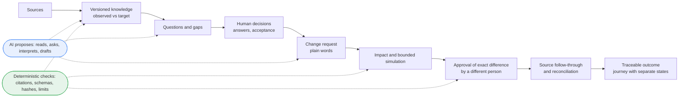
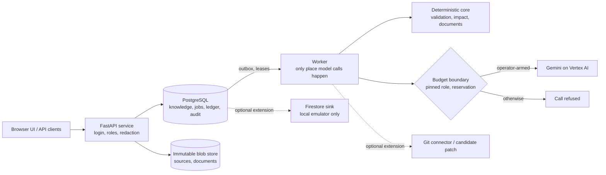

# Ripple: understand the rules, decide with evidence, change with confidence

**Ripple is an AI-powered business rule intelligence and governed change platform.** It reads the places where a company's rules actually live (code, configuration, spreadsheets, documents), turns them into cited, versioned business knowledge, and helps the right people decide what a rule *should* be and what a change would touch. Generative AI (Gemini on Vertex AI) reads, asks, drafts and explains. Deterministic code validates every proposal. People make the decisions.

**AI proposes. Deterministic systems validate. Humans decide.**

> **Development preview.** This repository is a development snapshot of Ripple's current implementation and its path to a fuller, validated build. It has not been deployed, has no human acceptance, and its real-model quality has not been independently measured. Exact limits are stated next to each claim and in [section 12](#12-known-limits-security-provenance-and-licence). Whether any team proceeds to a later competition round is decided by the organiser; this document makes no claim about it. Submission for the Google Cloud AI Builder Cup JAPAC 2026.

## Explore this repository

| I want to... | Go to |
|---|---|
| Understand the idea in two minutes | [The problem](#1-the-enterprise-problem), [why Ripple is different](#2-why-ripple-is-different), [a worked example](#3-a-concrete-example-harbor) |
| See the product flow | [End-to-end journey](#4-end-to-end-product-journey) |
| Judge the generative AI use | [Gemini implementation](#5-generative-ai-implementation) |
| Check engineering and evidence | [Trust foundation](#6-engineering-foundation-and-trust), [capabilities and evidence](#7-current-capabilities-and-evidence), [curated evidence](docs/release/FINAL_PREVIEW_EVIDENCE.md), [claims with limits](docs/release/FINAL_CLAIMS_EVIDENCE_LIMITS.md) |
| Run and inspect it | [Run and verify locally](#10-run-and-verify-locally) |
| See what is next | [Roadmap](#11-roadmap-toward-final-readiness) |

Reading paths: **2 minutes** = sections 1-4. **10 minutes** = add sections 5-7 and 12. **Developer verification** = sections 10 and 12 plus the [contracts](docs/contracts).

---

## 1. The enterprise problem

A rule such as "who must approve a purchase above a threshold" is rarely written in one place. It sits in a configuration file, a spreadsheet, a policy document and code, often with slightly different values or conditions.

- Sources overlap and can disagree, and nobody notices until a change is made.
- Business owners know what a rule should mean but cannot see what systems do; engineers see the implementation but cannot decide its meaning.
- A technical edit is not the same as an approved business decision.
- Updating a file does not prove that behaviour changed as intended.

The result is changes that are hard to review, hard to trace afterwards, and easy to approve on incomplete information.

## 2. Why Ripple is different

Ripple's core insight is that "what the sources say" and "what the business has decided" are different things, and that a change moves through several states that most tools collapse into one. Ripple keeps them separate and labelled:

| Kept separate | Why it matters |
|---|---|
| **Observed** evidence (what sources say) vs **Target** knowledge (what people decided) | a reader can see agreement, disagreement and decided intent at the same time |
| Proposed change vs **approved semantic difference** | approval is of an exact difference, by a person other than the requester |
| **Knowledge** decided vs **source** updated vs **behaviour** verified vs **result** accepted | "files edited" is never reported as "behaviour proven" |

Conceptual comparison (responsibilities, not a performance claim):

| Category | Typical focus | Ripple's added focus |
|---|---|---|
| Enterprise search / RAG | find and summarise text | decided vs observed knowledge, open questions, abstention when the knowledge does not answer |
| AI coding assistants | edit code | whether the edit matches an approved business rule; code gets recommendations, never silent edits |
| Impact analysis tools | list dependencies | impact with explicit coverage, where "unknown" is never reported as "no impact" |
| Approval workflows | route a request | approval bound to an exact semantic difference, with stale and moved-knowledge guards |

Ripple does not claim to have invented these techniques; the contribution is combining them into one governed loop.

## 3. A concrete example: Harbor

**Harbor** is a synthetic, runnable procurement system included in [`fixtures/harbor_public`](fixtures/harbor_public) (code, configuration, data, integrity manifest). In its public configuration the standard manager approval threshold is 1,000,000 JPY ([`approval.yaml`](fixtures/harbor_public/config/approval.yaml)). An illustrative request: *"Raise the standard manager approval threshold from 1,000,000 JPY to 1,500,000 JPY."*

1. **Discover.** Sources are imported as immutable revisions; rules are proposed with quotes the server re-checks against the source text.
2. **Version knowledge.** Rules, relations and open questions form a versioned snapshot; observed rules are not decided yet.
3. **Ask and accept.** Missing actors, conditions and conflicting facts become questions; people answer in their own words and accept a version.
4. **Understand the change.** The request becomes validated operations that quote the request and name a shown rule; anything uncovered becomes a question.
5. **Impact and simulation.** Affected rules, files and code are listed with coverage. For a supported numeric change, Harbor's own program is run on its public sample to count requisitions whose route changes; everything else is `NOT_SIMULATED` with the reason. The count is a measurement of the sample, not a forecast, and this README quotes none.
6. **Exact semantic diff.** A structured draft shows precisely what would change.
7. **Different-person approval.** An approver other than the requester approves that exact difference; if the knowledge moved, the decision is refused.
8. **Commit.** The change becomes Target knowledge with its history.
9. **Source follow-through.** For a YAML scalar of a configuration file, an approved automatic edit is written and read back; other sources (documents, workbooks, code) stay manual, and code only receives recommendations.
10. **Reconcile.** Edits are compared with the decision (correct, partial, divergent). Other sources that still state the old value stay visible as unresolved.

What this does **not** show: that runtime behaviour was verified (read-back is source alignment only), or that results generalise beyond Harbor.

## 4. End-to-end product journey



The journey ends in a per-change view of nine steps, each with a state and a next actor; "knowledge decided", "source aligned" and "behaviour verified" are different states ([journey logic](core/change_intelligence/v2/business_journey.py)). In this snapshot the browser UI is the earlier interface and the Final-stage supporting services (see section 7) are mostly API-only.

## 5. Generative AI implementation

Gemini is useful here because the inputs are messy language: policy prose, comments, spreadsheet labels and a person's free-text request. Deterministic code cannot read these, but it can verify what a model says about them. Ripple uses the model where language understanding is needed, and never where a decision is.

| Responsibility | Model proposes | Deterministic code checks | Human confirms | Current quality evidence |
|---|---|---|---|---|
| Extraction and grounding | cited rules | the quote must appear verbatim in the source; an amount without its unit stays visibly unknown | acceptance of knowledge | stub tests; one live artifact |
| Questions and clarification | missing exceptions, conflicts, follow-up questions; a reading of free-text answers | evidence must belong to the shown rules; an uncovered part is never confirmable | the person's own words are the decision | stub tests; a small live pilot |
| Grounded Q&A | an answer from a pinned context pack | every claim cites the pack; numbers must match; authority labels; disagreements disclosed; abstains when empty | n/a (read-only) | stub tests; pilot; one agent-written sealed set (see below) |
| Change understanding | operations from a plain-words request | each operation quotes the request and names a shown rule | confirmation by the requester | stub tests; pilot; one agent-written sealed set |
| Impact dependencies, draft guidance | candidate dependencies; comments on the draft | dependencies stay PROPOSED; guidance cannot widen an edit | review and approval | stub tests; one live case each |
| Optional extensions | audience wording of documents, conflict hypotheses, interview questions, multi-agent specialists | wording facts and numbers from the facts; hypotheses confirmed by the policy evaluator | people review | stub or synthetic tests only |

**Controls.** Each role is pinned to a frozen prompt and schema ([`config/`](config), pins guarded by [`test_final_prompt_pins.py`](tests/contract/test_final_prompt_pins.py)); a call needs a pinned, priced role, a cost reservation before the call and an accounting entry after it ([`test_final_budget_roles.py`](tests/contract/test_final_budget_roles.py)); without a budget configuration the role is refused and nothing silently falls back to a stub. The server can reject or downgrade a model output but never promote it. The provider integration is in [`ai_module/vertex_client.py`](ai_module/vertex_client.py).

**Five different kinds of evidence, kept apart:**

1. *Implemented roles and integrations*: present in the code and contracts.
2. *Deterministic validation*: tested without any model.
3. *Synthetic-stub integration tests*: stubs pass through the production callers, validators, budget boundary and persistence; they prove the pipeline, not Gemini's quality.
4. *Bounded live-model pilot (self-check)*: each role ran end to end on a real model (28 calls on Gemini 3.5 Flash-Lite, one paired case on Gemini 3.8 Flash) under a hard cost cap of 2 USD, of which 0.17475295 USD had been recorded at the snapshot. Two sealed sets written by the project's own agent were scored mechanically: questions 10/14, then 8/14 after a server fix; change requests 6/8. These sets are small and **not independent**. Observed: missing required citations with the lighter model, unreliability on three-part requests, varying abstention wording.
5. *Independent real-model quality evaluation*: **not yet performed**; a protocol exists, no result does. Results will be added to [`docs/release/FINAL_PREVIEW_EVIDENCE.md`](docs/release/FINAL_PREVIEW_EVIDENCE.md) and the [quality plan](docs/evaluation/FINAL_AI_QUALITY_PLAN.md) without changing this structure.

**AI capability implemented does not mean AI quality independently validated.** An earlier snapshot's held-out evaluation (2026-10-02) did not reach its targets ([record](docs/evaluation/HELD_OUT_EVALUATION.md)); it is kept as history and was not repeated on this snapshot.

## 6. Engineering foundation and trust

| Mechanism | Risk it addresses |
|---|---|
| Immutable source revisions; cited, versioned knowledge | silent edits to evidence; unverifiable claims |
| Observed/Target separation | a model's reading being mistaken for a business decision |
| Role and permission boundaries ([`test_ai2_t02_permission.py`](tests/security/test_ai2_t02_permission.py)) | a client choosing its own rights; leaking raw evidence |
| Exact-hash approval by a distinct person | approving something different from what was reviewed |
| Deterministic validators of model output | invented citations, numbers or scope |
| Compare-and-set and idempotent durable writes | lost updates and double effects |
| PostgreSQL outbox, leases, fencing, recovery ([runbook](docs/runbooks/FINAL_RECOVERY.md)) | duplicate delivery, lost leases, killed workers |
| Audit events and a self-verifying audit package | untraceable decisions |
| Budget reservation, pinned roles, fail-closed AI | runaway or unaccounted spend |

Boundaries to keep in mind: SHA-256 hashes detect a changed byte and are **not** digital signatures; the candidate-code sandbox is advisory by default and its optional container runtime shares the host kernel, so it is **not** a boundary for hostile code; reliability is shown by local injection and process-kill tests, not by production operation.

## 7. Current capabilities and evidence

Labels: **Local** = implemented and verified with stub models on a disposable database; **Mock/emulator** = verified against a mock transport or local emulator; **Pilot** = also run once or a few times on a real model (self-check); **API** = no UI in this snapshot. Evidence is test code in this repository; snapshots and run records are in [`FINAL_PREVIEW_EVIDENCE.md`](docs/release/FINAL_PREVIEW_EVIDENCE.md).

**Core loop**

| Capability | Status | Tests (examples) | Important limit |
|---|---|---|---|
| Versioned knowledge, observed/target, relations, gaps | Local, Pilot (extraction) | [`test_kno01_business_store.py`](tests/final_loop/test_kno01_business_store.py), [`test_kno03_graph_gaps.py`](tests/final_loop/test_kno03_graph_gaps.py) | extraction quality unmeasured; supported formats are limited ([section 12](#12-known-limits-security-provenance-and-licence)) |
| Answers, free-text reading, acceptance with history | Local, Pilot | [`test_kno04_answers.py`](tests/final_loop/test_kno04_answers.py), [`test_kno07_answer_interpret.py`](tests/final_loop/test_kno07_answer_interpret.py), [`test_kno05_accept.py`](tests/final_loop/test_kno05_accept.py) | reading quality unmeasured |
| Grounded Q&A with abstention | Local, Pilot | [`test_qry03_qa.py`](tests/final_loop/test_qry03_qa.py), [`test_qry01_context.py`](tests/final_loop/test_qry01_context.py) | retrieval is lexical by default and measured as limited (10/12 development, 4/8 validation) |
| Change request, impact, Harbor measurement | Local, Pilot | [`test_chg01_change_request.py`](tests/final_loop/test_chg01_change_request.py), [`test_chg02_impact.py`](tests/final_loop/test_chg02_impact.py), [`test_chg02_simulation.py`](tests/final_loop/test_chg02_simulation.py) | public Harbor sample only; five integer keys; never a forecast |
| Draft, review, distinct-person approval, commit | Local | [`test_chg03_draft.py`](tests/final_loop/test_chg03_draft.py), [`test_chg04_review.py`](tests/final_loop/test_chg04_review.py), [`test_chg05_commit.py`](tests/final_loop/test_chg05_commit.py) | approvals are self-checks, not business acceptance |
| Source follow-through, reconciliation, journey | Local | [`test_syn03_source_apply.py`](tests/final_loop/test_syn03_source_apply.py), [`test_syn02_reconcile.py`](tests/final_loop/test_syn02_reconcile.py), [`test_syn04_journey.py`](tests/final_loop/test_syn04_journey.py) | YAML scalars only; behaviour never verified |
| Documents (Business, Technical), exact export | Local | [`test_doc02_documents.py`](tests/final_loop/test_doc02_documents.py), [`test_doc05_export.py`](tests/final_loop/test_doc05_export.py) | deterministic templates, English |
| Reliability: concurrency, killed worker, upgrade chain | Local | [`test_rel02_reliability.py`](tests/final_loop/test_rel02_reliability.py), [`test_rel02_process_kill.py`](tests/final_loop/test_rel02_process_kill.py), [`test_rel02_upgrade_chain.py`](tests/final_loop/test_rel02_upgrade_chain.py) | local injection, not production |

**Extensions (secondary; each is gated and not a core claim)**

| Capability | Status | Tests | Important limit |
|---|---|---|---|
| Typed policy decisions, audit package | Local, API | [`test_mon_policy_audit.py`](tests/final_loop/test_mon_policy_audit.py) | not an authorization token; hashes are not signatures |
| Candidate code patch; Git read connector; pull-request path | Local; Mock (pull request); read-only check on one private test repository | [`test_fex_code_change.py`](tests/final_loop/test_fex_code_change.py), [`test_fex_git_remote.py`](tests/final_loop/test_fex_git_remote.py) | no product-created pull request on a real repository; never a merge |
| Business CI drift check, ROI replay | Local, API | [`test_mon_ci_check.py`](tests/final_loop/test_mon_ci_check.py), [`test_mon_roi_replay.py`](tests/final_loop/test_mon_roi_replay.py) | fixture or synthetic data only |
| Multi-agent review board, arbiter, coder/tester with repair loop, simulation | Local (synthetic specialists), API | [`test_ma_review_board.py`](tests/final_loop/test_ma_review_board.py), [`test_ma_repair_loop.py`](tests/final_loop/test_ma_repair_loop.py), [`test_ma_recovery.py`](tests/final_loop/test_ma_recovery.py) | no real-model quality; agreement is never evidence |
| Interview, audience variants, conflict mining | Local, API | [`test_aix_k2_interview.py`](tests/final_loop/test_aix_k2_interview.py), [`test_aix_d1_variants.py`](tests/final_loop/test_aix_d1_variants.py), [`test_aix_k1_mining.py`](tests/final_loop/test_aix_k1_mining.py) | stub wording; quality unmeasured |
| Firebase hybrid satellite (identity exchange, projection, notifications, listener tokens) | Mock; Firestore sink on a local emulator | [`test_fb_identity_exchange.py`](tests/final_loop/test_fb_identity_exchange.py), [`test_fs_emulator.py`](tests/final_loop/test_fs_emulator.py) | no cloud resource, real sign-in or latency measurement |

Every claim with its limit: [`FINAL_CLAIMS_EVIDENCE_LIMITS.md`](docs/release/FINAL_CLAIMS_EVIDENCE_LIMITS.md). **Test totals** recorded in earlier snapshots (for example 1,238 passed, 3 skipped, 1 deselected for an earlier export) are historical evidence, not a result for this export. This exact tree was rehearsed once with `pytest tests/contract tests/unit -q` (1,268 passed, 3 skipped, 1 deselected on the recording machine; no database, no provider); the database and browser suites were not rerun for the export.

## 8. Business value and potential

The intended benefits, **not measured outcomes**: less manual effort finding scattered rules; a clearer boundary between business decisions and technical edits; more traceable approvals; visibility of what is still unimplemented or unresolved; less ambiguity during review; knowledge that can be reused by later changes. No savings, productivity gain, return on investment or adoption has been measured. Harbor is synthetic, and generalisation beyond it is a design claim that is not validated.

## 9. Architecture and tech stack



Python 3.11+, FastAPI, PostgreSQL with SQL migrations, a React/TypeScript/Vite interface (built bundle included), pytest and Playwright, Gemini through Vertex AI as the optional provider, Docker for a throwaway database. Dashed paths are optional extensions; the Firestore path is emulator-only and nothing here is deployed to a cloud.

| Path | Responsibility |
|---|---|
| [`core/change_intelligence/v2/`](core/change_intelligence/v2) | pure business logic: knowledge, graph, answers, retrieval, Q&A validation, change, impact, draft, journey, documents |
| [`infra/`](infra), `infra/worker/` | API routes, roles, store and migrations; worker, jobs, budget accounting |
| [`config/`](config) | frozen prompts and schemas per AI role; budget examples with zero-price stand-ins |
| [`frontend/`](frontend), `app/ui_next/` | UI source and built bundle |
| [`fixtures/harbor_public`](fixtures/harbor_public) | the Harbor sample |
| [`docs/`](docs) | [contracts](docs/contracts), [quality plan](docs/evaluation/FINAL_AI_QUALITY_PLAN.md), [runbook](docs/runbooks/FINAL_RECOVERY.md), release records; [map](docs/README.md) |
| [`tests/`](tests), [`tools/`](tools) | suites by purpose; local rehearsal server |

## 10. Run and verify locally

No cloud account and no AI provider are needed. Prerequisites: Python 3.11+, a **disposable** PostgreSQL 15/16 (Docker is simplest); Node.js only to rebuild the UI; Chromium via Playwright only for browser tests.

```bash
python -m venv .venv
# Windows: .venv\Scripts\Activate.ps1      Linux/macOS: source .venv/bin/activate
python -m pip install -r requirements-dev.txt
docker run -d --name ripple-pg -e POSTGRES_PASSWORD=localtest -p 127.0.0.1:55831:5432 postgres:16
python -m tools.judge_local.run_local
```

After about 30-60 seconds the console prints `http://127.0.0.1:8765/app-next/` and three accounts with random passwords shown once (`rehearsal-admin`, `rehearsal-requester`, `rehearsal-approver`: an administrator, a requester and a different-person approver). Use a different browser profile per person.

**Safety and cleanup.** `run_local` drops and re-creates a database named `rehearsal` on the PostgreSQL it is pointed at (default `127.0.0.1:55831`), refuses non-loopback hosts and database names not ending in `rehearsal`, and keeps blobs in memory. Never point it at a database you care about. Stop with Ctrl+C, then `docker rm -f ripple-pg`.

**What runs, and what is simulated.** Deterministic parts run for real: knowledge versions, questions, controls, acceptance, graph, documents, impact, Harbor measurement, review, approval, commit, source edit, journey. All model output is **simulated by code**, not by a model. The Final AI roles answer with a declining simulation (abstain, clarify, unsure or unsupported, labelled as simulated), with one exception: a request written as "... from `<old value>` to `<new value>` ..." that matches exactly one rule is read by rules into a numeric change so the loop can be walked through. The seeded knowledge has no structured actors or conditions, so answer those first on the Questions page. The local demo therefore says nothing about Gemini's real behaviour. Changing an environment variable does not enable a real model: that needs an operator approval file, a budget configuration with real model ids and verified prices (`RIPPLE_BUDGET_CONFIG_PATH`), `RIPPLE_LIVE_LOCAL_ARM=1` and Vertex AI credentials ([`tools/judge_local/live_local.py`](tools/judge_local/live_local.py)).

**Tests.** Install `requirements-dev.txt`; browser tests also need `python -m pip install playwright` and `playwright install chromium`. Run suites one at a time.

| Purpose | Command | Needs |
|---|---|---|
| Contract, unit, architecture guards, prompt pins | `python -m pytest tests/contract tests/unit -q` | nothing |
| Permission sweep | `python -m pytest tests/security/test_ai2_t02_permission.py -q` | PostgreSQL in `AI2_T02_TEST_DSN` |
| Core loop, API level | `python -m pytest tests/final_loop -q -k "not browser"` | PostgreSQL in `PITCH_BRIEF_TEST_DSN` |
| Core loop, browser | `UI_BASE=app-next python -m pytest tests/final_loop -q -k browser` | the same plus Chromium |
| UI unit tests | `cd frontend && npm test` | Node.js |

```bash
docker run -d --name ripple-test-pg -e POSTGRES_PASSWORD=localtest -p 127.0.0.1:55831:5432 postgres:16
docker exec ripple-test-pg psql -U postgres -c "CREATE DATABASE pbrief"
export PITCH_BRIEF_TEST_DSN="host=127.0.0.1 port=55831 dbname=pbrief user=postgres password=localtest"
export AI2_T02_TEST_DSN="$PITCH_BRIEF_TEST_DSN"
```

**Skip semantics.** Without a database DSN the database tests are skipped, without Playwright the browser tests are skipped, and without the Firestore emulator the emulator tests are skipped. **A skip is not a pass**; read the skip count in the summary. No test calls a provider. Use a different container name or port if `ripple-pg` or 55831 is already in use.

## 11. Roadmap toward Final readiness

These are plans, not features. Reaching them does not guarantee selection for any later round.

| Stage | Status | Contents | Completion evidence |
|---|---|---|---|
| **Foundation** | Implemented | the business knowledge and governed change mechanisms of sections 3-4 and 6 | the local suites in section 7; recorded in the evidence file |
| **Intelligence** | Implemented, quality validation pending | the Gemini roles, grounding controls, budget boundary; a bounded self-check pilot | five evidence kinds in section 5; kinds 1-4 exist, kind 5 does not |
| **Validation** | Next gate | independent real-model evaluation on a reviewer-built set with fixed model, prompt and schema versions; human acceptance of the behaviour; scenario-based verification | a published result whatever it shows; an acceptance record; will establish measured quality on those sets, not quality in general |
| **Integration** | Next gate | merge of the redesigned user interface; cloud staging; one product-created pull request on a real repository under explicit authorisation; real Firebase activation | browser suites pass on the merged tree; staging checks recorded; the pull request opened and read back, never merged by the product |
| **Final readiness** | Target | an integrated, demonstrable system with published evidence and its remaining limits disclosed | all of the above recorded; no dates are promised here |

## 12. Known limits, security, provenance and licence

**Real-model quality.** Not independently measured (see section 5, kind 5). The sealed sets were agent-written and small. Two diagnostic labels on one held-out set remain disputed and unchanged. An earlier snapshot's held-out evaluation did not reach its targets.
**Human acceptance.** None has taken place; approvals in tests are self-checks.
**Supported use and formats.** Import of `.md`, `.yml/.yaml`, `.py`, `.xlsx` (no macros), `.csv`, `.jsonl`, English only; automatic source edits are YAML scalars of configuration files; changes effective on a date are unsupported; Harbor is the only exercised system.
**External integration.** The pull-request path is mock-tested; the product never merges or deploys; Firebase pieces are mock or local-emulator only; no cloud resource exists for this snapshot.
**Deployment and interface.** Not deployed. The interface in this snapshot is the earlier one; a redesign is developed separately and is not included.
**Behaviour and outcomes.** The product reads sources back and compares them with the decision; it never verifies behaviour or business outcomes.
**Security boundaries.** Roles are assigned by the server; raw quotes and code recommendations need `evidence.read`, AI use needs `ai.use` and a workspace policy; external identity exchange gives one generic refusal for any invalid case and every right still comes from SQL membership; projected hints are minimal and opaque. No independent security validation has been performed. No credential, token or private dataset is in this repository, and a pattern scan of the export reported 0 findings, which is a check and not a guarantee.

Details: [`FINAL_CLAIMS_EVIDENCE_LIMITS.md`](docs/release/FINAL_CLAIMS_EVIDENCE_LIMITS.md), [`FINAL_RELEASE_CHECKLIST.md`](docs/release/FINAL_RELEASE_CHECKLIST.md), [contracts](docs/contracts).

**Provenance.** This tree is an export of committed content from a private development repository with a fresh Git history; [`SUBMISSION_MANIFEST.json`](SUBMISSION_MANIFEST.json) records the source commit, file hashes and export decisions. The README is part of the exported source.

**Licence.** Proprietary, **Competition Evaluation Only** ([`LICENSE`](LICENSE)): authorised judges and evaluators may read, clone, build, run, test and modify a local copy solely to evaluate this submission. No commercial, production, reuse or redistribution rights are granted, and a public repository is not an open-source licence. Third-party components keep their own licences ([`THIRD_PARTY_NOTICES.md`](THIRD_PARTY_NOTICES.md), [`frontend/THIRD_PARTY_NOTICES.md`](frontend/THIRD_PARTY_NOTICES.md)).
**Ownership and thanks.** Copyright holder: Eiki Tomobe; team details are not provided in this repository. Thanks to Google Cloud (Vertex AI) and the competition organiser, and to the open-source libraries listed in the notices.
