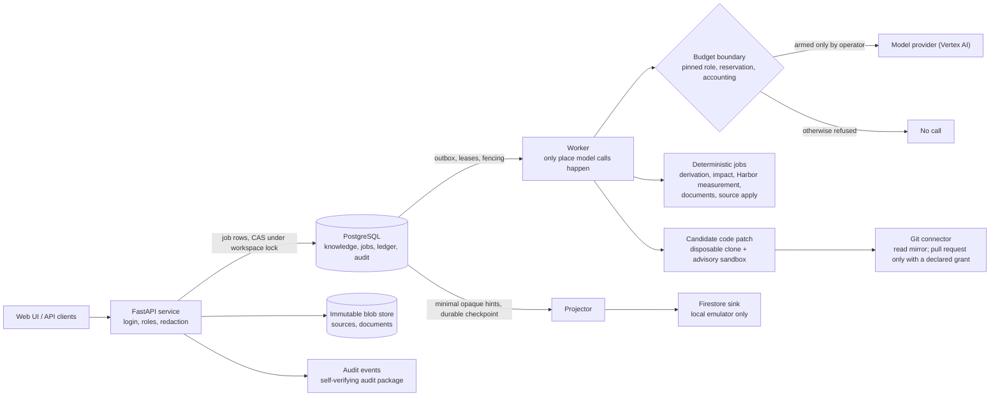

# Ripple (Final development preview)

**Ripple keeps the business rules that live inside existing systems understood, questioned, decided and traceable.** It reads the sources a company already has (configuration, workbooks, policy documents, code), turns them into versioned business knowledge with citations, finds what the sources leave open or say differently, lets the right people answer and accept, answers business questions from the accepted knowledge with evidence, understands a change request in plain words, shows its impact, lets a different person approve an exact semantic difference, and keeps the decided rule, the written sources, the code and the measured behaviour as **separate, honestly labelled axes**. AI proposes; deterministic code checks; people decide.

This is a submission for the **Google Cloud AI Builder Cup JAPAC 2026** (copyright holder: Eiki Tomobe; team details are not provided in this repository). The official Pitch-round demo is linked below. Participation in the Final round depends on the organiser's selection; this repository makes no claim about it, and the competition rules, dates and benefits are not restated here.

> ## Status box
> | | |
> |---|---|
> | **What this is** | A **development preview** of the direction for the Final round. It shows the progress implemented so far. It is **not** an accepted, validated or production-ready Final build. |
> | **Pitch demo** | The official Pitch-round demo is the Phase 1 build, linked in [Quick path](#quick-path). This repository is a different, later codebase. |
> | **Source snapshot** | Exported from a private development repository. The source commit, the file hashes and the export decisions are in [`SUBMISSION_MANIFEST.json`](SUBMISSION_MANIFEST.json) (`source_commit`). The public commit is the tag `preview-1` of this repository. |
> | **Date** | 2026-10-18 |
> | **Implemented scope** | The whole knowledge loop (sources → knowledge → questions → answers → acceptance → Q&A → change → impact → review → commit → source read-back → documents → journey) and a set of extension packages (Git connector, code-change candidates, governance, multi-agent workflows, interview, document variants, conflict mining, Firebase-hybrid satellite), each with its own status in [section 6](#6-modules-and-their-status). |
> | **Evidence type** | The project's own tests with synthetic model stubs on a disposable database (self-check), one bounded live-model pilot with a hard cost cap, and local emulator checks. **No human acceptance. No independent validation.** Details: [`docs/release/FINAL_PREVIEW_EVIDENCE.md`](docs/release/FINAL_PREVIEW_EVIDENCE.md). |
> | **Open gates** | Real-model quality (no rate proven); independent gate set; human acceptance; real Firebase/cloud activation; deployment of the Final build; product-created pull request on a real repository; merge of the new user interface work (see [section 11](#11-known-limitations-and-unmet-results)). |
> | **Licence** | Proprietary, competition evaluation only ([`LICENSE`](LICENSE)). Not open source. |

## Quick path

| | |
|---|---|
| **Official Pitch demo (Phase 1 build)** | <https://pitchrc---ripple-s6pcepa2cq-as.a.run.app/app-next/> (sign in with the judge account from the submission materials) |
| **Pitch judge guide** (static) | <https://ripple-guide-636767063018.asia-southeast1.run.app> |
| **Pitch demo video** | <https://www.youtube.com/watch?v=oSsEhUaO9do> |
| **Fast read for a judge (about 10 minutes)** | 1. this status box; 2. [section 4](#4-product-flow-in-this-snapshot); 3. [claims table with limits](docs/release/FINAL_CLAIMS_EVIDENCE_LIMITS.md); 4. [curated evidence](docs/release/FINAL_PREVIEW_EVIDENCE.md); 5. [known limitations](#11-known-limitations-and-unmet-results) |
| **Run it yourself, no cloud, no provider** | [Local setup](#8-local-setup) (one Python command and a throwaway PostgreSQL; AI is simulated) |

The Pitch links were reachable when this README was written (2026-10-18); they are operated separately and may change.

## Contents
1. [Problem, users and a concrete case](#1-problem-users-and-a-concrete-case)
2. [Inherited from Pitch and extended in Final](#2-inherited-from-pitch-and-extended-in-final)
3. [Where AI is used and how it is kept honest](#3-where-ai-is-used-and-how-it-is-kept-honest)
4. [Product flow in this snapshot](#4-product-flow-in-this-snapshot)
5. [Architecture](#5-architecture)
6. [Modules and their status](#6-modules-and-their-status)
7. [Tech stack and repository map](#7-tech-stack-and-repository-map)
8. [Local setup](#8-local-setup)
9. [What the simulated AI does](#9-what-the-simulated-ai-does)
10. [Verification guide](#10-verification-guide)
11. [Known limitations and unmet results](#11-known-limitations-and-unmet-results)
12. [Security, permissions, privacy and cost controls](#12-security-permissions-privacy-and-cost-controls)
13. [Roadmap to the Final round](#13-roadmap-to-the-final-round)
14. [Licence, provenance and acknowledgments](#14-licence-provenance-and-acknowledgments)

---

## 1. Problem, users and a concrete case

The rules that run a business (an approval threshold, who approves, when a rule applies, its exceptions) are written in several places at once and often already disagree. Business owners know what a rule should mean but cannot see what the systems do; engineers see the implementation but cannot decide its meaning. AI that edits code does not know whether a change is right for the business. Ripple works on the steps before and after any edit: *what do the sources say, what is still open, what did people decide, what would a change touch, and did the written result follow the decision?*

**Target users:** a knowledge owner (answers questions, accepts knowledge, commits a change), a requester (states a change), an approver (a different person), reviewers and viewers.

**A concrete case (Harbor, a synthetic procurement system).** A manager asks: "Raise the manager approval threshold from 500,000 to 1,000,000 JPY." Ripple restates it as a validated operation citing the rule it refers to, lists the rules, files and code that mention the value, runs Harbor's own program on its public sample to measure which requisitions change route (the number is a measurement of the sample, never a forecast), drafts the exact semantic difference, and waits for a person other than the requester to approve that exact difference. After a commit, an approved YAML scalar can be edited and read back; the journey shows nine steps, where "knowledge-complete", "fully implemented" and "behaviour-verified" are different states. Behaviour is never verified by the product.

## 2. Inherited from Pitch and extended in Final

| Inherited from the Pitch build (Phase 1) | Added in this snapshot |
|---|---|
| Byte-immutable source revisions, cited rule proposals the server re-checks; Harbor sample and simulation; different-person approval; budget-reserved, pinned-model AI jobs; Postgres outbox with leases; role model; judge guide | Versioned business knowledge with OBSERVED/TARGET authority, relations and gaps; answers in plain words and acceptance with history; pinned-context Q&A with abstention; change understanding, impact, review and commit as decided knowledge; source read-back and reconciliation; lazily generated immutable documents; per-axis journey; typed policy decisions and audit packages; extension packages in section 6 |

## 3. Where AI is used and how it is kept honest

Every AI role is pinned to a frozen prompt and schema, runs only in the worker, needs a budget reservation before the call and an accounting entry after it, and without a budget configuration the role is **refused** (there is no silent stub fallback). The server can reject or downgrade model output but never promote it. AI never confirms knowledge, approves, commits or applies.

| Role | Model proposes | Server does |
|---|---|---|
| `extraction` | cited rules | quote must exist verbatim in the source; an amount without its unit stays visibly unit-less |
| `knowledge.qa` | answer from a pinned context pack | every claim needs a reference in the pack; numbers must match; authority labels assigned; disagreements disclosed; empty search = abstained without a call |
| `knowledge.gap_proposals`, `gap.answer_interpret`, `gap.interview` | suggested questions, a reading of free text, follow-up questions | evidence must belong to the shown rules; an uncovered part is never confirmable; the person's own words are the decision |
| `change.understand`, `change.impact_deps`, `change.draft_guidance` | operations, dependencies, comments | every operation quotes the request and names a shown rule; dependencies stay PROPOSED; guidance cannot widen an edit |
| `retrieval.semantic`, `document.wording`, `knowledge.mining` | expansion/ranking, audience wording, conflict hypotheses | optional; lexical retrieval is the default; paragraphs kept only when facts, numbers and roles come from the facts; hypotheses kept only when the evaluator confirms the concrete case |

Quality of what a real model produces is **OPEN** ([quality plan](docs/evaluation/FINAL_AI_QUALITY_PLAN.md)); see [section 11](#11-known-limitations-and-unmet-results).

## 4. Product flow in this snapshot

1. **Input.** Import `.md`, `.yml/.yaml`, `.py`, `.xlsx` (no macros), `.csv`, `.jsonl` as immutable revisions (English only).
2. **Knowledge.** Rules with actor, condition, outcome, exceptions, scope; OBSERVED (what sources say) vs TARGET (what people decided) never merge.
3. **Questions.** Structural gaps and model-suggested gaps; optional finite interview over one question.
4. **Answers and acceptance.** People answer in their own words (a model may read the words into the structured form, the person confirms); acceptance creates a new version.
5. **Q&A.** Answers from accepted knowledge with citations, authority labels, disclosed disagreement, or abstention.
6. **Change.** Plain-word request → validated operations → confirmation → impact (with coverage; unknown is never "no impact") → Harbor measurement for supported numeric changes (otherwise `NOT_SIMULATED` with the reason).
7. **Review.** Structured draft and semantic diff; approval by a distinct person bound to the exact hash; stale, version and hash guards refuse moved knowledge.
8. **Commit and source follow-through.** Commit as TARGET knowledge; approved YAML scalar edit or manual edit; read-back and reconciliation (correct / partial / divergent).
9. **Documents.** Business and Technical Markdown generated when opened, immutable per version, exported as the viewed bytes; optional audience variants.
10. **Journey.** Nine steps with states and the next actor.

## 5. Architecture



Three kinds of work stay separate: deterministic derivation, measurement (Harbor's own program on its sample) and AI proposals. Every durable write is one transaction under the workspace lock with compare-and-set on the head and an idempotency ledger; duplicate delivery, a lost lease or a killed worker cannot create a second side effect (verified by injection tests and a process-kill harness). Recovery steps: [`docs/runbooks/FINAL_RECOVERY.md`](docs/runbooks/FINAL_RECOVERY.md).

## 6. Modules and their status

Status labels: **L** = implemented and verified locally (stub models, disposable DB); **M** = mock or emulator verified; **P** = live pilot (a self-check, not a quality rate); **API** = API only, no UI in this snapshot; **UI** = a UI exists in this snapshot; **Plan** = not built.

| Module | What it does | Status | Main limit |
|---|---|---|---|
| Knowledge model: versions, provenance, OBSERVED/TARGET | snapshots with CAS, audit, outbox; a target cites a human decision | L, UI | extraction quality unmeasured; P for one artifact |
| Retrieval, context pack, Q&A, citations, abstention | pinned pack (lexical, graph neighbours, counter-evidence); claims validated; abstains when knowledge does not answer | L, UI; P | retrieval measured as limited (development 10/12, validation 4/8); answer quality not proven |
| Change lifecycle | plain words → operations → draft → semantic diff → distinct-person approval → commit; stale/version/hash guards | L, UI | date-effective changes unsupported; approvals are self-checks |
| Impact and Harbor simulation | affected rules/files/code with coverage; Harbor measurement of five integer keys of `approval.yaml` | L, UI | public sample only; everything else `NOT_SIMULATED`; never a forecast |
| Documents | Business/Technical Markdown, lazy, immutable, exact export; audience variants | L, UI (variants API) | deterministic templates; English; variant checks are lexical |
| Source/code alignment | YAML scalar edit and read-back; manual-edit reconciliation; code gets recommendations only | L, UI | no code edit by the product; read-back is alignment, not behaviour |
| Candidate patch and pull request path | patch on a disposable clone, validation by declared commands, approval on both hashes, pull request only with a declared grant, never a merge | L, M (mock transport); read-only check on one private test repository | advisory sandbox; an optional container runtime is kernel-shared and **not** a boundary for hostile code |
| Policy decisions and audit packages | typed `ALLOW/DENY/REQUIRES_APPROVAL/INDETERMINATE`; zip with SHA-256 manifest | L, API | hashes are not signatures; not a bearer authorization |
| Business CI drift check and ROI replay | advisory drift report; replay of two policy versions over a frozen cohort | L, API | fixture repository / synthetic data only |
| Multi-agent workflows | review board, knowledge arbiter, coder/tester with bounded repair loop, process simulation; shared root budget, disagreement kept, bounded rebuttal, recovery under dead leases | L (synthetic specialists), API | no real-model quality; agreement is never evidence or approval |
| Interview, audience variants, conflict mining | finite interview (max 5 turns, always "I do not know"); server-checked variants; evaluator-verified conflict hypotheses | L, API | stub wording; quality unmeasured |
| Firebase hybrid satellite | identity exchange, opaque projection, notification intents, hosting-config validation, listener tokens | M (mock adapters; Firestore sink on a local emulator) | no cloud resource, no real sign-in, no listener client |
| GCP staging, human acceptance, independent gate set | prepared as proposals/protocols | Plan | need owner decisions |

Contracts: [`docs/contracts/`](docs/contracts) (knowledge loop, code change, governance, multi-agent, Firebase hybrid). Claims and limits per row: [`docs/release/FINAL_CLAIMS_EVIDENCE_LIMITS.md`](docs/release/FINAL_CLAIMS_EVIDENCE_LIMITS.md).

## 7. Tech stack and repository map

Python 3.11+, FastAPI, PostgreSQL (SQL migrations), React/TypeScript/Vite UI (built bundle committed), pytest and Playwright, Vertex AI as the optional model provider, Docker for the throwaway database.

| Path | Responsibility |
|---|---|
| [`infra/`](infra), `infra/worker/` | FastAPI app, routes, roles, store and migrations; worker, jobs, budget accounting |
| [`core/change_intelligence/v2/`](core/change_intelligence/v2) | pure business logic: knowledge, graph, answers, retrieval, Q&A validation, change, impact, draft, journey, documents |
| [`frontend/`](frontend), `app/ui_next/` | UI source and built UI served at `/app-next/` |
| [`config/`](config) | frozen prompts and schemas per role, budget examples (zero-price stand-ins) |
| [`docs/`](docs) | contracts, evaluation plan, runbooks, release records; [`docs/README.md`](docs/README.md) is the map |
| [`fixtures/harbor_public`](fixtures/harbor_public) | Harbor sample (code, config, data, integrity manifest) |
| [`tests/`](tests), [`tools/`](tools) | suites by purpose; local rehearsal server and packaging checks |

## 8. Local setup

No cloud account and no AI provider are needed; model output is simulated.

| Need | Notes |
|---|---|
| Python 3.11 or newer | a virtual environment |
| PostgreSQL 15/16 | a **disposable** local instance (Docker is simplest) |
| Node.js | only to rebuild the UI; the built UI is included |
| Chromium via Playwright | only for browser tests |

```bash
python -m venv .venv
# Windows: .venv\Scripts\Activate.ps1      Linux/macOS: source .venv/bin/activate
python -m pip install -r requirements-dev.txt
docker run -d --name ripple-pg -e POSTGRES_PASSWORD=localtest -p 127.0.0.1:55831:5432 postgres:16
python -m tools.judge_local.run_local
```

After about 30-60 seconds the console prints `http://127.0.0.1:8765/app-next/` and three accounts with random passwords shown once (`rehearsal-admin`, `rehearsal-requester`, `rehearsal-approver`): an administrator, a requester and a different-person approver. Use a different browser profile per person.

**Safety and cleanup.** `run_local` drops and re-creates a database named `rehearsal` on the PostgreSQL it is pointed at (default `127.0.0.1:55831`), refuses non-loopback hosts and database names not ending in `rehearsal`, and keeps blobs in memory. Stop with Ctrl+C, then `docker rm -f ripple-pg`. Do not point it at a database you care about. The schema is applied by the store from [`infra/migrations/`](infra/migrations); `tools/db_migrate.py` applies it once on an empty database.

## 9. What the simulated AI does

In the rehearsal server, **all model output is simulated** by code, not by a model. Phase 1 roles answer with rule-based stubs. The Final AI roles answer with a **declining** simulation (abstain / clarify / unsure / unsupported, labelled as simulated), with one exception: a request written as "... from `<old value>` to `<new value>` ..." that matches exactly one rule is read by rules into one numeric change, so the change loop can be walked through. The deterministic parts (knowledge versions, questions, controls, acceptance, graph, documents, impact, Harbor measurement, review, approval, commit, source edit, journey) run for real. The seeded knowledge has no structured actors or conditions, so the first step is to answer those on the Questions page. This is **not** evidence about real AI behaviour.

Changing an environment variable does **not** connect a real or other simulated provider. A real model needs an operator approval file, a budget configuration with real model ids and verified prices (`RIPPLE_BUDGET_CONFIG_PATH`), `RIPPLE_LIVE_LOCAL_ARM=1` and Vertex AI credentials; without them the provider stays refused with no fallback ([`tools/judge_local/live_local.py`](tools/judge_local/live_local.py)).

## 10. Verification guide

Install `requirements-dev.txt`; browser tests also need `python -m pip install playwright` and `playwright install chromium`. Run suites one at a time.

| Purpose | Command | Needs |
|---|---|---|
| Contract, unit, architecture guards, prompt pins | `python -m pytest tests/contract tests/unit -q` | nothing |
| Permission sweep | `python -m pytest tests/security/test_ai2_t02_permission.py -q` | disposable PostgreSQL in `AI2_T02_TEST_DSN` |
| Final loop, API level | `python -m pytest tests/final_loop -q -k "not browser"` | disposable PostgreSQL in `PITCH_BRIEF_TEST_DSN` |
| Final loop, browser | `UI_BASE=app-next python -m pytest tests/final_loop -q -k browser` | the same plus Chromium |
| Extension suites (examples) | `python -m pytest tests/final_loop/test_fex_git_remote.py tests/final_loop/test_ma_review_board.py -q` | database |
| UI unit tests | `cd frontend && npm test` | Node.js |

```bash
docker run -d --name ripple-test-pg -e POSTGRES_PASSWORD=localtest -p 127.0.0.1:55831:5432 postgres:16
docker exec ripple-test-pg psql -U postgres -c "CREATE DATABASE pbrief"
export PITCH_BRIEF_TEST_DSN="host=127.0.0.1 port=55831 dbname=pbrief user=postgres password=localtest"
export AI2_T02_TEST_DSN="$PITCH_BRIEF_TEST_DSN"
```

**Skip semantics.** Without a DSN the database tests are skipped, without Playwright the browser tests are skipped, without the Firestore emulator the emulator tests are skipped. **A skip is not a pass.** No test calls a provider. Recorded results are tied to their source snapshot in [`docs/release/FINAL_PREVIEW_EVIDENCE.md`](docs/release/FINAL_PREVIEW_EVIDENCE.md); the 1238-passed figure there belongs to an older snapshot and to the machine that recorded it, and is not a result or a timing promise for this one.

## 11. Known limitations and unmet results

- **No real-model quality is proven.** The live pilot ran each role end to end; two agent-authored sealed sets were scored (questions 10/14 then 8/14, change requests 6/8). They were authored by the project's own agent: **not independent**, not a gate, and small. Observed: missing required citations with the lighter model, unreliability on three-part requests, varying abstention wording.
- The Pitch-era held-out evaluation (2026-10-02) **did not reach its targets** ([record](docs/evaluation/HELD_OUT_EVALUATION.md)).
- Retrieval is lexical by default and measured as limited (10/12 and 4/8); a context pack can be incomplete and answers say so.
- Human acceptance has not taken place; no independent gate set has been scored.
- Two diagnostic labels on one held-out set remain disputed and unchanged.
- The pull-request path is tested on a mocked transport; the product never merges or deploys; the sandbox is advisory and not a boundary for hostile code.
- The Firebase hybrid has no cloud resource: the Firestore sink, rules and listener tokens are verified on a local emulator only; real token minting and latency are unmeasured.
- Harbor is the only validated vertical; reuse beyond it is a design claim.
- Formats outside the supported list, workbook edits by the system, AI wording of base documents and behaviour verification are not provided.
- The new user-interface work (a redesign) is **not part of this snapshot**; the UI shipped here is the earlier one.
- The Final build has not been deployed.

## 12. Security, permissions, privacy and cost controls

- Roles are assigned by the server; a client never chooses its own role. Raw source quotes and code recommendations need `evidence.read`; AI use needs `ai.use` and a workspace policy. The route registry is checked against the application by `tests/security/test_ai2_t02_permission.py`.
- Approval requires a person other than the requester and is bound to an exact hash.
- Tenant, revoke and wrong-project boundaries are covered by injection tests; the external identity exchange gives one generic refusal for any invalid case and every right still comes from SQL membership.
- Projected hints are minimal and opaque (no ids, rule text or amounts); notification payloads are generic.
- Cost controls: pinned model per role, reservation before each call, per-job and total caps on one ledger, retries off by default, a fail-closed budget; model calls are impossible without an operator-armed configuration.
- Sandbox: validation runs on a disposable clone with declared commands; isolation is advisory by default, with an optional container runtime (no network, read-only checkout, limits) that shares the host kernel.
- No credential, token or private dataset is in this repository; sample data is synthetic or public. A pattern scan of the export reported 0 findings; this is a check, not a guarantee.

## 13. Roadmap to the Final round

Plans, not features. Each item has a completion criterion.

| Item | Done when |
|---|---|
| Independent quality evidence | a reviewer-built gate set (protocol in the development process) is scored once on a pinned role configuration and the result is published, whatever it is |
| Human acceptance | the owner's acceptance checklist is run with real people and recorded |
| New user interface | the separate UI branch is merged and the browser suites pass on the merged tree |
| Cloud staging | the owner approves a staging project; the build is deployed there and the staging checks pass |
| Firebase activation | a real provider sign-in, a Firestore database and listener latency are measured against stated targets |
| Pull request on a real repository | the owner authorises a target and one product-created pull request is opened and read back (never merged by the product) |

## 14. Licence, provenance and acknowledgments

- **Licence:** proprietary, **Competition Evaluation Only** ([`LICENSE`](LICENSE)): authorised judges and evaluators may read, clone, build, run, test and modify a local copy solely to evaluate this submission. No commercial, production, reuse or redistribution rights are granted. A public repository is not an open-source licence. Third-party components keep their own licences ([`THIRD_PARTY_NOTICES.md`](THIRD_PARTY_NOTICES.md), [`frontend/THIRD_PARTY_NOTICES.md`](frontend/THIRD_PARTY_NOTICES.md)).
- **Provenance:** this tree is an export of committed content from a private development repository, with a fresh Git history. `SUBMISSION_MANIFEST.json` lists the source commit, file hashes and export decisions. The README and the curated evidence file are part of the exported source; no byte was edited after export.
- **Acknowledgments:** Google Cloud (Vertex AI, Cloud Run) and the competition organiser; open-source libraries listed in the notices.
