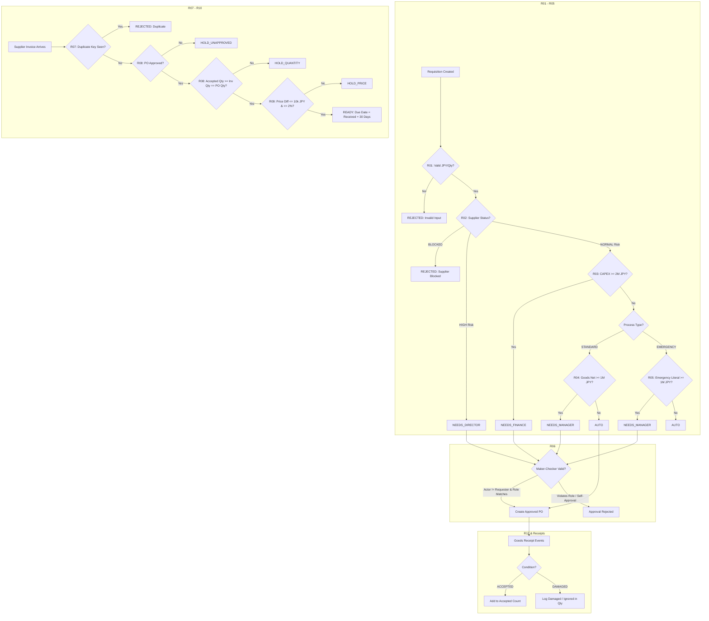
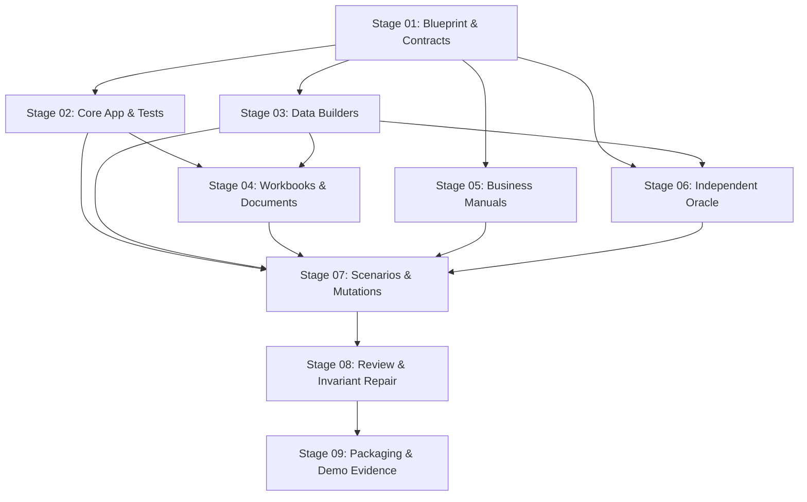

# Harbor Procurement Mini — System Blueprint (Stage 01)

## 1. System Boundary and Architectural Scope

Harbor Procurement Mini is a small, self-contained, synthetic enterprise reference system modeling the procurement operations of **Harbor Office Supply**, a fictional Japanese office-equipment distributor.

### 1.1 Operating Environment & Constraints
- **Domain Scope**: Internal procurement lifecycle covering Requisition submission, Approval Routing, Purchase Order (PO) generation, Goods Receipt recording, 3-Way Invoice Matching, and Payment Due-Date scheduling.
- **Excluded Capabilities**: No real payment disbursement, banking gateway, external accounting ERP sync, tax authority filing, dynamic database engine (PostgreSQL/SQLite), cloud dependencies, or LLM/AI modules.
- **Reference Timing**: Injected dataset reference date is `2026-09-01`. All temporal logic evaluates relative to this timestamp. Wall-clock time (`datetime.now()`) is forbidden.
- **Currency & Precision**: Japanese Yen (JPY) only. All monetary amounts are non-negative synthetic integers. Floating-point money arithmetic is strictly forbidden.
- **Portability**: Pure Python 3.11+ standard library domain core, with `openpyxl` for Excel generation and `pyyaml` for configuration. The public application must run standalone when copied out of the repository without any reference to authoring or evaluation suites.

---

## 2. Business Flow and Rule Precedence



### 2.1 Requisition & Routing Precedence
Requisitions are evaluated in a strict first-match waterfall:
1. **R01 (Validation)**: Goods net amount must be integer > 0; quantity must be integer > 0; freight and tax must be integer >= 0; currency must be `"JPY"`. Booleans are rejected. Failure results in `REJECTED`.
2. **R02 (Supplier Constraints)**: If supplier status is `BLOCKED`, route to `REJECTED`. If supplier risk is `HIGH`, route to `NEEDS_DIRECTOR` immediately (overriding category, process, and amount).
3. **R03 (Category Constraints)**: If category is `CAPEX` and goods net amount >= `2,000,000 JPY`, route to `NEEDS_FINANCE`. `OPEX` bypasses this rule.
4. **R04 (Standard Process)**: For `STANDARD` process, if goods net amount >= `1,000,000 JPY`, route to `NEEDS_MANAGER`; otherwise route to `AUTO`.
5. **R05 (Emergency Process)**: Evaluated in its own handler `route_emergency()`. Applies R01, R02, R03, then applies a hardcoded literal threshold of `1,000,000 JPY` -> `NEEDS_MANAGER`; below -> `AUTO`. (Note: The authority for future emergency scope changes is unconfirmed in S0 baseline; G01).
6. **R06 (Maker-Checker Approval)**: Human approval requires `requester_id != approver_id` and approver must possess the matching role (`MANAGER`, `FINANCE`, or `DIRECTOR`). `AUTO` is executed by system actor `SYSTEM_AUTO`.

### 2.2 Freight & Document Auxiliary Rules
- **R12 (Freight Schedule - Negative Control)**: Freight is `0 JPY` when goods net >= `500,000 JPY`; otherwise `2,000 JPY`. This is a non-approval operational policy and must remain fixed regardless of routing threshold changes.
- **R10 (Tax & Due Date)**: Standard tax is calculated as `floor(goods_net_jpy * 10 / 100)`. Gross amount is `goods_net_jpy + freight_jpy + tax_jpy`. Invoices with `READY` status have `due_date = received_date + 30 calendar days`.

### 2.3 Invoice 3-Way Matching Precedence
Invoices are evaluated in strict order:
1. **R07 (Duplicate Detection)**: Normalized key is `f"{supplier_id}:{supplier_invoice_number.strip().upper()}"`. If key is already in `seen_keys`, return `REJECTED`.
2. **R08 (PO Approval & Quantity)**:
   - If referenced PO is not in `APPROVED` state, return `HOLD_UNAPPROVED`.
   - If invoice quantity != PO quantity OR sum of `ACCEPTED` receipts < invoice quantity, return `HOLD_QUANTITY`.
3. **R09 (Price Matching)**:
   - Price deviation condition: `abs(inv_goods_net - po_goods_net) <= 10_000` AND `100 * abs(inv_goods_net - po_goods_net) <= 2 * po_goods_net`.
   - If either check fails, return `HOLD_PRICE`.
4. **R10 (Ready Status)**: When all pass, return `READY` and compute `due_date`.

---

## 3. Directory Layout and Separation of Concerns

```text
generated/
├── authoring/                     [PRIVATE] Specifications, contracts, canonical templates, build engine
│   ├── blueprint.md
│   ├── contracts.json
│   ├── build_contract.md
│   ├── build.py
│   └── templates/
│       └── input/                 [PRIVATE CANONICAL TEMPLATES]
├── evaluator_private/             [PRIVATE] Ground truth, oracle evaluator, scenario mutations, answer key
│   ├── oracle.py
│   ├── anchors.json
│   ├── scenarios/
│   │   ├── s0_baseline.json
│   │   ├── s1_manager_500k.json
│   │   ├── s2_manager_750k.json
│   │   ├── s3_restore_s0.json
│   │   ├── s4_excel_drift_650k.json
│   │   └── s5_finance_capex_only.json
│   └── validation/
│       └── edge_cases_24.jsonl    [PRIVATE 24 NEGATIVE TEST CASES]
├── operator/                      [PRIVATE] Runbooks, batch planning, execution guides
│   ├── generation_batches.md
│   └── demo_runbook.md
├── reports/                       [PRIVATE] Test logs, execution digests, evidence manifests
└── bundles/
    └── harbor_demo/
        └── input/                 [PUBLIC BUNDLE - INGESTED INTO RIPPLE]
            ├── app/               Runnable Python application package
            │   ├── __init__.py
            │   ├── models.py
            │   ├── enums.py
            │   ├── config_loader.py
            │   ├── routing.py
            │   ├── emergency.py
            │   ├── approval.py
            │   ├── matching.py
            │   ├── calculations.py
            │   ├── data_loader.py
            │   └── cli.py
            ├── config/
            │   ├── approval.yaml
            │   └── workflow.yaml
            ├── data/
            │   ├── suppliers.csv
            │   ├── employees.csv
            │   ├── requisitions.jsonl
            │   ├── purchase_orders.jsonl
            │   ├── receipts.jsonl
            │   ├── invoices.jsonl
            │   ├── approval_matrix.xlsx
            │   ├── supplier_directory.xlsx
            │   └── procurement_summary_202609.xlsx
            ├── docs/
            │   ├── procurement_policy.md
            │   ├── requisition_sop.md
            │   ├── invoice_matching_manual.md
            │   ├── finance_desk_guide.md
            │   ├── system_architecture.md
            │   ├── data_dictionary.md
            │   ├── cli_guide.md
            │   └── emergency_purchases.md
            ├── forms/
            │   ├── invoices/      12 synthetic HTML invoices
            │   └── receipts/      12 synthetic HTML goods-receipt vouchers
            ├── tests/             Characterization pytest suite
            │   ├── __init__.py
            │   ├── test_routing.py
            │   ├── test_matching.py
            │   ├── test_calculations.py
            │   └── test_cli.py
            ├── README.md
            └── requirements.txt
```

---

## 4. Controlled S0 Inconsistencies & Knowledge Boundaries

To test Ripple's semantic discovery and cross-source reconciliation capabilities, the baseline dataset (S0) embeds exactly two intentional discrepancies and two system gaps:

1. **C01 (Value Conflict)**:
   - `data/approval_matrix.xlsx` displays a Manager threshold of `500,000 JPY`.
   - `config/approval.yaml`, `config/workflow.yaml`, `docs/procurement_policy.md`, and `app/routing.py` use `1,000,000 JPY`.
   - *Status*: Operational guidance spreadsheet is stale/drifted; runtime application executes `1,000,000 JPY`.
2. **C02 (Scope Conflict)**:
   - `docs/finance_desk_guide.md` asserts that any purchase at or above `2,000,000 JPY` (regardless of category) requires Finance sign-off.
   - `docs/procurement_policy.md`, `config/approval.yaml`, and `app/routing.py` restrict Finance routing strictly to `CAPEX >= 2,000,000 JPY`.
   - *Status*: Informal desk guide over-generalizes scope; system logic only routes CAPEX.
3. **G01 (Emergency Governance Ambiguity)**:
   - `app/emergency.py` hardcodes `1,000,000 JPY`.
   - `docs/emergency_purchases.md` states "obtain appropriate sign-off" without clarifying whether future general limit adjustments apply to emergency purchases.
   - *Status*: Open policy question; cannot be resolved without human decision.
4. **G02 (Document-Only Implementation Gap)**:
   - `docs/requisition_sop.md` specifies that pending approvals must be escalated after 2 business days.
   - The application has no scheduler, holiday calendar, or background worker to enforce this.
   - *Status*: Documented business requirement that is an explicit capability gap.

---

## 5. Build Dependency DAG


