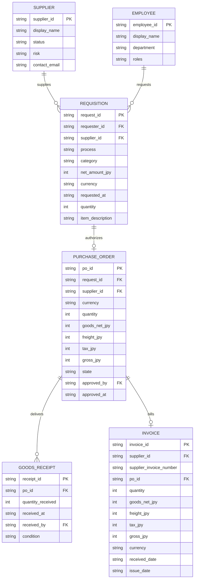

# Data Dictionary — Harbor Procurement Mini

## 1. Entity Relationship Model

---

## 2. Field Specifications

### 2.1 Supplier (`data/suppliers.csv`)
| Field | Type | Required | Description |
|---|---|---|---|
| `supplier_id` | String | Yes | Unique supplier code (e.g. `SUP-001`) |
| `display_name` | String | Yes | Fictional company name |
| `status` | Enum | Yes | `ACTIVE` or `BLOCKED` |
| `risk` | Enum | Yes | `NORMAL` or `HIGH` |
| `contact_email` | String | Yes | Contact email ending in `.example` |

### 2.2 Requisition (`data/requisitions.jsonl`)
| Field | Type | Required | Description |
|---|---|---|---|
| `request_id` | String | Yes | Unique request ID (e.g. `REQ-000001`) |
| `requester_id` | String | Yes | FK referencing `Employee.employee_id` |
| `supplier_id` | String | Yes | FK referencing `Supplier.supplier_id` |
| `process` | Enum | Yes | `STANDARD` or `EMERGENCY` |
| `category` | Enum | Yes | `OPEX` or `CAPEX` |
| `net_amount_jpy` | Integer | Yes | Positive goods value in integer JPY |
| `currency` | String | Yes | Denominated strictly in `"JPY"` |
| `requested_at` | String | Yes | ISO-8601 timestamp (`YYYY-MM-DDTHH:MM:SS`) |
| `quantity` | Integer | Yes | Count of units (> 0) |
| `item_description` | String | Yes | Descriptive text of procured goods |

### 2.3 Purchase Order (`data/purchase_orders.jsonl`)
| Field | Type | Required | Description |
|---|---|---|---|
| `po_id` | String | Yes | Unique PO identifier (e.g. `PO-000001`) |
| `request_id` | String | Yes | Source requisition reference |
| `supplier_id` | String | Yes | Vendor identifier |
| `goods_net_jpy` | Integer | Yes | Net goods total in JPY |
| `freight_jpy` | Integer | Yes | Standard delivery charge (0 or 2,000 JPY) |
| `tax_jpy` | Integer | Yes | 10% calculated consumption tax |
| `gross_jpy` | Integer | Yes | Total commitment (`goods_net + freight + tax`) |
| `state` | Enum | Yes | `DRAFT` or `APPROVED` |
| `approved_by` | String | Nullable | Employee ID or `SYSTEM_AUTO` |
| `approved_at` | String | Nullable | Authorization timestamp |

### 2.4 Goods Receipt (`data/receipts.jsonl`)
| Field | Type | Required | Description |
|---|---|---|---|
| `receipt_id` | String | Yes | Unique receipt code (e.g. `REC-000001`) |
| `po_id` | String | Yes | Reference purchase order |
| `quantity_received` | Integer | Yes | Inspected quantity (> 0) |
| `received_at` | String | Yes | Receipt timestamp |
| `received_by` | String | Yes | Inspecting employee ID |
| `condition` | Enum | Yes | `ACCEPTED` or `DAMAGED` |

### 2.5 Invoice (`data/invoices.jsonl`)
| Field | Type | Required | Description |
|---|---|---|---|
| `invoice_id` | String | Yes | Unique internal invoice tracking ID |
| `supplier_id` | String | Yes | Vendor identifier |
| `supplier_invoice_number` | String | Yes | Supplier's printed invoice reference |
| `po_id` | String | Yes | Reference purchase order |
| `quantity` | Integer | Yes | Billed units |
| `goods_net_jpy` | Integer | Yes | Billed net goods amount in JPY |
| `freight_jpy` | Integer | Yes | Billed freight charge |
| `tax_jpy` | Integer | Yes | Billed tax amount |
| `gross_jpy` | Integer | Yes | Total billed amount |
| `received_date` | String | Yes | Date invoice received (`YYYY-MM-DD`) |
| `issue_date` | String | Yes | Date invoice issued (`YYYY-MM-DD`) |
