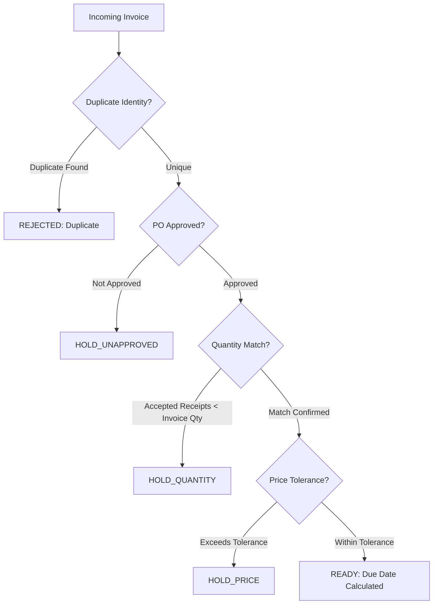

# Accounts Payable Manual: 3-Way Invoice Matching & Verification

**Document Reference**: MNL-AP-2026-03  
**Effective Date**: September 1, 2026  
**Audience**: Accounts Payable Clerks & Finance Reviewers  

---

## 1. Objectives of 3-Way Matching
To safeguard corporate funds and maintain internal accounting integrity, all supplier invoices must undergo systematic 3-way reconciliation before being cleared for payment scheduling.

The verification process reconciles three distinct artifacts:
1. **Purchase Order (PO)**: Validates authorized prices, quantities, and terms.
2. **Goods Receipt Vouchers**: Confirms actual physical receipt of undamaged goods.
3. **Vendor Commercial Invoice**: The formal payment claim submitted by the supplier.

---

## 2. Sequential Verification Precedence

### 2.1 Duplicate Prevention
To prevent accidental duplicate disbursements:
- A normalized composite key is constructed: `Supplier_ID + ":" + TRIM(UPPER(Supplier_Invoice_Number))`.
- If this normalized key has already been processed within the system, the invoice is immediately marked as `REJECTED`.
- Invoices sharing the same numbering across *different* suppliers are valid and distinct.

### 2.2 Purchase Order Approval Verification
- Invoices must reference an existing Purchase Order in `APPROVED` status.
- Invoices referencing orders in `DRAFT` status are placed on `HOLD_UNAPPROVED` pending operational resolution.

### 2.3 Quantity Reconciliation
- The billed invoice quantity must exactly match the authorized PO quantity.
- The cumulative sum of physical receipts with condition `ACCEPTED` must equal or exceed the billed invoice quantity.
- If physical receipts are insufficient, or if items were logged as `DAMAGED`, the invoice is placed on `HOLD_QUANTITY`.

### 2.4 Price Tolerance Check
To accommodate minor freight or catalog variance, price tolerances are enforced using exact integer arithmetic:
1. **Fixed Ceiling**: Absolute difference between invoice goods net and PO goods net must not exceed **10,000 JPY**.
2. **Percentage Ceiling**: Absolute difference multiplied by 100 must not exceed **2%** of the PO goods net amount.
3. Both conditions must be met simultaneously:
   $$\text{abs}(\text{InvNet} - \text{PONet}) \le 10,000 \quad \text{AND} \quad 100 \times \text{abs}(\text{InvNet} - \text{PONet}) \le 2 \times \text{PONet}$$
- Invoices failing either condition are assigned status `HOLD_PRICE`.

---

## 3. Payment Terms and Ready Status
- Invoices passing all verification steps are assigned status `READY`.
- Payment due date is established as **30 calendar days** following the official invoice received date.
- `READY` status indicates that an invoice is certified for payment scheduling; it does not represent immediate disbursement of funds.
