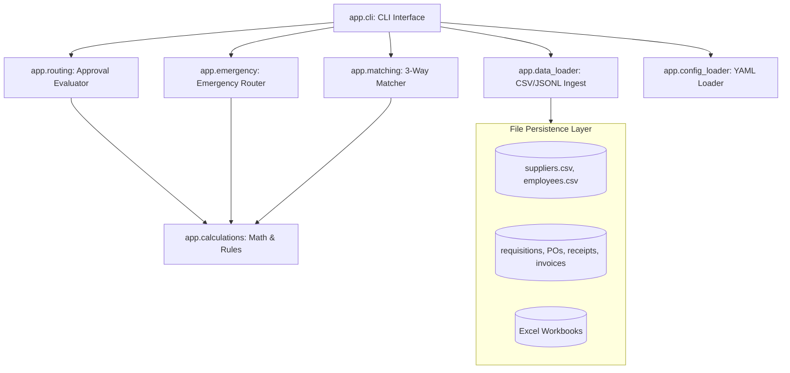

# System Architecture — Harbor Procurement Mini

## 1. Architectural Overview
Harbor Procurement Mini is designed as a modular, lightweight Python application implementing core procurement domain logic, file-based persistence, and a command-line interface.

---

## 2. Key Modules
- **`app.models`**: Pure dataclasses representing business records with type safety.
- **`app.enums`**: Explicit domain enumeration states.
- **`app.routing`**: Implements standard policy routing rules for requisitions.
- **`app.emergency`**: Dedicated emergency procedure routing logic.
- **`app.matching`**: Pure, non-mutating 3-way invoice matching engine.
- **`app.calculations`**: Strictly typed integer financial arithmetic, tax rounding, and date math.
- **`app.cli`**: Standard command-line operations for routing and matching.

---

## 3. Storage and Interfaces
- Tabular masters are stored in UTF-8 CSV (`suppliers.csv`, `employees.csv`).
- High-volume transaction streams are stored in JSON Lines (`requisitions.jsonl`, `purchase_orders.jsonl`, `receipts.jsonl`, `invoices.jsonl`).
- Operational summaries are exported to Microsoft Excel (`.xlsx`) via openpyxl.
- No dynamic database server or cloud connectivity is required.
